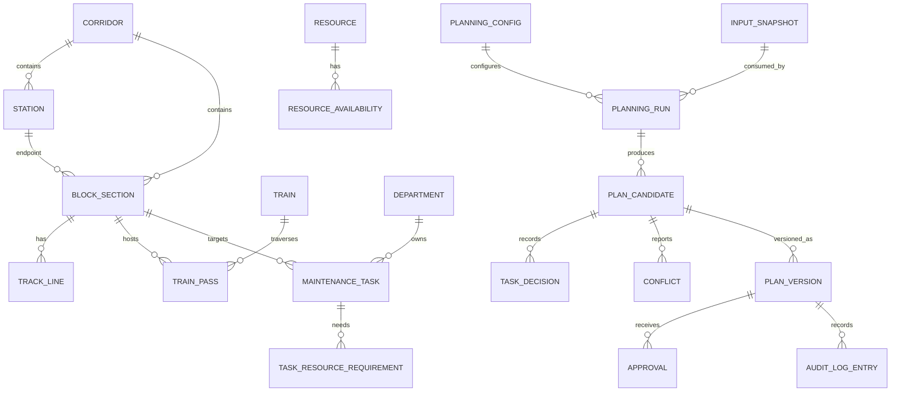

# TrackMeld Data Strategy and Domain Model

## 1. Data policy

TrackMeld's initial dataset is **synthetic and fictional**. The dataset exists to test the architecture, demonstrate planning behavior, and make the demo reproducible. It must not be described as real Indian Railways data.

The app must display `SYNTHETIC DEMONSTRATION DATA` wherever users could mistake displayed railway values for live or official information.

### Provenance labels

Every domain rule and dataset artifact must use one of:

- `SYNTHETIC`: generated fictional record.
- `PUBLIC_REFERENCE`: public source used for context/terminology; not necessarily an operational rule.
- `VERIFIED_SOURCE`: reviewed against an appropriate authoritative source and approved for the stated use.
- `ASSUMPTION`: engineering assumption that needs review.
- `DEMO_ONLY`: intentionally simplified behavior for the prototype.

Do not promote a `PUBLIC_REFERENCE`, `ASSUMPTION`, or `DEMO_ONLY` item into an authoritative safety rule without a documented review.

## 2. Initial synthetic scenario

Use a fictional corridor, not a named real corridor presented as an accurate replica.

Suggested starting scope:
- 8 fictional stations
- 7 connected block sections
- UP/DN line identifiers where applicable
- 30–50 maintenance tasks
- Synthetic trains and train passes
- A short configurable planning horizon
- Resources and resource availability
- Three departments as demonstration categories: Engineering, TRD, and S&T
- A set of explicitly labeled demo compatibility rules

Default random seed: `42`.

The generator must be deterministic for the same generator version, seed, and configuration. Save a metadata manifest containing:
- dataset ID
- scenario ID
- seed
- generator version
- created timestamp
- schema version
- provenance
- configuration hash
- record counts
- any known simplifications

Do not hardcode display metrics independently from the generated data.

## 3. Data acquisition policy

Do not scrape, infer, or fabricate internal railway operational data. Do not claim API access to CRIS/BDMS/COA/TMS/TDMS/SMMS. Public timetables, maps, and manuals may have licensing, freshness, completeness, and operational limitations. Before incorporating any external dataset:
1. identify the original publisher;
2. record the exact URL/title and retrieval date;
3. review usage terms and redistribution permission;
4. identify whether it is current and authoritative for the intended field;
5. distinguish published timetable information from real-time train running;
6. record transformation steps and limitations;
7. have domain-sensitive rules reviewed before using them as hard constraints.

Until an authorized operational dataset is actually available, the system should remain synthetic. The user interface and documentation must say so plainly.

## 4. Core entities

### Network
- `Corridor`: named fictional planning scenario and timezone.
- `Station`: node in the corridor graph.
- `BlockSection`: edge connecting two stations, with code, ordered endpoints, length (if modeled), and track configuration.
- `TrackLine`: line/track within a section, e.g. UP/DN/Single as a model label.
- `Asset`: maintenance target associated with a section/line and asset type.

### Operations
- `Train`: synthetic service identity and category.
- `TrainPass`: a train's occupancy interval on a specific section/line, with source/provenance and time basis.
- `PlanningHorizon`: start/end, timezone, and scenario.
- `BlockWindow`: allowed interval candidate for a task or section, with derivation source.

### Maintenance
- `Department`: Engineering, TRD, S&T, or another configured demo category.
- `TaskType`: tamping, inspection, cable work, etc. These are illustrative task types unless verified.
- `MaintenanceTask`: request ID, department, location, duration, allowed window, priority features, status, and requirements.
- `TaskResourceRequirement`: resource type, quantity, and requirement details.
- `Resource`: synthetic machine, crew, or equipment.
- `ResourceAvailability`: resource interval and availability status.

### Rules and planning
- `CompatibilityRule`: rule ID, rule type, source class, condition/configuration, verification status, source reference, and reason code.
- `PlanningConfig`: objective weights, time limit, solver settings, scenario settings, and version.
- `InputSnapshot`: immutable reference to all inputs used by a run.
- `PlanningRun`: lifecycle, status, runtime, solver status, config version, and snapshot reference.
- `PlanCandidate`: result set associated with a run and method.
- `TaskDecision`: scheduled/unscheduled status, assigned interval, and reason codes.
- `Conflict`: conflicting entity IDs, interval, type, severity label, and evidence.
- `Possession`: product abstraction for a coordinated maintenance window; not a claim that official terminology or authorization is equivalent.
- `PossessionTask`: relation between a possession and the tasks included.
- `PlanVersion`: immutable review/approval version.
- `Approval`: actor, decision, timestamp, and reason.
- `AuditLogEntry`: append-only action record and optional integrity hash.
- `DatasetManifest`: seed, generator version, provenance, counts, and configuration hash.

## 5. Suggested relationships

Treat this as a logical model. Normalize it into SQL tables with explicit primary keys, foreign keys, unique constraints, and indexes during implementation. Avoid one giant JSON column as the only representation of core entities.

## 6. Time and units

- Persist timestamps in UTC.
- Store the scenario's IANA timezone (for example, `Asia/Kolkata`) and convert for display.
- Use timezone-aware datetimes in Python.
- Use integer minutes or seconds consistently for solver intervals.
- Use half-open intervals `[start, end)` for computational occupancy unless a documented domain requirement says otherwise. This prevents adjacent intervals from being incorrectly treated as overlapping.
- Validate `end > start`, duration consistency, and planning-horizon bounds.
- Clearly distinguish elapsed duration, setup/clearance assumptions, and task execution time.
- Never silently add safety margins or headways without identifying their provenance and modeling purpose.

## 7. Priority model

Priority is a configurable decision-support feature, not a verified railway priority policy.

For the MVP:
- store raw input features separately from calculated score;
- store a feature-by-feature score breakdown;
- version the formula/configuration;
- validate ranges and missing values;
- make weights configurable and explainable;
- test monotonic behavior and sensitivity;
- do not hardcode unexplained `30/30/25/15` weights as if they were authoritative;
- never let priority override hard feasibility constraints.

A possible feature set includes task urgency, age/overdue status, operational impact, and configured maintenance criticality, but each feature must have a defined data source and explicit demo assumptions. Do not claim to use GMT, TSR, asset degradation, or other railway-specific features unless the input data and interpretation are actually implemented.

## 8. Constraint taxonomy

Every modeled constraint should be classified as:
- `HARD`: must be satisfied for a candidate to be valid.
- `SOFT`: preference represented in the objective.
- `DIAGNOSTIC_ONLY`: reported to a user but not enforced.
- `UNVERIFIED`: awaiting domain review; not used as an authoritative safety constraint.

Example categories:
- task allowed window
- train occupancy exclusion
- track/section exclusivity
- resource capacity
- task dependency
- co-location/compatibility
- setup/clearance assumption
- power/disconnection dependency
- user-pinned task or interval

The initial implementation should model only constraints that are well-defined by the synthetic scenario. Any power-block/PTW/S&T behavior must be clearly labeled as demo logic unless verified against appropriate authoritative documentation.

## 9. Validation rules

At dataset generation and ingestion:
- IDs are unique.
- All foreign keys resolve.
- Section endpoints exist and connectivity is valid.
- Train passes reference existing train and section/line records.
- Task windows lie within the planning horizon or are explicitly rejected.
- Durations are positive and units are known.
- Resource requirements reference known resource types.
- No invalid timestamp ordering.
- Provenance metadata is present.
- Scenario IDs and schema versions are recorded.

At result validation:
- Every assigned task exists in the input snapshot.
- Every scheduled interval lies within the allowed window.
- Interval duration matches the modeled duration.
- No hard train occupancy, track, resource, or dependency conflict remains.
- All required assignments/pins are honored or the run explains why the model was infeasible.
- Result references match the snapshot/configuration.
- An invalid candidate cannot be approved.

## 10. Reason codes

Use stable machine-readable reason codes, for example:
- `SCHEDULED_FEASIBLE`
- `OUTSIDE_ALLOWED_WINDOW`
- `TRAIN_OCCUPANCY_CONFLICT`
- `TRACK_EXCLUSIVITY_CONFLICT`
- `RESOURCE_UNAVAILABLE`
- `INCOMPATIBLE_TASK_REQUIREMENTS`
- `DEPENDENCY_NOT_SATISFIED`
- `LOWER_OBJECTIVE_VALUE`
- `MANDATORY_TASK_UNSCHEDULED`
- `SOLVER_NO_FEASIBLE_RESULT`
- `DIAGNOSTIC_INCOMPLETE`

Reason codes must be supported by evidence fields. Do not return a generic code if a specific verified cause is known. Do not claim a unique reason when several constraints jointly prevented scheduling.

## 11. Data lifecycle

1. Generate dataset using a seed/config.
2. Validate generated records.
3. Save a manifest and import report.
4. Persist data through a repeatable seed/import command.
5. Create an immutable planning input snapshot.
6. Run baseline and optimization methods against that snapshot.
7. Persist result metrics and diagnostics.
8. Retain approved plan versions and audit events.
9. Regenerate data only as a new dataset/scenario version; do not silently rewrite history.

## 12. External-data integration later

If authorized real data becomes available, build a separate adapter layer:
- source-specific parser/client
- schema mapping to internal entities
- validation and quarantine for invalid rows
- source provenance and retrieval timestamp
- reconciliation for updates/deletions
- access-control and licensing review
- explicit separation between imported facts and synthetic fallback values

Do not mix real and synthetic rows without a visible source marker on each record and a documented scenario policy.
