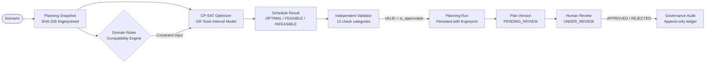
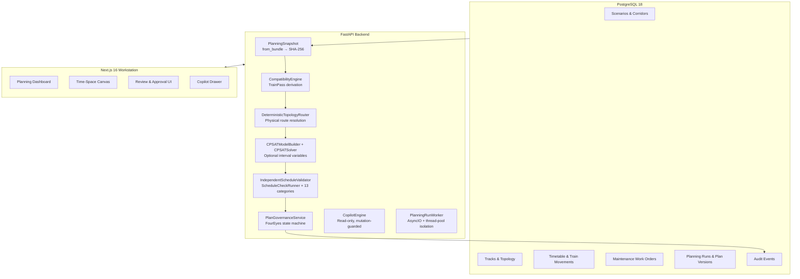

# TrackMeld

**Railway possession planning and decision-support platform.** Combines deterministic domain rules, Google OR-Tools CP-SAT optimization, independent constraint validation, physical infrastructure topology modeling, and human-governed four-eyes approval into a structured, auditable planning workflow.

[](https://www.python.org/)
[](https://fastapi.tiangolo.com/)
[](https://www.postgresql.org/)
[](https://developers.google.com/optimization)
[](https://nextjs.org/)
[](https://www.typescriptlang.org/)
[](https://playwright.dev/)

---

## What it does

TrackMeld models the problem of scheduling railway engineering possessions — periods during which track sections are removed from commercial service for maintenance — against a live timetable of passenger and freight movements. It does not control or dispatch trains. It is a **decision-support system** that produces candidate maintenance schedules, validates them independently, and routes them through mandatory human approval before any operational action is taken.

The system addresses a real coordination problem: multiple maintenance departments (P-Way, OHE Electrical, S&T Signalling) compete for the same track blocks. Their work windows are bounded by traffic headways, inter-train clearances, traction power isolations, gang availability, machinery schedules, and task dependency chains. A schedule that passes a calendar heuristic can still be infeasible under the full physical constraint set, and a schedule that the solver marks optimal is not operationally authorized until a human approves it.

TrackMeld separates these concerns explicitly and architecturally.

---

## Core architectural principle

```
Rules classify
  → Optimization proposes
    → Independent Validator verifies
      → Human reviews
        → Human approves
```

These stages are architecturally isolated. Each consumes verified prior output without sharing internal state, heuristics, or assumptions with adjacent stages.

> **OPTIMAL ≠ APPROVED**  
> **FEASIBLE ≠ APPROVED**  
> **VALID ≠ APPROVED**  
> **APPROVABLE ≠ APPROVED**  
> **AI EXPLAINS ≠ AI APPROVES**  
> **CREATOR ≠ APPROVER**

---

## The planning problem

A **block possession** requires exclusive occupancy of a track section for the duration of maintenance work, plus mandatory safety buffers before and after. Every possession must be placed within an allowed work window, must not collide with train movements on the same section, must not interfere with higher-priority possessions competing for overlapping blocks, must not exceed resource availability (machinery, gangs), and must satisfy task precedence dependencies.

This problem cannot be solved by interval heuristics or greedy approaches at scale. The constraint graph is globally coupled: scheduling one task may eliminate feasible windows for three others by saturating a resource or triggering adjacent-track impact rules. The optimizer must find a globally consistent assignment, not local greedy placements.

At the same time, **mathematical feasibility is not operational authorization**. A schedule can be solver-optimal, validator-valid, and still operationally wrong — because the domain data is synthetic, because a human reviewer spots a contextual issue, or because operational conditions changed. Human sign-off is therefore not cosmetic; it is the actual decision point.

---

## Architecture

### End-to-end pipeline



### Layer separation



---

## Component breakdown

### 1. Planning Snapshot (`PlanningSnapshot`)

Before any optimization begins, all scenario inputs are assembled into a `PlanningSnapshot` — a frozen Python dataclass. Tasks are sorted by `task_id`, dependencies are bidirectionally indexed, train passes are derived via `CompatibilityEngine.derive_train_passes`, and physical traversals are resolved via `CompatibilityEngine.expand_train_traversals`. A 64-character SHA-256 fingerprint is computed from the canonical content, independent of input ordering. Repeated solves against the same scenario and configuration produce identical fingerprints and identical results.

The snapshot is the only interface to the optimizer. No live database queries occur during scheduling.

### 2. Domain Rules and Compatibility (`CompatibilityEngine`)

The compatibility engine classifies pairs of time-interval occupants — tasks, train passes, traversals — by section, track, direction, and adjacent-track impact. Classifications use discrete enumerations (`BLOCKED`, `CAUTION_ORDER`, `COMPATIBLE`) derived from the domain model. These classifications are consumed by the CP-SAT model builder as hard constraint inputs, not as optimization hints.

Rule provenance is tracked in `RuleClass`: `VERIFIED_SOURCE`, `ASSUMPTION`, `DEMO_ONLY`, or `UNVERIFIED`. No rule is silently promoted to safety-critical status.

### 3. CP-SAT Optimization (`CPSATModelBuilder`, `CPSATSolver`)

TrackMeld uses Google OR-Tools CP-SAT discrete interval optimization.

**Model structure:**  
- Each maintenance task receives an **optional interval variable** (`NewOptionalIntervalVar`) with a boolean presence variable.
- Each task's interval is bounded strictly inside its allowed work window.
- A **possession envelope** interval is computed by extending the work interval by `safety_buffer_before_minutes` and `safety_buffer_after_minutes`.
- Sections are disjunctive: `AddNoOverlap` is applied per section across all possession envelopes of tasks and train passes sharing that section.
- In `TRACK_AWARE_CONSERVATIVE` mode, individual running tracks (`UP_MAIN`, `DOWN_MAIN`, `LOOP`) receive their own `AddNoOverlap` groupings. Adjacent-track impact rules inject additional constraints.
- Resources (machinery, gangs) use capacity constraints.
- Task precedence dependencies add `AddLinearConstraint(start[succ] >= end[pred])`.
- Mandatory tasks receive a hard `Add(presence == 1)` constraint.
- The objective maximizes weighted sum of scheduled priority scores.

**Solver configuration (`OptimizationConfig`):**  
- `time_limit_seconds`: bounded wall-clock execution (default 30 s, maximum 300 s).
- `num_search_workers`: default `1` for deterministic repeatability.
- `random_seed`: fixed at `0` by default.
- `solver_mode`: `TRACK_AWARE_CONSERVATIVE` (default) or `WHOLE_SECTION` fallback.

**Solver status mapping:**  
`OPTIMAL` | `FEASIBLE` | `INFEASIBLE` | `UNKNOWN` | `INVALID_INPUT` | `FAILED` — all handled explicitly with distinct downstream behavior.

Priority scoring decomposes into named, weighted components (`mandatory_weight`, `urgency_weight`, `window_tightness_weight`, `dependency_weight`, `operational_impact_weight`). Weights are configurable, versioned, and documented as experimental scheduling heuristics — not as railway-calibrated operational policy.

### 4. Deterministic Topology Routing (`DeterministicTopologyRouter`)

Commercial train timetables specify station-to-station movements, not physical track assignments. TrackMeld resolves timetable movements into physical `TrainTraversal` records by graph-traversing explicit topology entities: `TopologyNode`, `TrackEndpoint`, and `TopologyConnection` (types: `CONTINUITY`, `TURNOUT_NORMAL`, `TURNOUT_REVERSE`, `CROSSOVER`).

**Strict invariants:**  
- Zero connectivity is inferred from section ordering, station ID patterns, track naming, or chainage proximity.  
- If multiple valid physical routes exist without authoritative priority, the status is `AMBIGUOUS_ROUTE` and no track assignment is fabricated.  
- If the corridor has no topology at all, a safe section-level fallback is used and the traversal is marked `UNRESOLVED`.  
- Direction compatibility (`UP` / `DOWN` / `BIDIRECTIONAL`) is enforced at every hop.

Resolution statuses: `DIRECT_SECTION` | `EXPANDED_ROUTE` | `UNRESOLVED` | `AMBIGUOUS_ROUTE`.

### 5. Independent Schedule Validator (`IndependentScheduleValidator`, `ScheduleCheckRunner`)

The validator runs after the solver and is architecturally isolated from it. It does not share the CP-SAT model, internal heuristics, or solver state. It re-derives all constraints from the raw `PlanningSnapshot` and applies 13 independent verification categories:

| Category | What is checked |
|---|---|
| `STRUCTURAL` | Unknown tasks scheduled, duplicate placements, null intervals, invalid section references |
| `HORIZON` | Work and possession intervals within planning horizon boundaries |
| `TASK_WINDOW` | Work intervals strictly inside declared allowed windows |
| `DURATION_AND_BUFFERS` | Scheduled duration matches task specification; possession envelope reflects buffer values |
| `SECTION_OCCUPANCY` | No two possession intervals overlap on the same section (half-open interval semantics) |
| `MULTI_SECTION` | Multi-section task references resolve to known corridor sections |
| `TRAIN_MOVEMENT` | No possession interval overlaps with a derived train pass on the same section |
| `TRACK_SPATIAL_SAFETY` | Invalid track assignments, direction conflicts, same-track overlaps, adjacent-track full blocks |
| `RESOURCES` | No resource committed to two tasks simultaneously |
| `DEPENDENCIES` | Successor tasks start after predecessor task completion |
| `MANDATORY_TASKS` | All mandatory tasks are present in the scheduled set |
| `DOMAIN_RULES` | Applicable domain rules are satisfied |
| `SOLVER_OUTPUT_SANITY` | Schedule result internal consistency |

Findings are classified `ERROR` | `WARNING` | `INFO`. Any `ERROR` finding sets `is_approvable = False` and blocks promotion to human review. The validator computes an independent SHA-256 **schedule identity fingerprint** that covers task placements, section assignments, resource assignments, possession intervals, and solver status — independent of non-identity fields such as execution time and priority breakdowns.

### 6. Planning Run Persistence and Worker

Planning runs are persisted state machines with explicit lifecycle stages:

`QUEUED` → `CLAIMED` → `SNAPSHOT_BUILT` → `OPTIMIZING` → `VALIDATING` → `COMPLETED` | `FAILED` | `TIMED_OUT` | `CANCELLED`

The worker (`PlanningRunWorker`) claims jobs atomically via `FOR UPDATE SKIP LOCKED`. CP-SAT execution runs in a thread pool via `asyncio.to_thread` to avoid blocking the event loop. A 120-second timeout enforces termination. Heartbeats prevent stale lock accumulation. Solver telemetry (objective value, optimality gap, constraint counts, wall time) is preserved in `solver_diagnostics`.

### 7. Governance State Machine (`PlanGovernanceService`)

Plan versions represent human-reviewable candidates derived from completed, validated planning runs. The governance service enforces multiple preconditions before any state transition:

**Before creating a Plan Version from a run:**
- Run status must be `COMPLETED`.
- Run validation status must be `VALID` and `is_approvable = True`.
- No duplicate Plan Version for the same run.

**Before approving a Plan Version:**
- Status must be `UNDER_REVIEW` (legal transition check).
- Validation status must be `VALID`, `is_approvable = True`.
- Zero `ERROR`-severity validation findings.
- Cryptographic fingerprint of schedule identity must match source run.
- SHA-256 snapshot hash and input configuration hash must match source run.
- **Four-Eyes Principle**: `plan.created_by != actor.username` — enforced at the database row level. The planner who triggered the run cannot approve the resulting plan.

Plan version lifecycle: `PENDING_REVIEW` → `UNDER_REVIEW` → `APPROVED` | `REJECTED` | `SUPERSEDED`.

Every transition appends an immutable `GovernanceAuditEvent` recording: actor identity, role, timestamp, previous and new state, schedule identity fingerprint, snapshot hash, and justification text.

### 8. Read-Only AI Copilot (`CopilotEngine`)

The Copilot is evidence-grounded and strictly read-only. It does not share any state with the optimizer, validator, or governance service.

**Mutation refusal**: The engine pattern-matches against write-intent patterns (`approve`, `sign off`, `reject`, `reschedule`, `force override`, etc.) and returns a hard refusal with a governance boundary notice before touching any data retrieval.

**Evidence grounding**: All answers are assembled from typed `CopilotToolRegistry` calls against the database — `get_task_decision`, `get_run_summary`, `get_conflicts_for_task`, `get_plan_version_status`, `get_rule_provenance`. If evidence is absent, the response explicitly states the absence rather than inferring.

**Uncertainty reporting**: If a task, run, or rule is not found, the Copilot returns an `UNCERTAINTY` evidence item and states it cannot provide explanation for records that do not exist.

**Core boundary enforced in every response path**: `COMPLETED ≠ APPROVED`.

---

## Data model highlights

TrackMeld uses PostgreSQL 18 with SQLAlchemy 2.0 async ORM and 12 Alembic migrations.

Key domain entities:
- `Corridor` / `Section` / `Station` — corridor topology and operational boundaries
- `Track` — physical running line with `direction` (`UP` / `DOWN` / `BIDIRECTIONAL`) and `adjacent_track_impact` metadata
- `TopologyNode` / `TrackEndpoint` / `TopologyConnection` — physical infrastructure graph (Phases 16I–K)
- `MaintenanceTask` / `WorkOrder` — work requisitions with department, priority, window, buffers, and dependencies
- `TrainMovement` / `TrainTraversal` — timetable entries and resolved physical traversals
- `PlanningRun` / `PlanVersionModel` / `GovernanceAuditEventModel` — governance lifecycle
- `RailwayRule` — domain rules with `RuleClass` provenance

All timestamps are UTC. The planning timezone is explicit per scenario. Foreign keys, unit boundaries, and interval semantics are validated at ingestion.

---

## RBAC and security

Four roles enforced via `Authorization: Bearer <token>` on every API route:

| Role | Permissions |
|---|---|
| `ADMIN` | All permissions (`*`) |
| `MAINTENANCE_PLANNER` | Read reference & operational data, write operational data, review plans |
| `OPERATOR` (Approver) | Read reference & operational data, review plans, approve or reject |
| `VIEWER` | Read reference & operational data only |

Tokens are resolved via `get_active_credentials()` which merges environment-configured production tokens over built-in demo credentials. In production mode, unauthenticated requests fail closed with HTTP 401. Permission violations return HTTP 403 with a structured error envelope. Secrets never appear in API responses, logs, or frontend bundles.

---

## Technology stack

| Layer | Technologies |
|---|---|
| Backend runtime | Python 3.11+, FastAPI 0.115, Pydantic v2, SQLAlchemy 2.0 (asyncio) |
| Optimization | Google OR-Tools CP-SAT (via `ortools.sat.python.cp_model`) |
| Database | PostgreSQL 18, Alembic migrations (12 applied) |
| Frontend | Next.js 16 (App Router, Turbopack), React 19, TypeScript 5, Tailwind CSS |
| Testing | Pytest, Pytest-AsyncIO, Playwright (Chromium / Firefox / WebKit) |
| RBAC | Token-based bearer auth, `require_permission` FastAPI dependency |

---

## Test verification

```
Backend unit tests (Pytest)           310 passed
Backend integration tests (Pytest)    148 passed   [requires PostgreSQL]
Browser E2E tests (Playwright)         14 passed   [requires running app stack]
─────────────────────────────────────────────────
Total                                 472 passed

TypeScript compilation                0 errors
ESLint                                0 errors
```

Unit tests run without infrastructure dependencies and cover: snapshot fingerprinting, CP-SAT model correctness, validator check categories, governance preconditions, route resolution determinism, topology routing, track-aware optimization, and security invariants.

Integration tests require a live PostgreSQL 18 instance and cover: API schema contracts, governance lifecycle (create → review → approve → supersede), rejection terminal immutability, RBAC boundary enforcement, concurrency safety, and worker job claiming.

E2E Playwright specs: `01-happy-path-governance`, `02-auth-security`, `03-negative-governance`, `04-truthful-ui`, `05-train-occurrence-keys`. These require the full running stack (API server + planning worker + database).

---

## Running locally

### Prerequisites

- Python 3.11+
- PostgreSQL 18+
- Node.js 20+ with npm

### 1. Clone and configure

```bash
git clone https://github.com/sanskarchourasiya445/trackmeld.git
cd trackmeld
cp .env.example .env
# Edit .env — set DATABASE_URL and DATABASE_URL_SYNC to your PostgreSQL instance
```

### 2. Backend setup

```bash
python -m venv .venv
.venv\Scripts\Activate.ps1        # Windows
# source .venv/bin/activate        # macOS/Linux

pip install -r backend/requirements.txt

# Apply all 12 schema migrations
cd backend
alembic upgrade head
cd ..

# Seed synthetic corridor data (NDLS-GZB-ALJN corridor, SCN-DEMO-001)
python -m backend.app.cli.seed
```

### 3. Start the backend services

Two processes are required. Run each in a separate terminal:

```bash
# Terminal 1: Background planning worker (claims and executes planning jobs)
python -m backend.app.worker

# Terminal 2: FastAPI application server
uvicorn backend.app.main:app --host 127.0.0.1 --port 8000 --reload
```

API documentation: `http://127.0.0.1:8000/docs`

### 4. Frontend

```bash
cd frontend
npm install
npm run dev
```

Operational workstation: `http://localhost:3000`

### 5. Run the test suite

```bash
# Unit tests (no database required)
pytest tests/unit/ -v

# Integration tests (requires running PostgreSQL)
pytest tests/integration/ -v

# Playwright E2E (requires full stack running)
cd frontend
npx playwright test
```

---

## Known limitations and domain boundaries

**Prototype scope.** TrackMeld is a decision-support prototype. It is not a certified railway control system, does not interface with live signalling infrastructure, and does not produce binding operational orders.

**Synthetic data only.** All corridor topology, station names, train numbers, maintenance schedules, and timetables in this repository are synthetic. They were generated for reproducibility and do not represent any real railway corridor. No operational inference should be drawn from them.

**Topology coverage.** Physical topology connections cover three demonstration sections of the NDLS–GZB–ALJN corridor. Sections outside this curated corridor fall back to section-level occupancy modeling. Route resolution returns `UNRESOLVED` or `AMBIGUOUS_ROUTE` for corridors without explicit topology — it does not infer connections.

**Rule provenance.** Domain rules are classified `VERIFIED_SOURCE`, `ASSUMPTION`, or `DEMO_ONLY`. No rule is automatically promoted to operationally binding status without a verifiable source reference. Safety-sensitive rule claims require independent verification before operational use.

**Optimization weights.** Priority scoring weights are labeled explicitly as experimental scheduling heuristics. They are configurable and documented but are not calibrated to any railway operational policy.

**Four-eyes governance.** The four-eyes enforcement separates the creator of a plan from its approver using username comparison persisted in the database. This is a prototype governance mechanism and is not a replacement for institutional authorization processes in an operational railway environment.

---

## Documentation

- [`docs/TRACKMELD_FINAL_ARCHITECTURE.md`](docs/TRACKMELD_FINAL_ARCHITECTURE.md) — comprehensive system architecture reference
- [`ARCHITECTURE.md`](ARCHITECTURE.md) — application boundary and service responsibility specification
- [`PRD.md`](PRD.md) — product requirements and acceptance criteria
- [`DATA_AND_DOMAIN_MODEL.md`](DATA_AND_DOMAIN_MODEL.md) — domain entity model, provenance policy, and data contracts
- [`DESIGN_SYSTEM.md`](DESIGN_SYSTEM.md) — visual language, time-space diagram standards, and UI tokens
- [`AGENTS.md`](AGENTS.md) — instructions for AI coding agents working in this repository
- [`docs/archive/README.md`](docs/archive/README.md) — index of 40+ phase implementation reports from the development history

---

## License

[MIT](LICENSE)
