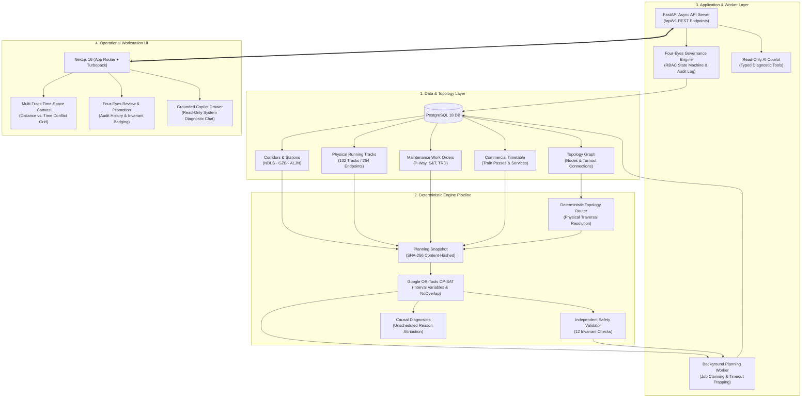

# TrackMeld

[](https://www.python.org/)
[](https://fastapi.tiangolo.com/)
[](https://www.postgresql.org/)
[](https://developers.google.com/optimization)
[](https://nextjs.org/)
[](https://www.typescriptlang.org/)
[](https://playwright.dev/)
[]()

> **Decision-support platform for railway maintenance possession planning, constraint programming, and four-eyes operational governance.**

---

## 1. Overview

Railway infrastructure maintenance requires taking tracks out of commercial service for fixed durations—known as **engineering possessions** or **track blocks**. In high-density mixed-traffic corridors, allocating these windows is one of the most operationally demanding combinatorial challenges in transport logistics.

Track maintenance cannot be scheduled in isolation. Every possession request directly contends with scheduled commercial passenger and freight timetables, locomotive and gang availability, adjacent track safety clearances, electrical traction isolations (OHE power blocks), and physical track topology.

### The Operational Problem

When possession scheduling relies on manual deliberation or fragmented spreadsheets:
- **Possessions are canceled late**, idling specialized heavy machinery (e.g., track tamping and ballast cleaning machines) and work gangs.
- **Timetable punctuality collapses**, as unplanned speed restrictions (cautions) propagate cascading delay across contiguous blocks.
- **Adjacent-track hazards arise**, when maintenance gangs work alongside live running lines without enforced safety buffers.

TrackMeld solves this problem by formulating possession planning as a rigorous mathematical optimization task paired with an independent safety auditing engine and mandatory human approval controls.

```
┌─────────────────────────────────────────────────────────────────────────────────────────────────────────┐
│                                    OPERATIONAL GOVERNANCE CHAIN                                         │
│                                                                                                         │
│  [Rules Classify] ──► [CP-SAT Optimizes] ──► [Independent Validator] ──► [Human Reviews] ──► [Approved] │
│                                                                                                         │
│  OPTIMAL ≠ APPROVED    │    FEASIBLE ≠ APPROVED    │    VALID ≠ APPROVED    │    CREATOR ≠ APPROVER     │
└─────────────────────────────────────────────────────────────────────────────────────────────────────────┘
```

---

## 2. Core Architecture

TrackMeld enforces strict separation between optimization, safety auditing, persistence, and human authorization.



---

## 3. Key Technological Innovations

### 1. Deterministic Planning Snapshots (SHA-256)
Optimization never operates directly against live mutating tables. Instead, an in-memory `PlanningSnapshot` is assembled, normalized, sorted, and fingerprinted with a 64-character SHA-256 hash. Any permutation of input records yields an identical fingerprint, ensuring 100% reproducible schedule outcomes across environments.

### 2. Track-Aware Mathematical Optimization (Google OR-Tools CP-SAT)
Unlike naive interval schedulers that lock entire corridor sections, TrackMeld provides a **track-aware conservative optimization engine**:
- **Discrete Interval Variables**: Models maintenance tasks and train occupancies as native CP-SAT interval variables.
- **Disjunctive Multi-Track Constraints**: Enforces `AddNoOverlap` per physical running line (`UP_MAIN`, `DOWN_MAIN`, `LOOP`).
- **Adjacent-Track Safety Buffer**: Automatically injects caution orders and dynamic safety margins on adjacent lines when heavy on-track machinery is scheduled.
- **Whole-Section Fallback**: Automatically degrades to whole-section reservation whenever track assignment metadata is incomplete or ambiguous.

### 3. Deterministic Topology Routing
Commercial passenger timetables specify station stop times, not switch positions. TrackMeld's `DeterministicTopologyRouter` traverses physical `TrackEndpoint` and `TopologyConnection` entities to resolve timetable movements into explicit, timestamped `TrainTraversal` segments with track assignments.

### 4. Independent Safety Validator (12 Verification Rules)
TrackMeld does not trust the optimizer as the sole authority. An independent verification service audits candidate plans against 12 strict safety rules without sharing internal solver heuristics or state:
- Same-track train/maintenance collision detection
- Adjacent-track clearance and caution adherence
- Task-to-task spatial overlap protection
- Crew, gang, and fleet capacity limits
- Work order earliest-start and latest-finish deadline adherence

### 5. Four-Eyes Human Governance & Immutable Audit Log
No algorithm or AI agent can authorize a plan. Candidate plans transition through an explicit relational state machine:
`CREATED` → `SUBMITTED` → `APPROVED` / `REJECTED`.
- **Database-Level Segregation**: Enforces `CREATOR ≠ APPROVER` (the user who triggers a run cannot approve it).
- **Append-Only Audit Ledger**: Persists actor identity, role, timestamp, transition state, and mandatory justification comments.

### 6. Read-Only Grounded AI Copilot
The embedded AI Copilot is strictly bounded:
- It has **zero write permissions** and cannot create, modify, or approve plans.
- It queries the system exclusively through typed inspection tools returning deterministic structured data.
- If evidence is absent, it reports the gap rather than hallucinating train paths.

---

## 4. Technology Stack

| Layer | Technologies |
|---|---|
| **Backend & Optimization** | Python 3.11+, FastAPI, Google OR-Tools (CP-SAT), Pydantic v2, SQLAlchemy 2.0 (AsyncIO), Alembic |
| **Database** | PostgreSQL 18+ with compound operational indexes (`pg_trgm`, `btree`) |
| **Frontend Workstation** | Next.js 16 (React 19, Turbopack), TypeScript 5, Tailwind CSS, Lucide Icons |
| **Testing & QA** | Pytest, Pytest-AsyncIO, Playwright (Chromium/Firefox/WebKit E2E), ESLint, TSC |

---

## 5. Quick Start & Setup

### Prerequisites
- **Python 3.11+**
- **Node.js 20+** and **npm**
- **PostgreSQL 18+**

### 1. Clone & Configure Environment

```bash
git clone https://github.com/your-username/trackmeld.git
cd Trackmeld

# Create your local environment configuration
cp .env.example .env
```

### 2. Backend Setup & Migrations

```bash
# Set up Python virtual environment
python -m venv .venv
source .venv/bin/activate  # On Windows: .venv\Scripts\Activate.ps1

# Install backend dependencies
pip install -r backend/requirements.txt

# Run database migrations
cd backend
alembic upgrade head
cd ..

# Seed synthetic corridor data (NDLS-GZB-ALJN)
python -m backend.app.cli.seed
```

### 3. Start the Background Worker & API Server

In separate terminal sessions (or background processes):

```bash
# Terminal 1: Background planning job worker
python -m backend.app.services.planning_worker

# Terminal 2: FastAPI application server
uvicorn backend.app.main:app --host 127.0.0.1 --port 8000 --reload
```

API documentation will be accessible at: `http://127.0.0.1:8000/docs`

### 4. Frontend Workstation Setup

```bash
cd frontend
npm install
npm run dev
```

The operational workstation will be running at: `http://localhost:3000`

---

## 6. Role-Based Access Control (RBAC)

TrackMeld enforces role-based authorization headers for all mutations and reviews:

| Role | Default Header Token | Permissions |
|---|---|---|
| **Planner** | `Bearer demo-planner-token` | Ingest work orders, configure parameters, trigger CP-SAT planning runs. |
| **Approver** | `Bearer demo-approver-token` | Review candidate plans, inspect validator findings, issue Four-Eyes approval or rejection. |
| **Admin** | `Bearer demo-admin-token` | Manage system configuration, reset stalled worker jobs. |
| **Viewer** | `Bearer demo-viewer-token` | Read-only access to corridors, timetables, and approved plans. |

---

## 7. Verification & Automated Test Suite

TrackMeld maintains 100% pass rates across **472 automated tests**, spanning low-level discrete solver mathematics, database integrity, and full-stack browser workflows:

```
================================== TEST SUMMARY ==================================
Backend Unit Tests               : 310 passed (Pytest)
Backend Integration & API Tests  : 148 passed (Pytest + PostgreSQL)
Browser E2E User Journeys        :  14 passed (Playwright)
----------------------------------------------------------------------------------
Total Automated Test Suite       : 472 passed (0 failures, 0 regressions)
TypeScript Static Check          : Clean (0 errors)
ESLint Code Quality              : Clean (0 errors)
==================================================================================
```

### Running the Test Suite

```bash
# Run all backend unit and integration tests
pytest tests/ -v

# Run the Playwright browser E2E test suite
cd frontend
npx playwright test
```

---

## 8. Responsible AI & Domain Boundaries

- **Prototype Decision Support**: TrackMeld is an advanced decision-support prototype built for maintenance planning and operational scheduling. It is **not** an operational railway interlocking or live signalling system.
- **Synthetic Data Provenance**: All corridor topology, station names, train numbers, and maintenance schedules bundled with this repository are synthetic demo datasets created for reproducibility.
- **Human Authority**: The system adheres to the iron rule: *Rules classify, optimization schedules, independent validator verifies, human approves, and AI explains.* Automated systems cannot sign off on operational possessions.

---

## 9. Documentation Index

- **[System Architecture Reference](docs/TRACKMELD_FINAL_ARCHITECTURE.md)**: Deep dive into the mathematical formulation, topology graph structure, and state machine.
- **[Design System Specification](DESIGN_SYSTEM.md)**: Visual language, time-space graph standards, and dark-theme tokens.
- **[Historical Phase Archive](docs/archive/README.md)**: Full archive of 40+ implementation reports across all 21 development phases.

---

## 10. License

This project is licensed under the MIT License. See [LICENSE](LICENSE) for details.
