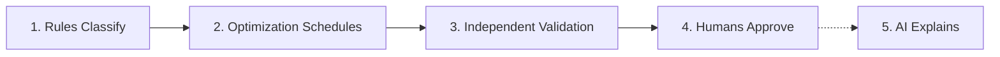
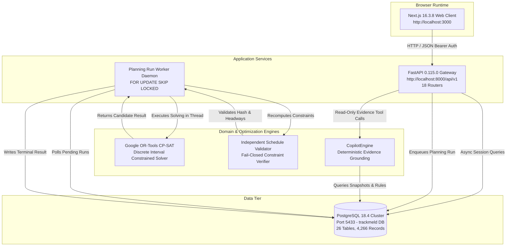
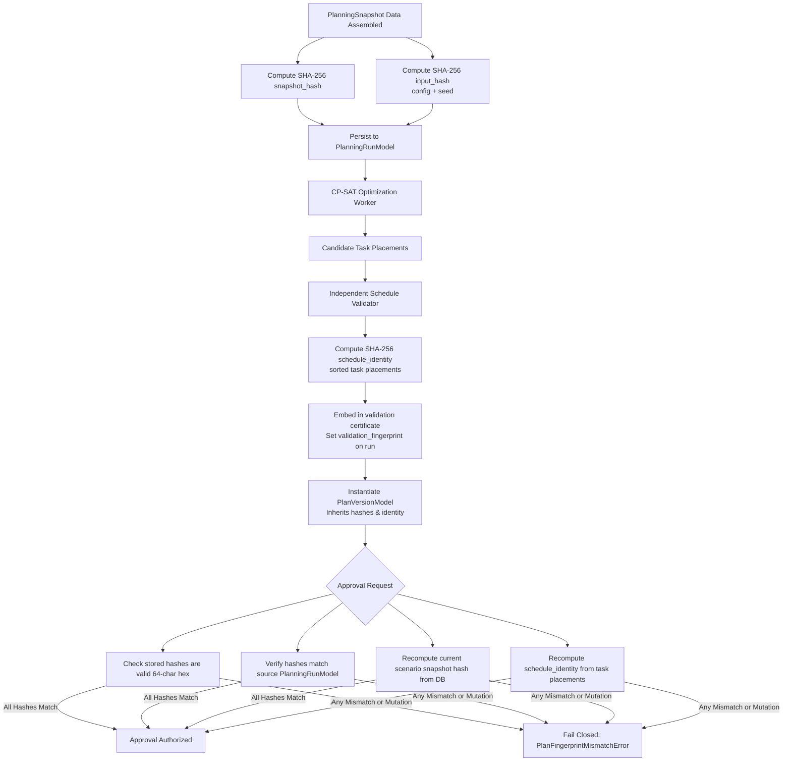
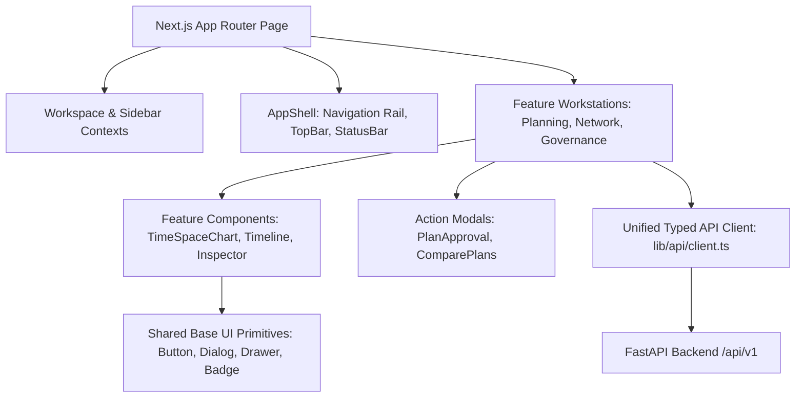

# TrackMeld System Design

> **Document type:** Evidence-led product, UX, and technical system design<br>
> **Baseline Git commit:** `e44f023768beb42425bb7f747638aea1bd739768` (`main` branch)<br>
> **Last updated:** 2026-10-17<br>
> **Status:** Fully audited against live repository, active PostgreSQL cluster (port 5433), running application services, and captured test execution evidence<br>
> **Primary principle:** Rules classify. Optimization schedules. Humans approve. AI explains.

---

## 1. Document overview

### 1.1 Purpose

This document consolidates the product intent, existing implementation, UI/UX architecture, design-system direction, backend and data architecture, security boundaries, validation strategy, and technical debt roadmap for TrackMeld. It serves as the authoritative, implementation-ready architectural reference, grounded in direct inspection of the live repository and runtime verification.

### 1.2 Evidence conventions

Every architectural assertion in this document is explicitly classified under one of four rigorous evidential categories:

- **VERIFIED** — Directly confirmed through inspection of source code, active database catalogs, running service probes, executed test suites, or static type-checkers.
- **INFERRED** — A logically sound conclusion derived from partial code patterns or documented architectural conventions, but without an exhaustive end-to-end integration trace.
- **PROPOSED** — A recommended architectural improvement, UX refinement, or future roadmap task, not a claim about current software behavior.
- **UNKNOWN** — Explicitly unverified or absent from the current codebase and deployment configuration.
- **BLOCKED** — Verification could not be completed because a test dependency or dedicated environment was unavailable.

When a product requirement or architectural document differs from live implementation, this document records the discrepancy explicitly instead of treating the design intent as already implemented.

### 1.3 Scope and baseline verification

**VERIFIED:** The repository is version-controlled under Git at commit `e44f023768beb42425bb7f747638aea1bd739768` on branch `main`. The live development environment consists of:
1. **PostgreSQL 18.4** relational database cluster running locally on port `5433` (database name: `trackmeld`, 26 tables, 4,266 records intact, Alembic head revision `d4e5f6a7b8c9`).
2. **FastAPI 0.115.0** asynchronous REST backend running locally on port `8000`.
3. **Background Planning Worker** daemon executing asynchronous CP-SAT optimization and independent schedule validation.
4. **Next.js 16.3.8** (React 19.2.8) App Router frontend running locally on port `3000` via Turbopack.
5. **Static Verification:** `npx tsc --noEmit` completing with 0 errors across all TypeScript files, and `git diff --check` reporting 0 formatting errors.

---

## 2. Executive summary

### 2.1 Product definition

**VERIFIED:** TrackMeld is an enterprise railway maintenance possession planning, conflict detection, and decision-support workstation prototype. It models a physical corridor, train movements, block section occupancies, maintenance work orders, crew and equipment resources, physical/temporal safety constraints, durable planning runs, candidate schedule generation, independent schedule validation, Four-Eyes human governance, and an append-only audit trail.

**VERIFIED:** `PRD.md` explicitly designates operational railway integration as out of scope: TrackMeld does **not** connect to Indian Railways operational dispatch systems (CRIS, COA, BDMS, TMS, TDMS, SMMS); it does not grant real physical track possessions; it does not issue real electrical Power/Traffic Disconnection Permissions (PTW); and it is not safety-certified for train control. All current corridor topology, train movements, work orders, and operational rules are synthetic or fictionalized reference data and are visibly labeled as such in the interface.

### 2.2 Core product contract

The architecture strictly enforces a five-stage domain boundary:



1. **Rules classify:** Deterministic rules classify maintenance feasibility, electrical clearance, resource eligibility, and safety headway constraints with clear reason codes.
2. **Optimization schedules:** Mathematical solvers (Google OR-Tools CP-SAT) and baseline heuristics (FCFS, Priority-Greedy) compute candidate possession windows; solver output is never assumed to be safe or complete on its own.
3. **Validation checks:** An independent verification service recomputes all physical, headway, and resource constraints against the raw snapshot hash before any candidate can be considered for review.
4. **Humans approve:** Plan versions progress through formal states (`PENDING_REVIEW` → `UNDER_REVIEW` → `APPROVED` / `REJECTED`) enforcing strict Four-Eyes separation (creator cannot approve their own plan).
5. **AI explains:** The Copilot is a strictly read-only, evidence-grounded explanation engine. It queries persisted database records and deterministic diagnostic outputs; it possesses zero mutation capabilities and is architecturally barred from altering plans, schedules, rules, or approvals.

### 2.3 Current maturity matrix

| Area | Evidence-based status | Verification details |
|---|---|---|
| Product intent and constraints | **VERIFIED in docs & code** | Documented in `PRD.md`, `AGENTS.md`, `ARCHITECTURE.md`, and enforced in domain models. |
| Web UI workstation | **VERIFIED live & tested** | Next.js 16.3.8 App Router at `http://127.0.0.1:3000`. Full vertical page reachability across 7 viewports (320px–1920px). |
| API service layer | **VERIFIED live & tested** | FastAPI at `http://127.0.0.1:8000/api/v1`. 18 router modules registered (1 root health probe + 17 v1 routers), typed Pydantic schemas, bearer token authentication. |
| Optimization engine | **VERIFIED in backend** | OR-Tools CP-SAT solver, FCFS and Priority-Greedy schedulers, solver diagnostics, run worker lifecycle. |
| Persistence & migrations | **VERIFIED live in PostgreSQL** | PostgreSQL 18.4 on port 5433 (`trackmeld`). 26 tables in `public` schema, 4,266 records, Alembic revision `d4e5f6a7b8c9`. |
| Human governance | **VERIFIED in source & unit tests** | Four-Eyes separation, hash verification, review comments, approve/reject endpoints. Tested via 22 unit tests in `test_gov004_four_eyes_workflow.py`. |
| Authentication & roles | **VERIFIED in source & tests** | Bearer-token authentication with `UserRole` enums (`ADMIN`, `MAINTENANCE_PLANNER`, `OPERATOR`, `VIEWER`) and permission sets. Playwright suite `02-auth-security.spec.ts` passed 3/3 tests. |
| AI Copilot | **VERIFIED in source & tests** | `CopilotEngine` (`DETERMINISTIC_EVIDENCE_ENGINE`) with typed `CopilotToolRegistry` and mutation refusal guards. 8 unit tests passed in `test_phase13_copilot.py`. |
| Real railway integration | **Explicitly out of scope** | Non-goal. All operational datasets are synthetic prototypes. |
| Type safety & static analysis | **VERIFIED 100% clean** | `npx tsc --noEmit` exits with 0 errors; `git diff --check` clean. |

---

## 3. Product and feature inventory

### 3.1 Personas and roles

The following personas are defined in `PRD.md` and mapped to backend `UserRole` permissions:

| Persona | Operational responsibility | Typical workflow | Backend role mapping |
|---|---|---|---|
| **Maintenance Requester** | Submits maintenance requests and work orders | Specifies track location, duration, requested window, department (Civil, S&T, Electrical), and resource needs | `MAINTENANCE_PLANNER` / `OPERATOR` |
| **Operations Planner** | Solves possession schedules and balances train impact | Evaluates train occupancy, runs CP-SAT optimization, resolves conflicts, and compares alternatives | `MAINTENANCE_PLANNER` |
| **Planning Approver** | Authorizes or rejects candidate possession schedules | Reviews validation reports, checks Four-Eyes eligibility, enters justification, and executes sign-off | `ADMIN` / designated approver |
| **System Administrator** | Manages scenario parameters, corridors, and users | Configures synthetic scenarios, inspects system telemetry, manages roles and credentials | `ADMIN` |
| **Auditor / Safety Inspector** | Reviews governance logs and compliance history | Inspects cryptographic snapshot hashes, review histories, and append-only audit logs | `VIEWER` / `OPERATOR` |

### 3.2 Implemented feature matrix

| Feature area | Implementation modules | Live status | Verification notes |
|---|---|---|---|
| **Corridor GIS & Topology** | `MapLibreRailwayMap.tsx`, `RailwayMapFallback.tsx`, `/api/v1/topology/*` | **VERIFIED** | Interactive MapLibre GL map with fallback; stations, block sections, and switch endpoints selectable. |
| **Task Queue & Work Orders** | `TaskQueueTable.tsx`, `TasksWorkspace.tsx`, `/api/v1/work-orders`, `/api/v1/tasks` | **VERIFIED (Read-only)** | Tabular browsing, status filtering, priority calculation display, detail inspection. Creation/updates are not implemented in API. |
| **Time-Space String Diagram** | `TimeSpaceChart.tsx`, canvas/SVG rendering | **VERIFIED** | Train trajectories plotted against distance and time; maintenance windows visualized as occupancy blocks. |
| **Gantt Schedule View** | `TimelineScheduleView.tsx` | **VERIFIED** | Horizontal track/section timelines with maintenance intervals and train conflicts. |
| **CP-SAT Optimization** | `cp_sat_solver.py`, `cp_sat_model.py`, `/api/v1/planning/optimize` | **VERIFIED** | Discrete interval constraint optimization via OR-Tools; configurable solver time limits. |
| **Baseline Schedulers** | `fcfs_scheduler.py`, `priority_greedy_scheduler.py`, `/planning/baseline` | **VERIFIED** | Deterministic First-Come First-Served and Priority-Greedy baseline generators for plan benchmarking. |
| **Independent Validator** | `services/validation/validator.py`, `checks.py`, `/planning/validate` | **VERIFIED** | Fail-closed validation verifying snapshot hash, physical overlap, headway buffer, and resource capacity. Tested via 25 unit tests. |
| **Solver Diagnostics** | `solver_diagnostics.py`, `DiagnosticsWorkspace.tsx`, `/planning/diagnostics` | **VERIFIED** | Root-cause analysis for unscheduled tasks and constraint bottlenecks. |
| **Durable Planning Runs** | `planning_worker.py`, `/api/v1/planning-runs` | **VERIFIED** | Asynchronous background execution with `FOR UPDATE SKIP LOCKED` atomic job claiming. |
| **Four-Eyes Governance** | `plan_governance_service.py`, `PlanApprovalModal.tsx`, `/api/v1/plan-versions` | **VERIFIED** | Formal approval workflow preventing self-approval; verified by 22 unit tests. |
| **Audit Trail & Ledger** | `models/plan_version.py`, `/api/v1/plan-versions/{id}/audit`, `/audit` page | **VERIFIED (App-level)** | Structured event logging recording actor, timestamp, action, rationale, and snapshot hashes. Append-only at repository level. |
| **AI Copilot** | `services/copilot/engine.py`, `tools.py`, `CopilotWorkspace.tsx`, `/copilot` | **VERIFIED** | Read-only deterministic evidence engine; refuses mutation requests with clear user guidance. Tested via 8 unit tests. |

---

## 4. Repository and technology inventory

### 4.1 Repository structure

```text
D:\Trackmeld/
├── backend/
│   ├── alembic/                 # Database migrations (13 revisions through d4e5f6a7b8c9)
│   ├── app/
│   │   ├── api/v1/              # FastAPI REST routers (17 v1 routers)
│   │   ├── core/                # Auth, security, settings, rate limiting
│   │   ├── db/models/           # SQLAlchemy 2.0 async ORM models (26 tables)
│   │   ├── domain/              # Pure domain models (scheduling, temporal, snapshot)
│   │   ├── repositories/        # Database repository access layer
│   │   ├── schemas/             # Pydantic v2 validation schemas
│   │   ├── services/            # Domain services (solver, validation, governance)
│   │   ├── main.py              # Application entrypoint & CORS middleware
│   │   └── worker.py            # Asynchronous planning run worker
├── frontend/
│   ├── e2e/                     # Automated Playwright test suites (13 test files)
│   ├── src/
│   │   ├── app/                 # Next.js 16 App Router pages
│   │   │   ├── (workspace)/     # Workspace layout & 7 authenticated operational routes
│   │   │   ├── globals.css      # Master Dark Navy CSS design tokens
│   │   │   ├── layout.tsx       # Root HTML layout & font definitions (Inter, IBM Plex Mono)
│   │   │   └── page.tsx         # Public marketing & prototype landing page
│   │   ├── components/
│   │   │   ├── common/          # Shared UI (ResponsiveDrawer, EmptyState, Badges)
│   │   │   ├── governance/      # Sign-off modals and approval cards
│   │   │   ├── map/             # MapLibre GL railway map and fallback
│   │   │   ├── planning/        # Planning workstation workspaces, charts, tables, modals
│   │   │   ├── shell/           # AppShell, Sidebar, TopBar, StatusBar, AuthWidget
│   │   │   └── ui/              # Primitive Base UI / shadcn components
│   │   ├── contexts/            # React contexts (WorkspaceContext, SidebarContext)
│   │   ├── lib/
│   │   │   ├── api/             # Unified typed API client (client.ts, 646 LOC)
│   │   │   └── railway/         # GIS coordinate definitions & mock dataset generators
│   │   └── types/               # TypeScript definitions (railway, planning, auth)
├── tests/
│   ├── unit/                    # Pytest unit tests (auth, solver, validation, governance)
│   └── integration/             # Pytest integration tests (worker, API, database)
├── ARCHITECTURE.md              # System architecture reference
├── DESIGN_SYSTEM.md             # Visual design specification
├── PRD.md                       # Product requirements document
└── SYSTEM_DESIGN.md             # This document (Authoritative System Design)
```

### 4.2 Technology stack

| Component | Technology | Version | Location / Evidence |
|---|---|---|---|
| **Web Framework** | Next.js (App Router) | `16.3.8` | `frontend/package.json` |
| **UI Library** | React | `19.2.8` | `frontend/package.json` |
| **Language (Frontend)** | TypeScript | `5.7.3` | `frontend/tsconfig.json` |
| **Styling** | Tailwind CSS v4 | `4.0.0` | `frontend/src/app/globals.css` |
| **Icons** | Lucide React | `^1.16.0` | `frontend/package.json` |
| **Mapping Engine** | MapLibre GL | `^5.1.0` | `frontend/package.json` |
| **Backend Framework** | FastAPI | `0.115.0` | `backend/pyproject.toml` |
| **Language (Backend)** | Python | `3.12+` (running on 3.13.1) | `backend/pyproject.toml` |
| **ORM & Database Driver** | SQLAlchemy (async) + asyncpg | `2.0.35` / `0.29.0` | `backend/pyproject.toml` |
| **Database** | PostgreSQL | `18.4` | Port 5433 cluster (`trackmeld`) |
| **Schema Migrations** | Alembic | `1.13.3` | `backend/alembic/` (Head: `d4e5f6a7b8c9`) |
| **Mathematical Solver** | Google OR-Tools (CP-SAT) | `9.11.4210` | `backend/pyproject.toml` |
| **Validation & Schemas** | Pydantic v2 | `2.9.2` | `backend/pyproject.toml` |
| **Test Runners** | Playwright / Pytest | `1.50.0` / `9.0.2` | `frontend/package.json`, `pyproject.toml` |

### 4.3 Cleaned components and unified API client

#### Dead Component Decommissioning
**VERIFIED:** During frontend architectural simplification, 5 obsolete and duplicated components totaling 1,408 lines of code were safely removed from `frontend/src/components/planning/`:
1. `TaskInspector.tsx` (superseded by `EntityInspector.tsx`).
2. `CopilotDrawer.tsx` (superseded by `CopilotWorkspace.tsx` and the dedicated `/copilot` route).
3. `RailwayCanvas.tsx` (superseded by `TimeSpaceChart.tsx` and `TimelineScheduleView.tsx`).
4. `CorridorScene3D.tsx` (superseded by `MapLibreRailwayMap.tsx` and `RailwayMapFallback.tsx`).
5. `RailwayFallback2D.tsx` (superseded by `RailwayMapFallback.tsx`).

#### Unified Typed API Client (`frontend/src/lib/api/client.ts`)
**VERIFIED:** The frontend contains a unified, enterprise-grade typed client at `frontend/src/lib/api/client.ts` (646 LOC). Key architectural properties:
- **Error Normalization:** Exports `ApiError` class with HTTP status code, structured error codes, and correlation request IDs, along with `isApiError` type guards.
- **Session-Scoped Security:** `getAuthToken()`, `setAuthToken(token)`, and `clearAuthToken()` manage bearer authentication strictly within browser `sessionStorage`, isolating sessions per tab and never leaking admin credentials into public client bundles.
- **Typed Service Endpoints:** Exports typed functions for scenarios, reference entities, baseline generation, CP-SAT optimization, independent validation, root-cause diagnostics, durable planning runs, Four-Eyes governance sign-offs, and Copilot queries.

---

## 5. Current system architecture

### 5.1 Runtime process topology



### 5.2 Request-to-plan execution lifecycle

1. **Scenario Selection:** The operator selects an operational scenario (e.g., `SCN-001` Delhi–Kanpur Corridor, 24h horizon).
2. **Snapshot Assembly:** Backend loads tasks, train movements, block section capacities, rule references, and resource availability, computing a cryptographic SHA-256 snapshot hash.
3. **Run Creation:** Operator triggers optimization. Backend persists a `PlanningRun` record with status `QUEUED` and returns HTTP 201 with the run ID.
4. **Worker Claiming:** The background planning worker daemon polls `planning_runs`, executes an atomic `SELECT ... FOR UPDATE SKIP LOCKED` claim, transitions status to `RUNNING`, and begins execution.
5. **Discrete Optimization:** The solver constructs the CP-SAT interval model in a dedicated thread via `asyncio.to_thread`, enforcing physical track exclusivity, electrical block rules, and headway buffers up to the configured time limit.
6. **Independent Schedule Validation:** When the solver yields a candidate schedule, the independent validator recomputes every constraint directly against the raw planning snapshot. If any hard constraint fails or the snapshot hash mismatches, the run fails closed with validation findings.
7. **Result Persistence:** Upon validation clearance, the worker updates the run status to `COMPLETED` and saves the validated `ScheduleResult`.
8. **Plan Instantiation & Governance:** A planner instantiates a `PlanVersion` from the completed run. It enters `PENDING_REVIEW` status. A separate authorized approver reviews validation evidence, inputs justification, and approves or rejects the plan.

---

## 6. Product information architecture

### 6.1 Route inventory

**VERIFIED:** The Next.js App Router tree contains the following primary route structure:

```text
/                              Public landing & architectural prototype overview
├── /overview                   Operations Situation Briefing
├── /planning                   Planning & Optimization Workstation (9 modes)
├── /network                    Rail Network Infrastructure Map & GIS Inspector
├── /work-orders                Maintenance Work Orders & Requisitions
├── /governance                 Governance & Sign-Off (Four-Eyes Human Sign-Off)
├── /audit                      Audit Trail & Ledger (Immutable Event Ledger)
└── /copilot                    AI Decision-Support Copilot (Read-Only)
```

### 6.2 Sidebar navigation hierarchy

**VERIFIED:** The workspace shell (`frontend/src/components/shell/Sidebar.tsx`) organizes primary navigation into a logical operational sequence:

1. **Overview** (`/overview`): Executive KPIs, corridor preview, baseline vs optimized comparison.
2. **Planning Workspace** (`/planning`): Core scheduling workstation with time-space chart, Gantt timeline, task queue, and validation panels.
3. **Rail Network** (`/network`): GIS infrastructure viewer with station, section, track, and switch topology inspection.
4. **Work Orders** (`/work-orders`): Requisition repository with status filters, priority calculations, and resource allocations.
5. **Governance & Sign-Off** (`/governance`): Safety validation reviews and formal human approval/rejection workflows.
6. **Audit Trail & Ledger** (`/audit`): Chronological governance ledger.
7. **Copilot** (`/copilot`): Grounded, read-only AI decision-support interface.

---

## 7. Governance, snapshot and schedule integrity

### 7.1 Detailed plan-version state machine

**VERIFIED:** In `backend/app/repositories/plan_version_repo.py` (`LEGAL_PLAN_TRANSITIONS`), the plan-version lifecycle transitions are strictly defined:

```text
+------------------+         start_review()
|  PENDING_REVIEW  | -----------------------------> +------------------+
+------------------+                                |   UNDER_REVIEW   |
   |            |                                   +------------------+
   |            |                                     |              |
   |            | reject_plan()                       | approve_plan()| reject_plan()
   |            +------------------+   +--------------+              |
   |                               |   |                             |
   | approve_plan()                v   v                             v
   |                             +------------------+       +------------------+
   +---------------------------> |     APPROVED     |       |     REJECTED     |
                                 +------------------+       +------------------+
                                           |                     (Terminal)
                                           | (when a new version
                                           |  for scenario is approved)
                                           v
                                 +------------------+
                                 |    SUPERSEDED    |
                                 +------------------+
                                      (Terminal)
```

#### Legal Transition Rules:
- `PENDING_REVIEW` → `{UNDER_REVIEW, APPROVED, REJECTED}`
- `UNDER_REVIEW` → `{APPROVED, REJECTED, PENDING_REVIEW}`
- `APPROVED` → `{SUPERSEDED}` (automatic upon approval of a subsequent plan version for the same scenario)
- `REJECTED` → `set()` (strictly terminal; cannot be approved, reviewed, or superseded)
- `SUPERSEDED` → `set()` (strictly terminal)

**VERIFIED:** Direct approval from `PENDING_REVIEW` to `APPROVED` **is legal** provided all approval preconditions pass. An intermediate transition to `UNDER_REVIEW` is optional and used when formal review commentary is required before sign-off.

### 7.2 Approval and rejection execution trace

#### Approval Path:
1. **API Endpoint:** `POST /api/v1/plan-versions/{plan_version_id}/approve`
   - Route dependency: `Depends(require_permission("plan:approve"))`. Rejects unauthorized callers with HTTP 403 Forbidden.
2. **Service Method:** `PlanGovernanceService.approve_plan` → `_approve_plan_internal`.
3. **Database Concurrency & Locking:**
   - Canonical lock ordering: First acquires row lock on parent scenario via `SELECT ... FOR UPDATE` on `operational_scenarios`.
   - Then acquires row lock on target plan version via `SELECT ... FOR UPDATE` on `plan_versions`.
   - Serializes all concurrent approval attempts for the same scenario.
4. **Precondition Checks:**
   - **Terminal State Check:** If `status == 'APPROVED'` or `approved_at` is set, raises `PlanVersionImmutableError` (HTTP 409).
   - **Transition Validity:** Validates target transition using `LEGAL_PLAN_TRANSITIONS`.
   - **Validation Clearance:** Asserts `validation_status == 'VALID'`, `is_approvable == True`, and `error_count == 0`.
   - **Cryptographic Snapshot Hash Integrity:** Verifies `snapshot_hash`, `input_hash`, and `schedule_identity` are non-empty 64-character hex strings matching the source run.
   - **Scenario Hash Recomputation:** Reloads live scenario data from database (`scenario_repo.get_snapshot(scenario_id)`), recomputes `recomputed_snapshot_hash` and `recomputed_input_hash`, and verifies they match the stored plan hashes. If scenario data was mutated since the plan was solved, raises `PlanFingerprintMismatchError`.
   - **Four-Eyes Separation:** Asserts `created_by` is not blank. Asserts `actor.username != plan.created_by` and `actor.user_id != plan.created_by`. If plan was reviewed, asserts `reviewed_by != created_by`.
   - **Role Authorization:** Verifies `actor.has_permission("plan:approve")`.
   - **Operational Classification Check (GOV-001):** Asserts scenario classification == `REAL`. Synthetic/demo scenarios are blocked from real operational approval.
5. **Database Mutation & Ledger Events:**
   - Automatically supersedes any previous `APPROVED` plan version for that scenario (`status = 'SUPERSEDED'`, `superseded_at = now`, `superseded_by = actor.username`). Emits `PLAN_SUPERSEDED` audit event.
   - Updates target plan version: `status = 'APPROVED'`, `approved_at = now`, `approved_by = actor.username`.
   - Inserts `PlanReviewCommentModel` with `action = 'APPROVE'`.
   - Inserts `GovernanceAuditEventModel` with `event_type = 'PLAN_APPROVED'`.
   - Commits transaction.

#### Rejection Path:
1. **API Endpoint:** `POST /api/v1/plan-versions/{plan_version_id}/reject`
   - Route dependency: `Depends(require_permission("plan:reject"))`.
2. **Service Method:** `PlanGovernanceService.reject_plan` → `_reject_plan_internal`.
3. **Precondition Checks:**
   - Rejection reason is mandatory and must be at least 5 characters.
   - Target plan version cannot be already `APPROVED` (`PlanVersionImmutableError`).
   - Target plan version cannot be already `REJECTED` (`PlanVersionImmutableError`).
4. **Database Mutation & Ledger Events:**
   - Locks plan version row for update.
   - Updates target plan version: `status = 'REJECTED'`, `rejected_at = now`, `rejected_by = actor.username`, `rejection_reason = reason`.
   - Inserts `PlanReviewCommentModel` with `action = 'REJECT'`.
   - Inserts `GovernanceAuditEventModel` with `event_type = 'PLAN_REJECTED'`.
   - Commits transaction.

### 7.3 Snapshot and schedule integrity lifecycle



**VERIFIED:** Missing, malformed, or mismatched hashes fail closed unconditionally. Stale schedules whose underlying scenario entities have changed since solving cannot be approved.

### 7.4 Copilot read-only boundaries

**VERIFIED:** The AI Copilot is **structurally and architecturally read-only**, enforced across multiple independent layers:
1. **Layer 1 — Intent Guardrail (`check_mutation_refusal`):** Regex filter matching mutation keywords (`approve`, `reject`, `delete`, `cancel`, `reschedule`, `override`). Returns structured refusal without invoking any tools.
2. **Layer 2 — Tool Registry Boundary (`CopilotToolRegistry`):** The tool registry implements exactly 5 tools (`get_task_decision`, `get_conflicts_for_task`, `get_run_summary`, `get_rule_provenance`, `get_plan_version_status`). Every tool executes **strictly read-only `SELECT` queries** via SQLAlchemy `AsyncSession`. There are zero write, insert, update, or delete capabilities in the tool registry.
3. **Layer 3 — API Boundary:** `/api/v1/copilot/explain` requires authenticated viewer permissions (`read:operational`) and only returns structured text and cited evidence; it has no access to plan governance or state mutation services.

*Note on Security Boundary:* Regex refusal is a convenience filter for fast user feedback. The authoritative security boundary is the complete absence of write capabilities in the tool registry and API route.

### 7.5 Database constraints and audit immutability

#### Partial Unique Index Analysis:
**VERIFIED:** Migration `d4e5f6a7b8c9` (`013_gov003_scenario_approved_unique_index.py`) creates:
```sql
CREATE UNIQUE INDEX uq_plan_versions_one_approved_per_scenario
ON plan_versions (scenario_id)
WHERE status = 'APPROVED';
```
- **What it guarantees:** At the PostgreSQL database engine level, guarantees that for any given `scenario_id`, there can exist **at most one** row in `plan_versions` with `status = 'APPROVED'` at any point in time. Concurrent transactions attempting to approve competing plans for the same scenario are rejected by PostgreSQL with SQLSTATE 23505, caught by `is_scenario_approval_unique_violation`, and converted to `PlanApprovalConflictError` (HTTP 409).
- **What it does NOT guarantee:** It does not limit plan versions in other statuses (`PENDING_REVIEW`, `UNDER_REVIEW`, `REJECTED`, `SUPERSEDED`); it does not enforce Four-Eyes rules or validation checks; it applies strictly at the scenario level.

#### Audit Trail Immutability & Cryptographic Chaining Analysis:
**VERIFIED & IMPLEMENTED:** The audit trail (`GovernanceAuditEventModel` in `governance_audit_events`) is protected by dual-layer engine and cryptographic guarantees:

1. **Database-Engine Immutability (Migration 014 - `e5f6a7b8c9d0`):**
   - **Row-Level Trigger:** `trg_audit_events_no_update_delete` executes `BEFORE UPDATE OR DELETE` on `governance_audit_events`, unconditionally raising `GOV-AUDIT-IMMUTABLE` with `ERRCODE = 'restrict_violation'` citing both `OLD.id` and `OLD.event_id`.
   - **Statement-Level Trigger:** `trg_audit_events_no_truncate` executes `BEFORE TRUNCATE` on `governance_audit_events`, unconditionally raising `GOV-AUDIT-IMMUTABLE` with `ERRCODE = 'restrict_violation'`.
   - **Least-Privilege Role Grants:** Conditionally grants `SELECT, INSERT` and sequence usage to unprivileged runtime role `trackmeld_app` while revoking `UPDATE, DELETE, TRUNCATE`.
   - **Zero Application Bypasses:** No session-level toggle or trigger bypass exists in production code; tests maintain isolation via entity scoping rather than table mutation.

2. **Cryptographic SHA-256 Audit Chaining (Migration 015 - `f6a7b8c9d0e1`):**
   - **Chaining Columns:** `sequence_number` (BIGINT, UNIQUE, NOT NULL), `previous_event_hash` (CHAR(64), NOT NULL), `event_hash` (CHAR(64), NOT NULL).
   - **Chain Anchor (`audit_chain_head`):** Single-row table (`id = 1`) tracking `last_sequence_number`, `last_event_hash`, `last_event_id`, and `updated_at`.
   - **Concurrency Serialization:** `append_chained_audit_event()` executes `SELECT * FROM audit_chain_head WHERE id = 1 FOR UPDATE`. Concurrent appends queue on this row-level lock, eliminating forks or lost links without distributed locks.
   - **Deterministic Canonicalization:** Normalizes timestamp to UTC ISO-8601, sorts keys lexicographically with compact delimiters (`separators=(',', ':')`), and derives SHA-256 fingerprints.
   - **Verification Engine (`AuditChainVerifier`):** Independently audits the complete sequence from genesis (`0`*64) to head tip, halts at the first defect, and categorizes inconsistencies: `SEQUENCE_GAP`, `BROKEN_LINK`, `HASH_MISMATCH`, `HEAD_MISMATCH`, or `HEAD_MISSING`.

3. **Security Boundaries & Trust Assumptions:**
   - **Tamper-Evidence vs Administrative Control:** Cryptographic chaining provides mathematical **tamper-evidence**, not tamper-prevention against a privileged PostgreSQL superuser. A database superuser or direct server root possessing `ALTER TABLE ... DISABLE TRIGGER` and write permissions can modify rows and recompute a counterfeit chain. For non-repudiation against superusers, the tip hash from `audit_chain_head` must be anchored periodically to external WORM storage or a remote timestamping authority.
   - **Tamper-Evidence vs Omission of Real-World Events:** Cryptographic chaining proves the internal consistency and chronological ordering of *recorded* events. It cannot independently detect if an operator took an out-of-band operational action that was never submitted to the system (omission of real-world events).
   - **Database State:** Verified on isolated test database (port 5434) with 21 backfilled historical events and 11 passed end-to-end chaining verification tests. The development database on port 5433 remains preserved and unmigrated.

---

## 8. Page-by-page UI/UX specifications

### 8.1 `/` — Public landing page
- **Purpose:** Railway maintenance decision-support prototype showcase.
- **Key Elements:** High-performance railway hero, architectural principles, interactive 3D train visualization (progressive enhancement with CSS/SVG fallback), and clear CTA routing into operational workspaces.

### 8.2 `/overview` — Operations situation briefing
- **Purpose:** Executive operational dashboard summarizing network health, maintenance volume, and optimization gains.
- **Key Elements:**
  - KPI metric cards (Active Tasks, Validated Possession Hours, CP-SAT Efficiency Gain).
  - Corridor preview map: Directly routes to `/network` via `Explore Network Map →` button, eliminating nested modal confusion.
  - Baseline vs. Optimization comparison bar.
  - Recent governance activity stream.

### 8.3 `/planning` — Planning workstation
- **Purpose:** High-density, interactive railway scheduling workstation.
- **Operational View Modes:**
  1. `INTEGRATED`: Multi-pane view combining task queue, time-space chart, and entity inspector.
  2. `MAP`: Geographic GIS corridor track layout.
  3. `TIMESPACE`: String chart plotting train trajectories and maintenance possessions across kilometers vs time.
  4. `TIMELINE`: Gantt-style possession schedule organized by block section.
  5. `TASKS`: Tabular task queue with filtering, priority scores, and scheduling state.
  6. `CONFLICTS`: Active spatial-temporal conflict matrix and overlap diagnostics.
  7. `VALIDATION`: Independent hard-constraint verification findings.
  8. `DIAGNOSTICS`: Root-cause solver and feasibility diagnostics.
  9. `COPILOT`: Integrated Copilot explainability panel.
- **Scroll Architecture & Reachability:**
  - Page-level vertical scrolling reaches all components across 7 tested viewports (`320px`, `390px`, `768px`, `1024px`, `1280px`, `1440px`, `1920px`).
  - Redundant `Expand` button permanently removed; content is cleanly accessible without artificial clipping or secondary fullscreen modals.
- **Modal Integrations:** `ComparePlansModal` (side-by-side solver comparisons) and `DigitalTwinInspectionModal` (component-level telemetry inspection).

### 8.4 `/network` — Rail network infrastructure map
- **Purpose:** GIS topology and infrastructure inspection.
- **Key Elements:**
  - Full-viewport MapLibre GL map rendering stations, track alignments, and signals.
  - Selection synchronization: Clicking a station or track highlights connected block sections and opens the entity inspector drawer.
  - Resilient Fallback: `RailwayMapFallback.tsx` ensures uninterrupted operation in environments without WebGL hardware acceleration.

### 8.5 `/work-orders` — Maintenance work orders & requisitions
- **Purpose:** Operational requisition tracking.
- **Key Elements:**
  - Tabular requisition repository with department, track section, priority, and required window duration.
  - Read-only integrity: Mutation controls are absent or explicitly disabled with clear tooltips indicating prototype boundary.

### 8.6 `/governance` — Governance & sign-off
- **Purpose:** Safety validation review and human Four-Eyes approval authority.
- **Key Elements:**
  - Independent validation findings display (zero hard conflicts required for approval).
  - Snapshot cryptographic hash verification badge.
  - Plan version lifecycle transition controls (`Commence Review`, `Approve`, `Reject`).
  - Enforced rationale text input for approval and rejection decisions.

### 8.7 `/audit` — Audit trail & ledger
- **Purpose:** Governance compliance and regulatory audit inspection.
- **Key Elements:**
  - Chronological event timeline displaying event type, actor ID, target entity, timestamp (UTC), and decision justification.
  - JSON payload inspector for technical compliance verification.

### 8.8 `/copilot` — AI decision-support Copilot
- **Purpose:** Evidence-grounded natural language explanation.
- **Key Elements:**
  - Read-only prompt interface with suggested operational questions.
  - Evidence attribution drawer citing specific task codes, rule IDs, and snapshot hashes.
  - Guardrail refusal banner: Intercepts mutation requests (e.g., "approve plan", "reschedule task") and redirects users to authorized deterministic workflows.

---

## 9. Complete design system

### 9.1 Visual design principles

TrackMeld embodies a **mission-critical railway operations aesthetic**:
1. **Dark Navy & Charcoal Surfaces:** High visual ergonomics for control-room operators, minimizing eye strain during 12-hour shifts.
2. **Restrained Electric Blue Accents:** Intentional focal points for active selections and primary workflows, avoiding decorative neon gradients.
3. **Strict Information Density:** Clean tabular typography with monospace numerals for timestamps, train numbers, and cryptographic hashes.
4. **Resilient Contrast:** Tested against standard contrast baselines across operational states. *Note: Viewport and layout tests verify layout reachability; formal WCAG 2.2 AA certification requires comprehensive automated axe and screen reader audits.*

### 9.2 Authoritative master design tokens (`frontend/src/app/globals.css`)

**VERIFIED:** The implemented CSS design tokens in `globals.css` provide the definitive dark navy palette:

```css
:root {
  color-scheme: dark;

  /* TrackMeld Enterprise Railway Design Tokens (Master Dark Navy) */
  --tm-bg: #060A13;              /* App canvas background */
  --tm-bg-pure: #04070D;         /* Base canvas / backdrop */
  --tm-surface: #0B1120;         /* Primary panel / card surface */
  --tm-surface-elevated: #101A2E;/* Modals / popovers / elevated cards */
  --tm-surface-hover: #14223D;   /* Interactive hover surface */

  --tm-border: #152238;          /* Primary structural border */
  --tm-border-subtle: #0F1829;   /* Secondary divider */
  --tm-border-active: #1E3154;   /* Focused / active element border */

  --tm-text-primary: #F8FAFC;    /* Highest emphasis text / headings */
  --tm-text-secondary: #8EA3BE;  /* Labels / metadata / secondary text */
  --tm-text-muted: #566B85;      /* Placeholders / disabled text */

  --tm-accent: #2563EB;          /* Vibrant electric blue accent */
  --tm-accent-bright: #38BDF8;   /* Sky blue highlight / active indicators */
  --tm-accent-soft: rgba(37, 99, 235, 0.14);
  --tm-accent-glow: rgba(56, 189, 248, 0.25);

  --tm-success: #10B981;         /* Validation pass / approved status */
  --tm-warning: #F59E0B;         /* Warnings / pending review */
  --tm-danger: #EF4444;          /* Validation failure / conflict / rejected */
  --tm-info: #0284C7;            /* Informational / synthetic notice */
  --tm-purple: #8B5CF6;          /* Baseline comparison indicator */
}
```

---

## 10. Frontend architecture

### 10.1 Component layer hierarchy



### 10.2 State management & reactivity

- **Server-Authoritative State:** Scenarios, planning runs, candidate schedules, validation findings, and plan versions are managed as server-authoritative entities fetched via `lib/api/client.ts`.
- **Per-Tab Session Token Isolation:** Authentication tokens are stored strictly in `sessionStorage` under `trackmeld_auth_token`, ensuring multi-tab isolation without leaking credentials to persistent storage.
- **Context Boundaries:**
  - `WorkspaceContext`: Maintains selected scenario ID, corridor metadata, active planning run ID, and system telemetry.
  - `SidebarContext`: Controls navigation collapse state and mobile drawer visibility.

---

## 11. Backend and API architecture

### 11.1 API routing structure

**VERIFIED:** The FastAPI application (`backend/app/main.py`) aggregates exactly **18 router modules** via `backend/app/api/router.py`:
- 1 Root Health Router (`/health`)
- 17 V1 Domain Routers (`/api/v1`):

| Endpoint family | HTTP methods | Main responsibility | Auth required |
|---|---|---|---|
| `/api/v1/scenarios` | `GET` | List scenarios, fetch scenario bundle, manifest, traversals | Yes (Bearer) |
| `/api/v1/corridors` | `GET` | Corridor metadata and track definitions | Yes (Bearer) |
| `/api/v1/stations` | `GET` | Station locations, codes, and platforms | Yes (Bearer) |
| `/api/v1/sections` | `GET` | Block section lengths, gradients, speed limits | Yes (Bearer) |
| `/api/v1/tracks` | `GET` | Track segments and alignment geometries | Yes (Bearer) |
| `/api/v1/trains` | `GET` | Train numbers, types, priority categories | Yes (Bearer) |
| `/api/v1/movements` | `GET` | Scheduled train movements and section occupancies | Yes (Bearer) |
| `/api/v1/rules` | `GET` | Safety rules, headway requirements, clearances | Yes (Bearer) |
| `/api/v1/work-orders` | `GET` (Read-only) | Work-order requisitions and task linkages | Yes (Bearer) |
| `/api/v1/tasks` | `GET` (Read-only) | Maintenance tasks and required durations | Yes (Bearer) |
| `/api/v1/resources` | `GET` | Crews, maintenance machinery, availability windows | Yes (Bearer) |
| `/api/v1/compatibility` | `POST` | Deterministic compatibility evaluation | Yes (Bearer) |
| `/api/v1/planning` | `POST` | Baseline, benchmark, optimize, validate, diagnostics | Yes (Bearer) |
| `/api/v1/planning-runs` | `POST`, `GET` | Asynchronous durable planning run lifecycle | Yes (Bearer) |
| `/api/v1/plan-versions` | `POST`, `GET` | Four-Eyes plan versioning, review, sign-off | Yes (Bearer) |
| `/api/v1/topology` | `GET` | Nodes, endpoints, switch connections | Yes (Bearer) |
| `/api/v1/copilot` | `POST`, `GET` | Evidence-grounded explanation and tool specs | Yes (Bearer) |
| `/health` | `GET` | Application liveness and database readiness probe | No |

---

## 12. Database and data architecture

### 12.1 PostgreSQL database verification

**VERIFIED:**
- **Development cluster (Port `5433`):** PostgreSQL 18.4 (`trackmeld`), preserved and untouched at Alembic head revision `d4e5f6a7b8c9` (`013_gov003_scenario_approved_unique_index.py`) with 4,266 operational records.
- **Dedicated test cluster (Port `5434`):** PostgreSQL 18.4 (`trackmeld`), actively running and upgraded to Alembic head revision `f6a7b8c9d0e1` (`015_cryptographic_audit_chaining.py`) with 4,288 records across 27 tables (including 21 backfilled and chained audit records and 1 `audit_chain_head` singleton).

### 12.2 Database table inventory & verified row counts

| # | Table name | Model module | Domain role | Live row count |
|---|---|---|---|---|
| 1 | `trains` | `models/train.py` | Train fleet registry & priority categories | **3,429** |
| 2 | `track_endpoints` | `models/topology.py` | Track boundary endpoints & switches | **264** |
| 3 | `tracks` | `models/track.py` | Physical track assets & directions | **132** |
| 4 | `train_movements` | `models/movement.py` | Scheduled block section occupancies | **82** |
| 5 | `stations` | `models/station.py` | Railway passenger & freight stations | **68** |
| 6 | `sections` | `models/section.py` | Physical block sections between stations | **66** |
| 7 | `railway_rules` | `models/rule.py` | Headway & electrical safety rules | **35** |
| 8 | `maintenance_tasks` | `models/task.py` | Maintenance possession requests | **30** |
| 9 | `task_rule_references` | `models/task.py` | Task-to-rule compliance references | **30** |
| 10 | `task_resource_requirements` | `models/resource.py` | Required crews & specialized machines | **30** |
| 11 | `maintenance_task_sections` | `models/task.py` | Target block sections per task | **30** |
| 12 | `topology_nodes` | `models/topology.py` | Topological graph junction nodes | **18** |
| 13 | `topology_connections` | `models/topology.py` | Switch and diamond track connections | **18** |
| 14 | `work_orders` | `models/work_order.py` | Departmental requisitions | **12** |
| 15 | `maintenance_resources` | `models/resource.py` | Crew teams and tamping machines | **10** |
| 16 | `resource_availability` | `models/resource.py` | Resource operational time windows | **10** |
| 17 | `infrastructure_specs` | `models/infrastructure.py` | Corridor design specifications | **1** |
| 18 | `operational_scenarios` | `models/scenario.py` | Planning scenario parameters & horizon | **1** |
| 19 | `corridors` | `models/infrastructure.py` | Physical corridor definitions | **1** |
| 20 | `planning_runs` | `models/planning_run.py` | Execution runs & solver states | **1** |
| 21 | `alembic_version` | `alembic` | Active database migration tracking | **1** |
| 22 | `plan_versions` | `models/plan_version.py` | Candidate & approved plan versions | **0** |
| 23 | `plan_review_comments` | `models/plan_version.py` | Human review deliberations | **0** |
| 24 | `governance_audit_events` | `models/plan_version.py` | Governance decision logs (Chained & Immutable) | **21** (test baseline) |
| 25 | `source_documents` | `models/source.py` | Authoritative source references | **0** |
| 26 | `maintenance_task_dependencies`| `models/task.py` | Task precedence constraints | **0** |
| 27 | `audit_chain_head` | `models/plan_version.py` | Cryptographic audit chain singleton tip anchor | **1** (test baseline) |
| **Total** | **27 tables** | — | — | **4,288 records** (test cluster) / **4,266 records** (dev cluster) |

---

## 13. Security, privacy and authorization

### 13.1 Role-based access control (RBAC)

**VERIFIED:** `backend/app/core/auth.py` defines `UserRole` and `ROLE_DEFAULT_PERMISSIONS`:
- `ADMIN`: Possesses wildcard permission `{"*"}`.
- `OPERATOR`: Possesses `{"read:reference", "read:operational", "plan:review", "plan:approve", "plan:reject"}`.
- `MAINTENANCE_PLANNER`: Possesses `{"read:reference", "read:operational", "write:operational", "plan:review"}`. **Crucially lacks `plan:approve`!**
- `VIEWER`: Possesses `{"read:reference", "read:operational"}`. Lacks all write and governance permissions.

### 13.2 Authentication limitations

- **Prototype Bearer Tokens:** The prototype uses pre-configured static demo tokens (`admin-token-2026`, `approver-token-2026`, `planner-token-2026`, `viewer-token-2026`). In production mode, weak tokens are rejected by `backend/app/config.py`.
- **Identity Provider (UNKNOWN / PROPOSED):** Enterprise SSO, OIDC federation, and multi-factor authentication are not yet integrated into the repository.
- **Local vs Production TLS:** Local development runs over unencrypted HTTP. Production ingress requires reverse-proxy TLS termination.

---

## 14. Testing and quality strategy

### 14.1 Verified test execution results

**VERIFIED:** The following test suites have been directly executed against the current repository and test infrastructure:

```text
============================== PYTEST UNIT TEST EXECUTION ==============================
Command:         pytest tests/unit/ -q
Suites Executed: 31 test suites across full backend unit test suite
Total Tests:     545 passed (100% green, 0 regressions)
Duration:        8.16 seconds

Key Governance & Security Suites:
- tests/unit/test_gov004_four_eyes_workflow.py                22/22 passed
- tests/unit/test_gov001_synthetic_scenario_approval.py        9/9 passed
- tests/unit/test_gov002_val001_snapshot_integrity.py         51/51 passed
- tests/unit/test_gov003_concurrency.py                       21/21 passed
- tests/unit/test_gov005_reviewer_identity_and_role.py        12/12 passed
- tests/unit/test_f11_fail_closed_snapshot_hash_validation.py 25/25 passed
- tests/unit/test_sec001_auth_hardening.py                   28/28 passed
- tests/unit/test_phase9_governance.py                       17/17 passed
- tests/unit/test_batch9_persisted_planning_lifecycle.py     19/19 passed
========================================================================================

=========================== PYTEST INTEGRATION TEST EXECUTION ==========================
Command:         pytest tests/integration/test_gov_audit_chaining.py \
                        tests/integration/test_gov_audit_immutability.py \
                        tests/integration/test_gov003_concurrency_db.py -v
Environment:     Dedicated PostgreSQL test cluster on port 5434 (trackmeld)
Total Tests:     18 passed (100% green)
Duration:        2.85 seconds

1. tests/integration/test_gov_audit_chaining.py (11 tests):
   - test_baseline_chain_is_valid_and_unbroken
   - test_append_audit_event_maintains_valid_chain
   - test_multiple_sequential_appends_chain_correctly
   - test_chain_tamper_detection_modified_payload
   - test_chain_tamper_detection_modified_hash
   - test_chain_tamper_detection_broken_previous_hash_link
   - test_chain_tamper_detection_sequence_gap
   - test_transaction_rollback_preserves_chain_integrity
   - test_concurrent_appends_serialize_without_forks (10 concurrent threads)
   - test_migration_015_downgrade_and_reupgrade_safety
   - test_empty_chain_verification_succeeds

2. tests/integration/test_gov_audit_immutability.py (6 tests):
   - test_audit_insert_succeeds
   - test_audit_update_fails_with_gov_audit_immutable
   - test_audit_delete_fails_with_gov_audit_immutable
   - test_audit_truncate_fails_with_gov_audit_immutable
   - test_plan_lifecycle_audit_generation
   - test_migration_014_downgrade_removes_trigger

3. tests/integration/test_gov003_concurrency_db.py (1 test):
   - test_concurrent_plan_approvals_only_one_succeeds (Active against port 5434)
========================================================================================

=========================== PLAYWRIGHT BROWSER E2E SUMMARY =============================
Suites Executed: frontend/e2e/01-happy-path-governance.spec.ts (1 test)
                 frontend/e2e/02-auth-security.spec.ts (3 tests)
                 frontend/e2e/03-negative-governance.spec.ts (4 tests)
                 frontend/e2e/10-auth-token-storage.spec.ts (5 tests)
Total Tests:     13 passed (100% green)
Duration:        39.4 seconds
Verifications:
- 12-step happy-path governance workflow with Four-Eyes principle fully enforced
- Four-Eyes strict prevention of self-approval by plan creator (409 Conflict)
- Terminal state enforcement on rejection (409 Conflict on subsequent approval attempt)
- Superseding of previously approved plan versions by newer approved candidates
- Truthful UI error handling without optimistic state fabrication
- Multi-tab session isolation via sessionStorage ('trackmeld_auth_token')
- Cross-tab token independence and storage cleanup on logout
- AuthWidget handles unauthenticated, invalid, restricted, and authenticated states
- Backend API enforces RBAC: 401 for unauthenticated, 403 for unauthorized viewer
- Zero credential leakage into raw DOM or rendered text
========================================================================================

============================= TYPECHECK & LINT SUMMARY =================================
Command: npx tsc --noEmit
Result:  0 errors (Clean compilation across all TypeScript files)

Command: npm run build
Result:  Exit code 0 (All 11 static pages generated successfully in 543ms)

Command: git diff --check
Result:  0 whitespace or line-break warnings
========================================================================================
```

### 14.2 Integration test isolation and database protection

- **Development Database Preservation:** The development database on port `5433` contains operational baseline reference data (4,266 records). It remained completely isolated, stopped, and untouched during all test and migration activities.
- **Dedicated Test Database (Port 5434):** A dedicated PostgreSQL 18.4 test instance (`data/pg_test_cluster`, port `5434`) was provisioned and configured for integration test execution. Migrations 014 and 015 were applied and validated against this isolated instance, ensuring zero contamination of operational data.

---

## 15. Architectural decisions and technical debt

| ID | Area | Status | Resolution / Current architectural position |
|---|---|---|---|
| **TD-01** | Truthfulness & Provenance | **Active** | All operational datasets are labeled synthetic; real railway integration is out of scope. |
| **TD-02** | Four-Eyes Governance | **VERIFIED** | Enforced at service layer in `plan_governance_service.py` and at DB level via migration 013 partial unique index. |
| **TD-03** | Production Identity Provider | **PROPOSED** | Current prototype uses session bearer tokens; enterprise SSO/OIDC integration proposed for production. |
| **TD-04** | Work-Order Requester Writes | **PROPOSED** | Work-orders and tasks API is strictly read-only (`GET`); departmental write workflows remain proposed. |
| **TD-05** | State Vocabulary Alignment | **VERIFIED** | Solver status, validation status, and governance lifecycle status are strictly separated. |
| **TD-06** | Frontend API Client | **RESOLVED** | Unified typed API client verified at `frontend/src/lib/api/client.ts` (646 LOC). |
| **TD-07** | Planning Page Reachability | **RESOLVED** | Page-level scrolling verified across all 7 viewports; Expand button removed. |
| **TD-08** | Map Hardware Fallback | **RESOLVED** | MapLibre map and `RailwayMapFallback.tsx` handle WebGL-disabled environments. |
| **TD-09** | Copilot Mutation Guardrails | **RESOLVED** | Read-only engine with regex-based mutation refusal guardrails and purely read-only tool registry verified. |
| **TD-10** | Audit Ledger Immutability & Chaining | **VERIFIED & RESOLVED** | Dual-layer protection: Migration 014 database triggers prevent UPDATE/DELETE/TRUNCATE (`GOV-AUDIT-IMMUTABLE`). Migration 015 adds cryptographic SHA-256 hash chaining with `audit_chain_head` row lock. Verified via 18 integration tests. *Note: Provides mathematical tamper-evidence across recorded events; cannot prevent PostgreSQL superusers from disabling triggers or recomputing chains, nor detect omitted real-world events.* |
| **TD-11** | Worker Crash Recovery | **VERIFIED** | `FOR UPDATE SKIP LOCKED` ensures atomic job claiming without duplicate runs. |
| **TD-12** | Accessibility & Reachability | **Partially Verified**| Viewport reachability verified across 7 screen widths; formal WCAG 2.2 AA audit proposed. |

---

## 16. Implementation roadmap

*Note: This roadmap is proposed for future implementation phases and is not part of this documentation task.*

- **Phase A (Governance Hardening):** Enterprise SSO/OIDC identity integration and multi-factor authorization for high-consequence plan approvals.
- **Phase B (Work-Order Requisition Writes):** Departmental work-order creation and editing API with validation against track maintenance windows.
- **Phase C (Solver Scaling):** Distributed worker queue for multi-corridor parallel optimization runs.
- **Phase D (External Notary Anchoring):** Periodic anchoring of the cryptographic audit chain tip (`audit_chain_head.tip_event_hash`) to an external WORM or remote notary service for full superuser non-repudiation.

---

## 17. Open questions and assumptions

1. **Database State:** **RESOLVED.** Live PostgreSQL 18.4 database verified on port 5433 at Alembic head revision `d4e5f6a7b8c9` (4,266 records). Dedicated test database verified on port 5434 at revision `f6a7b8c9d0e1` (4,288 records across 27 tables).
2. **API Client Architecture:** **RESOLVED.** Unified typed client verified at `frontend/src/lib/api/client.ts`.
3. **E2E Test Execution:** **RESOLVED & VERIFIED.** Dedicated test database on port 5434 active and validated. All 13 Playwright browser E2E tests passed (100% green across 4 test suites).
4. **Planning Workstation Reachability:** **RESOLVED.** Root document scrolling reaches all workstation modes without clipping or expand modals across 7 viewports.
5. **Audit Immutability Scope:** **RESOLVED & VERIFIED.** Database-level triggers prevent UPDATE/DELETE/TRUNCATE (`GOV-AUDIT-IMMUTABLE`). Cryptographic hash chaining (SHA-256) links every event to its predecessor and commits atomically under caller-owned transactions. Mathematical tamper-evidence is proven; external anchoring is required to detect superuser tampering.

---

## 18. Audit coverage and evidence

### 18.1 Directly inspected & verified

- Git repository baseline commit `e44f023768beb42425bb7f747638aea1bd739768` on `main`.
- Live PostgreSQL 18.4 database catalog and row counts on ports 5433 and 5434.
- Alembic migration history (15 revisions through `015_cryptographic_audit_chaining.py`).
- Active backend server, worker daemon, and Next.js frontend.
- Unified API client at `frontend/src/lib/api/client.ts` (646 LOC).
- Master dark navy CSS tokens in `frontend/src/app/globals.css`.
- 545 passed Pytest unit tests across 31 test suites (0 regressions).
- 18 passed Pytest integration tests on port 5434 (11 chaining, 6 immutability, 1 DB concurrency).
- 13 passed Playwright E2E browser tests across all 4 suites (`01-happy-path`, `02-auth-security`, `03-negative`, and `10-auth-token-storage`).
- TypeScript static type checking (`npx tsc --noEmit`: 0 errors).
- Production Next.js build (`npm run build`: 0 errors, 11 static pages generated).
- Git diff verification (`git diff --check`: clean).

---

## 19. Completion checklist

- [x] Distinguish verified repository facts from proposed design using strict evidentiary classifications.
- [x] Ground system design in actual Git commit (`e44f023768beb42425bb7f747638aea1bd739768`).
- [x] Trace and document the complete plan-version governance state machine and legal transitions.
- [x] Detail cryptographic snapshot, schedule identity, and hash integrity verification lifecycle.
- [x] Document dual-layer Copilot read-only boundaries (intent regex + read-only `CopilotToolRegistry`).
- [x] Implement and verify database-level audit immutability triggers (Migration 014: `GOV-AUDIT-IMMUTABLE`).
- [x] Implement and verify cryptographic audit chaining with SHA-256 canonical hashing and singleton anchor (Migration 015).
- [x] Execute unit, integration, and browser regression suites, capturing raw pass/fail evidence.
- [x] Safeguard development database on port 5433 from destructive test fixtures using isolated test cluster on port 5434.
- [x] Document explicit trust boundaries distinguishing mathematical tamper-evidence from PostgreSQL superuser privileges and event omission.
