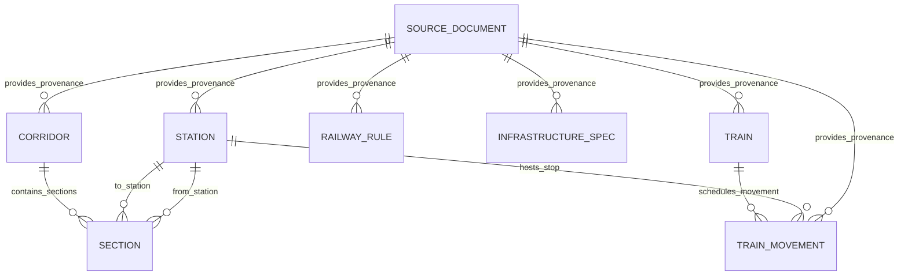

# TrackMeld Data Contracts & Schema Specification

**Document Version:** 1.0.0  
**Phase:** Phase 1 — Foundation & Canonical Data Model  
**Date:** October 2, 2026  
**Audience:** Railway Domain Engineers, API Consumers, Optimization Engine  

---

## 1. Core Principles & Provenance Invariants

TrackMeld enforces strict cryptographic and domain provenance for all railway network and operational entities.

### Data Classifications (`DataClass`)

| Classification | Definition | Mutability Invariant | Example |
| :--- | :--- | :--- | :--- |
| `REAL` | Unmodified fact extracted directly from official, authoritative Ministry of Railways or Railway Board publications. | Cannot be modified; authoritative baseline. | Station code `NDLS`, Train `12301` |
| `DERIVED` | Computationally generated from real official facts using documented deterministic logic (e.g. topological connectivity). | **Must never silently become `REAL`.** | Section `SEC-NDLS-GZB` derived from station chainages. |
| `SYNTHETIC` | Fictional or model-generated demonstration entities (e.g. candidate maintenance work orders, simulated gang shifts). | **Must never silently become `REAL` or `DERIVED`.** Must carry explicit synthetic generator manifest. | Maintenance Task `TSK-001` |
| `ASSUMED` | Engineering rules or heuristic operational parameters adopted for decision-support modeling awaiting formal railway validation. | Must be explicitly labeled unverified until formal authority sign-off. | Buffer clearance headway assumption |

---

## 2. Entity Relationship Diagram

---

## 3. Entity Specifications

### 3.1. Source Document (`source_documents`)

Stores metadata and cryptographic hashes of official railway publications.

| Field | Type | Nullable | Description |
| :--- | :--- | :--- | :--- |
| `source_id` | String(64) | No (PK) | Canonical identifier (e.g. `SRC-TAG-2023-TBL-01`) |
| `title` | String(256) | No | Official publication title |
| `publisher` | String(256) | No | Publishing authority (e.g. Railway Board, Ministry of Railways) |
| `organization` | String(256) | No | Railway administration (e.g. Indian Railways) |
| `source_class` | SourceClass Enum | No | `OFFICIAL_MINISTRY`, `OFFICIAL_RAILWAY_BOARD`, `OFFICIAL_CRIS`, etc. |
| `source_url` | Text | Yes | Official portal download URL |
| `local_path` | Text | Yes | Archive path in `data/raw/` |
| `file_size_bytes` | BigInt | Yes | Size of raw archive in bytes |
| `document_date` | String(32) | Yes | Publication date |
| `version` | String(64) | Yes | Edition string |
| `sha256` | String(64) | No | Cryptographic SHA-256 hash of raw file |
| `data_types` | JSON | No | Categories contained (`TRAINS`, `STATIONS`, `TIMETABLES`) |
| `authority_level` | String(128) | No | Statutory / Operational hierarchy |
| `notes` | Text | Yes | Explanatory annotations |

---

### 3.2. Station (`stations`)

Railway network node with geographic and divisional hierarchy.

| Field | Type | Nullable | Description |
| :--- | :--- | :--- | :--- |
| `station_id` | String(32) | No (PK) | Unique station ID (`STN-NDLS`) |
| `station_code` | String(16) | No (UQ, IX) | Official IR alphabetical code (`NDLS`) |
| `station_name` | String(128) | No | Full station name |
| `zone` | String(16) | No (IX) | Zonal Railway (`NR`, `NCR`, `CR`, `WR`, `SR`) |
| `division` | String(64) | No (IX) | Operating division (`Delhi`, `Prayagraj`, `Mumbai CR`) |
| `route` | String(128) | Yes | Primary corridor route |
| `route_km` | Float | Yes | Distance in KM from corridor datum |
| `station_type` | String(32) | No | `MAJOR_TERMINAL`, `TERMINAL`, `JUNCTION`, `WAY_STATION` |
| `classification` | DataClass Enum | No | Data origin (`REAL`) |
| `source_id` | String(64) | No (FK) | Reference to `source_documents.source_id` |
| `source_reference`| String(256) | Yes | Specific table/index citation |

---

### 3.3. Block Section (`sections`)

Contiguous running track between two block stations. Represents physical exclusivity unit for maintenance blocks.

| Field | Type | Nullable | Description |
| :--- | :--- | :--- | :--- |
| `section_id` | String(64) | No (PK) | Unique section ID (`SEC-NDLS-GZB`) |
| `section_code` | String(32) | No (UQ, IX) | Hyphenated station codes (`NDLS-GZB`) |
| `from_station_id` | String(32) | No (FK, IX) | Originating block station |
| `to_station_id` | String(32) | No (FK, IX) | Terminating block station |
| `routes` | JSON | No | Array of corridor routes sharing this section |
| `division` | String(64) | No (IX) | Responsible operating division |
| `zone` | String(16) | No (IX) | Zonal Railway |
| `kilometrage_start`| Float | No | Start chainage KM post |
| `kilometrage_end` | Float | No | End chainage KM post |
| `length_km` | Float | No (CK > 0) | Section length in kilometers |
| `track_count` | Integer | No | Number of running tracks (2 for UP/DN double line) |
| `electrified` | Boolean | No | 25 kV AC OHE status (True) |
| `gauge` | String(32) | No | Broad Gauge 1676mm |
| `signalling_type` | String(128) | No | Signalling standard (MACLS / Absolute / Automatic) |
| `classification` | DataClass Enum | No | `DERIVED` (from station kilometrage) |
| `derivation_method`| Text | Yes | Method description |
| `input_source_ids`| JSON | No | Array of `source_id`s used in topological derivation |
| `confidence` | Float | No | Confidence score [0.0 - 1.0] |

---

### 3.4. Train (`trains`)

Canonical train service operating over the Indian Railways network.

| Field | Type | Nullable | Description |
| :--- | :--- | :--- | :--- |
| `train_id` | String(32) | No (PK) | Unique train ID (`TRN-12301`) |
| `train_number` | String(16) | No (UQ, IX) | Official 5-digit number (`12301`) |
| `train_name` | String(256) | No | Official service name (`Howrah Rajdhani`) |
| `train_type` | String(64) | Yes (IX) | Category (`RAJDHANI`, `SHATABDI`, `MAIL_EXPRESS`, `VANDE_BHARAT`) |
| `source_station` | String(128) | Yes | Originating station name |
| `destination_station`| String(128)| Yes | Terminating station name |
| `corridor_table` | String(32) | Yes | Trains at a Glance table number |
| `running_days` | JSON | No | Frequency array (e.g. `["DAILY"]`) |
| `classification` | DataClass Enum | No | `REAL` |
| `source_id` | String(64) | No (FK) | Reference to `source_documents.source_id` |

---

### 3.5. Train Movement (`train_movements`)

Scheduled station stop or transit event along a timetable path.

| Field | Type | Nullable | Description |
| :--- | :--- | :--- | :--- |
| `movement_id` | String(64) | No (PK) | Unique movement ID (`MOV-12301-HWH-01`) |
| `train_id` | String(32) | No (FK, IX) | Reference to `trains.train_id` |
| `station_id` | String(32) | No (FK, IX) | Reference to `stations.station_id` |
| `stop_sequence` | Integer | No (CK >= 1)| 1-indexed order along route |
| `scheduled_arrival`| String(8) | Yes (IX) | 24-hr `HH:MM` arrival time (null for origin) |
| `scheduled_departure`| String(8)| Yes (IX) | 24-hr `HH:MM` departure time (null for destination) |
| `day_offset` | Integer | No | Day counter from origin (0, 1, 2) |
| `distance_km` | Float | No | Cumulative distance from origin |
| `movement_type` | String(32) | No | `SCHEDULED_ORIGIN`, `SCHEDULED_INTERMEDIATE_STOP`, `SCHEDULED_DESTINATION` |
| `basis` | String(32) | No | `SCHEDULED_TIMETABLE` |
| `classification` | DataClass Enum | No | `REAL` |
| `source_id` | String(64) | No (FK) | Reference to `source_documents.source_id` |

---

### 3.6. Railway Rule (`railway_rules`)

Statutory, operational, electrical, or signalling safety regulation governing maintenance possessions.

| Field | Type | Nullable | Description |
| :--- | :--- | :--- | :--- |
| `rule_id` | String(64) | No (PK) | Unique rule ID (`RULE-STAT-RBP-1502C`) |
| `category` | String(64) | No (IX) | `MAINTENANCE_PLANNING`, `TRAFFIC_BLOCK`, `POWER_BLOCK`, `S_AND_T` |
| `title` | String(256) | No | Rule title |
| `source_document` | String(256) | No | Parent publication name |
| `source_id` | String(64) | No (FK) | Reference to `source_documents.source_id` |
| `section_page` | String(256) | Yes | Chapter/rule clause reference |
| `original_text` | Text | No | Verbatim statutory or manual clause text |
| `normalized_summary`| Text | No | Operational interpretation for scheduler |
| `applicability` | String(128) | No | Scope of application |
| `safety_critical`| Boolean | No | True if violation breaches railway safety |
| `rule_class` | RuleClass Enum | No | `VERIFIED_SOURCE` |

---

## 4. Future Operational Data Boundary (Phase 2+)

TrackMeld defines an explicit interface boundary (`OperationalDataProvider` in [`backend/app/services/operational_provider.py`](file:///d:/Trackmeld/backend/app/services/operational_provider.py)) for future integration with internal Indian Railways systems:

1. **BDMS (Block Demand & Management System):**
   - Requisition of engineering, electrical, and S&T blocks.
   - Division-level granting and cancellation logs.
2. **TMS (Track Management System):**
   - P-Way asset inventory, rail wear, and USFD ultrasonic testing flaw alerts.
3. **COA (Control Office Application):**
   - Real-time train telemetry, section occupancy, and dispatch movements.

**Constraint:** In Phase 1, no mock adapters or fake implementations of BDMS/TMS/COA exist. Operational feeds remain deferred until authorized integration occurs.
