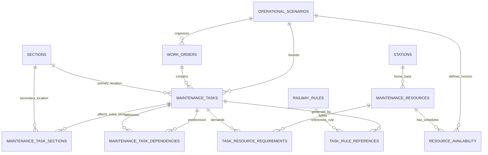

# TrackMeld Operational Data Contracts & Schema Specification

**Document Version:** 2.0.0  
**Phase:** Phase 2 — Operational Data Layer & Synthetic Grounding  
**Date:** October 2, 2026  
**Audience:** Railway Operations Engineers, API Consumers, Optimization Solver Engineers  

---

## 1. Architectural Scope & Invariants

TrackMeld strictly maintains the boundary between authoritative railway reference data (Phase 0/1) and operational planning requisitions (Phase 2):

```text
Railway Reference Layer (REAL / DERIVED)
   [stations, sections, corridors, trains, train_movements, rules, specs]
                             │
                             ▼ (referenced via FK)
Operational Planning Layer (SYNTHETIC for demo / RTI pending)
   [operational_scenarios, work_orders, maintenance_tasks,
    maintenance_resources, resource_availability, task_dependencies,
    maintenance_task_sections, task_rule_references]
```

### Key Invariants:
1. **Zero Mock CRIS/BDMS/TMS:** TrackMeld never fakes internal railway APIs. All operational simulation records are generated with a deterministic, reproducible seed and explicit `SYNTHETIC` classification.
2. **Provenance Traceability:** Every synthetic record carries `classification: SYNTHETIC` and `source_id: SRC-TRACKMELD-SYNTHETIC-GEN`.
3. **Temporal Validity:** For every entity with a temporal range, `start_time < end_time` is strictly enforced via database CHECK constraints and Pydantic validators.
4. **Physical Feasibility:** Task duration must not exceed window capacity: `0 < estimated_duration <= (window_end - window_start)`.
5. **Acyclic Dependencies:** Task dependencies are strictly distinct (`predecessor != successor`) and form a directed acyclic graph (DAG).
6. **Multi-Section Spatial Impact:** Maintenance work extending across adjacent sections (e.g., ballast cleaning, rail grinding, bridge rehabilitation) links primary and additional sections through `maintenance_task_sections`.

---

## 2. Entity-Relationship Diagram



---

## 3. Operational Entity Specifications

### 3.1. Operational Scenario (`operational_scenarios`)

Defines a discrete scheduling and simulation horizon for multi-department possessions.

| Field | Type | Constraint | Description |
| :--- | :--- | :--- | :--- |
| `scenario_id` | VARCHAR(64) | PK | Unique identifier (e.g. `SCN-DEMO-001`) |
| `scenario_code` | VARCHAR(32) | UNIQUE, INDEX | Business scenario key |
| `name` | VARCHAR(128) | NOT NULL | Scenario title |
| `description` | TEXT | NOT NULL | Scenario context and scope |
| `planning_start` | TIMESTAMPTZ | NOT NULL | Horizon start timestamp (UTC) |
| `planning_end` | TIMESTAMPTZ | NOT NULL | Horizon end timestamp (UTC, > planning_start) |
| `generation_seed` | INTEGER | NOT NULL | Random seed for deterministic reproducibility |
| `dataset_version` | VARCHAR(32) | NOT NULL | Pipeline version (e.g. `2.0.0`) |
| `classification` | DataClass Enum | NOT NULL | Fixed to `SYNTHETIC` |

### 3.2. Work Order (`work_orders`)

Departmental parent requisition grouping related maintenance activities under an authorized maintenance programme.

| Field | Type | Constraint | Description |
| :--- | :--- | :--- | :--- |
| `work_order_id` | VARCHAR(64) | PK | Unique identifier (e.g. `WO-0001`) |
| `work_order_number` | VARCHAR(32) | UNIQUE, INDEX | Business number (e.g. `WO-2026-10-001`) |
| `title` | VARCHAR(256) | NOT NULL | Work order title |
| `department` | WorkDepartment Enum | NOT NULL | `ENGINEERING`, `ELECTRICAL`, `S_AND_T`, `OPERATING`, `OTHER` |
| `requesting_unit` | VARCHAR(128) | NOT NULL | Subdivisional unit (e.g. `SSE/P-Way/GZB`) |
| `requested_by` | VARCHAR(128) | NOT NULL | Authorizing officer (e.g. `Sr.DEN(North)/DLI`) |
| `status` | WorkOrderStatus Enum | NOT NULL | `DRAFT`, `SUBMITTED`, `VALIDATED`, `PLANNED`, `APPROVED`, etc. |
| `priority` | TaskPriority Enum | NOT NULL | `CRITICAL`, `HIGH`, `MEDIUM`, `LOW` |
| `mandatory` | BOOLEAN | NOT NULL | Whether scheduling is mandatory under Rolling Block rules |
| `scenario_id` | VARCHAR(64) | FK -> `operational_scenarios` | Parent scenario |
| `requested_execution_start` | TIMESTAMPTZ | NOT NULL | Earliest permissible execution start |
| `requested_execution_end` | TIMESTAMPTZ | NOT NULL | Latest permissible execution end |
| `classification` | DataClass Enum | NOT NULL | `SYNTHETIC` |
| `source_id` | VARCHAR(64) | FK -> `source_documents` | `SRC-TRACKMELD-SYNTHETIC-GEN` |

### 3.3. Maintenance Task (`maintenance_tasks`)

Atomically schedulable maintenance job requiring track possession, safety buffers, crews, and machinery.

| Field | Type | Constraint | Description |
| :--- | :--- | :--- | :--- |
| `task_id` | VARCHAR(64) | PK | Unique identifier (e.g. `TSK-0001`) |
| `work_order_id` | VARCHAR(64) | FK -> `work_orders` | Parent work order |
| `task_code` | VARCHAR(32) | UNIQUE, INDEX | Business code (e.g. `TSK-TRK-001`) |
| `title` | VARCHAR(256) | NOT NULL | Task summary |
| `task_type` | TaskType Enum | NOT NULL | `TRACK_MACHINE_WORK`, `TRACK_MAINTENANCE`, `OHE_MAINTENANCE`, `SIGNAL_MAINTENANCE`, `BRIDGE_WORK`, `INSPECTION` |
| `status` | TaskStatus Enum | NOT NULL | `REQUESTED`, `PLANNED`, `APPROVED`, `EXECUTED`, `CANCELLED`, `POSTPONED` |
| `priority` | TaskPriority Enum | NOT NULL | Urgency level |
| `mandatory` | BOOLEAN | NOT NULL | Mandatory block requisition |
| `section_id` | VARCHAR(64) | FK -> `sections` | Primary block section affected |
| `station_id` | VARCHAR(32) | FK -> `stations` (Nullable) | Station yard reference if applicable |
| `corridor_id` | VARCHAR(64) | FK -> `corridors` (Nullable) | Corridor identifier |
| `scenario_id` | VARCHAR(64) | FK -> `operational_scenarios` | Scenario identifier |
| `window_start` | TIMESTAMPTZ | NOT NULL | Earliest allowed start |
| `window_end` | TIMESTAMPTZ | NOT NULL | Latest allowed finish |
| `preferred_start` | TIMESTAMPTZ | Nullable | Preferred start within window |
| `preferred_end` | TIMESTAMPTZ | Nullable | Preferred completion |
| `estimated_duration_minutes` | INTEGER | NOT NULL, > 0 | Job duration in minutes |
| `requires_traffic_block` | BOOLEAN | NOT NULL | Requires track block from operating authority |
| `requires_power_block` | BOOLEAN | NOT NULL | Requires 25 kV OHE isolation |
| `requires_ptw` | BOOLEAN | NOT NULL | Requires formal Permit to Work |
| `requires_ohe_isolation` | BOOLEAN | NOT NULL | Requires physical earthing and bonding |
| `requires_signal_disconnection`| BOOLEAN | NOT NULL | Requires S&T disconnection notice |
| `safety_buffer_before_minutes` | INTEGER | NOT NULL | Safety buffer before possession grant (default 15m) |
| `safety_buffer_after_minutes`  | INTEGER | NOT NULL | Safety buffer after track restoration (default 15m) |
| `crew_size_required` | INTEGER | NOT NULL, > 0 | Minimum workforce headcount |

### 3.4. Maintenance Resource (`maintenance_resources`)

Physical equipment, track machines, inspection cars, or specialized gangs required for task execution.

| Field | Type | Constraint | Description |
| :--- | :--- | :--- | :--- |
| `resource_id` | VARCHAR(64) | PK | Unique identifier (e.g. `RES-TM-CSM-01`) |
| `resource_code` | VARCHAR(32) | UNIQUE, INDEX | Equipment/gang code |
| `name` | VARCHAR(128) | NOT NULL | Full equipment/crew title |
| `resource_type` | ResourceType Enum | NOT NULL | `CREW`, `TRACK_MACHINE`, `OHE_EQUIPMENT`, `S_AND_T_EQUIPMENT`, `VEHICLE` |
| `department` | WorkDepartment Enum | NOT NULL | Responsible department |
| `capacity` | INTEGER | NOT NULL, > 0 | Concurrency capacity or crew headcount |
| `home_station` | VARCHAR(32) | FK -> `stations` (Nullable) | Base depot / station |
| `qualification_tags` | JSON | NOT NULL | Capabilities list (e.g. `["tamping", "plain_track"]`) |

### 3.5. Task Dependency (`maintenance_task_dependencies`)

Defines precedence relations between tasks.

| Field | Type | Constraint | Description |
| :--- | :--- | :--- | :--- |
| `dependency_id` | VARCHAR(64) | PK | Unique identifier (e.g. `DEP-0001`) |
| `predecessor_task_id` | VARCHAR(64) | FK -> `maintenance_tasks` | Task that must finish first |
| `successor_task_id` | VARCHAR(64) | FK -> `maintenance_tasks` | Task that begins after predecessor |
| `dependency_type` | DependencyType Enum | NOT NULL | Fixed to `FINISH_TO_START` |

---

## 4. API Endpoints for Operational Layer

| Method | Endpoint | Description |
| :--- | :--- | :--- |
| `GET` | `/api/v1/scenarios` | List scenarios with pagination |
| `GET` | `/api/v1/scenarios/{id}` | Get scenario metadata |
| `GET` | `/api/v1/scenarios/{id}/bundle` | Assembled solver bundle (tasks, resources, train movements, rules) |
| `GET` | `/api/v1/work-orders` | List work orders with department/status filtering |
| `GET` | `/api/v1/work-orders/{id}` | Work order details |
| `GET` | `/api/v1/tasks` | List maintenance tasks with section/status filtering |
| `GET` | `/api/v1/tasks/{id}` | Full task details with dependencies, resources, and rules |
| `GET` | `/api/v1/resources` | List resources with type/department filtering |
| `GET` | `/api/v1/resources/{id}` | Resource details |
| `GET` | `/api/v1/resources/{id}/availability` | Resource availability intervals across scenario |
