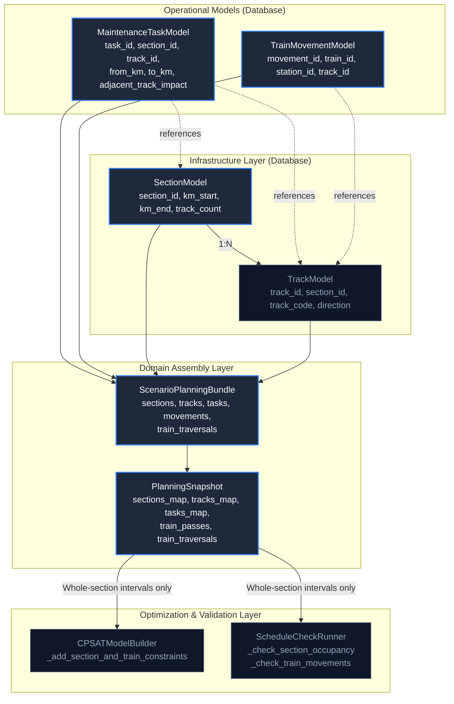

# Phase 16F: Track Conflict Semantics Discovery Report

**Phase:** Phase 16F — Track Conflict Semantics Discovery  
**Status:** Discovery / Architecture Complete  
**Date:** 2026-10-04  
**Author:** AI Coding Agent (Antigravity)  
**Baseline Commit:** `a0bd998` (`feat(phase-16e): add deterministic train traversal expansion`)  
**Product Boundary:** Rules classify $\rightarrow$ Optimization schedules $\rightarrow$ Independent Validator verifies $\rightarrow$ Human reviews $\rightarrow$ Human approves. Decision support only; no autonomous control, interlocking, signalling, or dispatch.

---

## 1. Executive Summary

Over Phases 16A through 16E-B, TrackMeld established the structural foundations for track-level domain modeling:
- **Phase 16A (`31e695e`):** Introduced `TrackModel`, `Track` domain entity, and 132 seeded tracks across 66 block sections.
- **Phase 16B (`2f4a5d3`):** Added maintenance task spatial coordinates (`track_id`, `from_km`, `to_km`).
- **Phase 16C (`0a7660b`):** Added train movement track semantics (`TrainMovementModel.track_id`).
- **Phase 16E-A (`84f8aa5`):** Added spatial safety foundation and provisional `adjacent_track_impact` enum (`NONE`, `CAUTION_ORDER`, `FULL_TRAFFIC_BLOCK`).
- **Phase 16E-B (`a0bd998`):** Established deterministic train traversal expansion (`TrainTraversal`), mapping multi-section express hops into physical block sections.

Throughout all these phases, a deliberate, strict safety boundary was maintained: **CP-SAT solver and Independent Schedule Validator continued enforcing whole-section resource exclusivity.** Two activities in the same section at the same time remain mutually exclusive regardless of track attribution.

**Phase 16F investigates the critical question:**  
*What exact domain semantics, rules, and infrastructure facts are required before TrackMeld can safely transition from whole-section exclusivity to track-aware scheduling without compromising safety?*

---

## 2. Current Semantics

TrackMeld's current scheduling and validation architecture operates on four distinct spatial concepts:

| Level | Current Implementation | Active Conflict Enforcer? | Behavior Today |
|---|---|---|---|
| **Section Occupancy** | `SectionModel`, `sections_map` | **YES (Primary)** | In CP-SAT (`CPSATModelBuilder`) and Validator (`ScheduleCheckRunner`), a section is treated as a monolithic mutex resource. Any overlapping interval on the same section causes infeasibility / error. |
| **Track Occupancy** | `TrackModel`, `track_id` | **NO (Informational)** | Seeded tracks exist under each section. Tasks and movements can store `track_id`, but neither CP-SAT nor the Validator uses `track_id` to separate conflict domains. |
| **Maintenance Worksite** | `MaintenanceTaskModel` (`from_km`, `to_km`) | **NO (Informational)** | Kilometrage bounds are validated against section boundaries $[km_{\text{start}}, km_{\text{end}}]$, but the possession lock is placed on the whole section ($0$ to $L_{\text{sec}}$). |
| **Train Traversal** | `TrainTraversal` (Phase 16E-B) | **NO (Derived Analysis)** | Expands station hops into physical sections with proportional timing. `traversal_track_id` is set to `None`. CP-SAT and Validator still check conflicts against parent `TrainPass.section_id`. |

---

## 3. Graph Trace: Existing Architecture



### Trace Findings:
1. `TrackModel` is isolated from conflict logic: in `CPSATModelBuilder._add_section_and_train_constraints()`, interval variables are grouped exclusively by `sec_id`.
2. In `ScheduleCheckRunner._check_section_occupancy()`, tasks are bucketed by `section_id`; overlap of possession windows on the same section triggers `SECTION_OCCUPANCY_CONFLICT`.
3. In `ScheduleCheckRunner._check_train_movements()`, train passes are indexed by `tp.section_id`; overlap triggers `TRAIN_MOVEMENT_CONFLICT`.
4. `adjacent_track_impact` is stored on `MaintenanceTaskModel` and transmitted in the bundle, but ignored during constraint formulation.

---

## 4. Section vs. Track Conflict Analysis

To allow two activities on different tracks within the same section to coexist, the conflict domain must shift from `SectionID` to `(SectionID, TrackID)` plus **Inter-Track Coupling Rules**.

### Concrete Coexistence Scenarios:

#### Scenario A: Track A occupied by Maintenance, Track B occupied by Train
- **Current Semantics:** **FORBIDDEN (Infeasible).**
  - CP-SAT: Both task possession $[t_{\text{pos\_start}}, t_{\text{pos\_end}})$ and train pass $[t_{\text{arr}}, t_{\text{dep}})$ are added to `section_intervals[sec_id]`. `AddNoOverlap` prevents coexistence.
  - Validator: Flags `TRAIN_MOVEMENT_CONFLICT`.
- **Can they physically coexist in reality?** YES, on double-line tracks, provided the maintenance work does not foul the adjacent running line.
- **Required Additional Railway Rule:**
  - *Structure Gauge Clearance Rule (IRPWM Para 807 / SOD):* Heavy machinery (e.g. Ballast Cleaning Machine, Track Relaying Train) swings during operation and fouls the standard 4.26m track center clearance, requiring an adjacent block. Hand packing or rail ultrasonic testing does not foul the adjacent line.
  - *Rule Logic Needed:* If `task.track_id == "TRK-UP"` and `train.track_id == "TRK-DN"`, coexistence is permitted **IF AND ONLY IF** `task.adjacent_track_impact == NONE`.

#### Scenario B: Track A occupied by Maintenance, Track B occupied by Maintenance
- **Current Semantics:** **FORBIDDEN.**
  - CP-SAT: `AddNoOverlap` on section possession envelopes rejects concurrent scheduling.
  - Validator: Flags `SECTION_OCCUPANCY_CONFLICT`.
- **Can they physically coexist in reality?** YES, under specific conditions.
- **When could both coexist?**
  1. `task_1.track_id != task_2.track_id` (different physical running lines).
  2. Neither task requires `FULL_TRAFFIC_BLOCK` of the adjacent track.
  3. *Traction Power Isolation Compatibility:* If both tasks require a Power Block (`requires_power_block == True`), are the two tracks on independent electrical switching sections (cantilever/portal isolation) or can both be de-energized simultaneously without blocking traffic elsewhere?
  4. *Logistical Non-Interference:* Depots, crossovers, and sidings used to stage machinery do not conflict.

#### Scenario C: Track A occupied by Train, Track B occupied by Train
- **Current Semantics:** Currently, timetable train passes are fixed inputs. However, if two trains cross the same section simultaneously in opposite directions (normal double-line railway operation), TrackMeld's current whole-section model would treat them as colliding if both passes were checked under section mutex.
- **Can they physically coexist in reality?** YES. Routine operational standard on double/multiple lines.
- **When could both coexist?**
  - Physical separation on dedicated directional tracks (`TRK-UP` vs `TRK-DN`).
  - Strict absence of route conflicting points (crossovers, station throats).

---

## 5. `FULL_TRAFFIC_BLOCK` Analysis

### Current Implementation:
- Defined in `backend/app/domain/enums.py`:
  ```python
  class AdjacentTrackImpact(str, Enum):
      NONE = "NONE"
      CAUTION_ORDER = "CAUTION_ORDER"
      FULL_TRAFFIC_BLOCK = "FULL_TRAFFIC_BLOCK"
  ```
- Stored on `MaintenanceTaskModel.adjacent_track_impact` (default `"NONE"`).
- **Feasibility Impact:** None (Purely descriptive metadata).
- **Validator Impact:** None.
- **Solver Impact:** None.

### Missing Operational Semantics:
1. **Target Track Specification:** In a 4-track section (e.g. `SEC-NDLS-GZB` with `UP_MAIN`, `DN_MAIN`, `UP_RELIEF`, `DN_RELIEF`), which adjacent track is affected? TrackMeld currently has no relative spatial adjacency matrix (e.g. `UP_MAIN` is adjacent to `DN_MAIN` and `UP_RELIEF`, but not `DN_RELIEF`).
2. **Coupled Possession Injection:** Operationally, a task on Track 1 with `FULL_TRAFFIC_BLOCK` must inject a shadow possession window on Track 2 for the exact duration of the machine deployment or structural fouling.
3. **Power Block Coupling:** A full traffic block often requires simultaneous 25 kV AC OHE de-energization across both tracks due to shared portal structures (IR OHE Manual Vol II).

---

## 6. `CAUTION_ORDER` Analysis

### Current Implementation:
- Exists solely as an enum option (`AdjacentTrackImpact.CAUTION_ORDER`).

### Capability Audit:

| Operational Dimension | Exists Today? | Missing Domain Concepts |
|---|---|---|
| **Reduced Speed Limit** | NO | No TSR entity (`restricted_speed_kmh`). `MaintenanceTask.speed_restriction_kmh` exists in schema but is unlinked. |
| **Temporary Speed Restriction (TSR)** | NO | No representation of permanent vs temporary engineering speed restrictions. |
| **Train Running-Time Impact** | NO | TrackMeld has no train running-time calculation engine (e.g. calculating $+4$ minutes deceleration/acceleration delay). Train passes have fixed timestamps. |
| **Protection Distance** | NO | Engineering protection zones (IRPWM: Caution board at 30m, Speed board at worksite, Terminal board at end, Detonators/Banner flags at 600m/1200m). |
| **Approach Restriction** | NO | No concept of signal aspects or driver notice sheets. |

**Discovery Conclusion:** `CAUTION_ORDER` cannot affect schedule feasibility without a train runtime expansion model. In scheduling decision support, its primary immediate role should be **diagnostic rule classification** (flagging that trains on the adjacent track require a Caution Order) rather than dynamic train deceleration math.

---

## 7. Track Continuity Analysis

### Investigation:
*Does TrackMeld know that `SEC-NDLS-GZB/UP_MAIN` connects to `SEC-GZB-KRJ/UP_MAIN`?*

**Verdict: NO.**
- Tracks are modeled with an isolated foreign key to `SectionModel`:
  ```python
  class TrackModel(Base):
      track_id: str          # e.g. "TRK-NDLS-GZB-UP"
      section_id: str        # e.g. "SEC-NDLS-GZB"
      track_code: str        # e.g. "UP"
      direction: str         # "UP"
  ```
- There is **no link, pointer, or topological graph** connecting `TRK-NDLS-GZB-UP` to `TRK-GZB-KRJ-UP`.
- `track_code = "UP"` is purely **local section metadata**.
- At station boundaries (e.g. `STN-GZB`), tracks enter a station yard. A station yard contains turnouts, crossovers, and platform loops. TrackMeld has zero yard or interlocking topology.
- **Therefore, a `track_id` CANNOT currently represent a physically continuous corridor running route.**

---

## 8. Directional Semantics

### Current Architecture:
- Tracks have `direction` (`UP`, `DOWN`, `BIDIRECTIONAL`).
- Sections have `from_station_id` and `to_station_id`.
- Train movements have scheduled times and an optional `track_id` (added in Phase 16C).

### Semantic Gaps:
1. **Undirected Traversal Expansion:** In Phase 16E-B, `expand_train_traversals` uses undirected section adjacency (`adj[u].append(v)` and `adj[v].append(u)`). It does not verify whether section traversal aligns with nominal UP/DOWN corridor direction.
2. **Direction Inconsistency Allowed:** A train moving in the DOWN direction can be assigned to an `UP` track without trigger or validation finding.
3. **No Wrong-Line (Reversible) Running Rules:** TrackMeld has no rules for temporary single-line working on double-line sections (e.g. running DOWN trains on UP line during UP line maintenance).

---

## 9. Single-Line Section Analysis

### Current Architecture:
- Sections have `track_count` (`1` for single line, `2` for double line).
- 132 seeded tracks exist (single-line sections have 1 track: `TRK-*-SL`, marked `BIDIRECTIONAL`).

### Operational Reality vs Current Code:
1. **Train vs. Train:** On a single-line section, opposite-direction trains cannot pass each other between stations. They must cross at stations with loop tracks. TrackMeld's current whole-section mutex **correctly prevents single-line train collision**, but cannot schedule crossing/precedence dwell at station loops.
2. **Maintenance vs. Train:** On a single line, any maintenance block constitutes a total line closure. Whole-section mutex **accurately models single-line maintenance closure**.
3. **Missing Rules:**
   - Station crossing loops: TrackMeld has no entity for crossing loops (`STN-LOOP`).
   - Line Clear / Absolute Block Token working: No token reservation semantics.

---

## 10. Adjacent-Track Protection Analysis

To turn `adjacent_track_impact` into an operationally verifiable constraint, the following taxonomy must be formalized:

```
[Worksite on Track A] 
       │
       ├── Impact = NONE 
       │     └── Track B operates at full line speed (isolated, safe separation)
       │
       ├── Impact = CAUTION_ORDER 
       │     └── Track B operates with TSR (e.g. 30 km/h) & Whistle Warning (personnel near track)
       │
       └── Impact = FULL_TRAFFIC_BLOCK 
             └── Track B is locked mutually exclusive with Worksite (heavy equipment fouling)
```

### Missing Physical Specifications:
- **Track Spacing (Track Centers):** Track distance $< 4.26\text{ m}$ automatically mandates `FULL_TRAFFIC_BLOCK` under Indian Railways SOD for heavy on-track tamping/screening machines.
- **Worksite Limits (`from_km` to `to_km`):** Work at km 12.0–14.0 on a 30 km section only fouls the adjacent track within that sub-interval, plus safety approach distances.

---

## 11. Train Traversal Analysis (Phase 16E-B Review)

### Strengths of Phase 16E-B:
1. Successfully resolves express train skips into exact ordered physical sections (e.g. 8 contiguous block sections for `12301` from `CNB` to `NDLS`).
2. Strictly conserves time intervals with zero rounding drift.
3. Correctly handles disconnected stations as `UNRESOLVED` without fabricating topology.

### Current Limitations:
- **`traversal_track_id` is deliberately `None`:** Running tracks are not assigned because track continuity across station throats is missing.
- **Audit:**
  - Topology-aware? **YES** (Uses station-to-station physical section graph).
  - Direction-aware? **NO** (Undirected graph traversal).
  - Track-continuity-aware? **NO** (Does not chain tracks).
  - Conflict-aware? **NO** (Derived independently of maintenance schedules).

---

## 12. Infrastructure Data Gap Matrix

| Concept | Exists? | Current Representation | Required Before Track-Aware Scheduling? |
|---|---|---|---|
| **Block Sections** | YES | `SectionModel` (`section_id`, `length_km`, endpoints) | Yes (Baseline exists) |
| **Tracks** | YES | `TrackModel` (`track_id`, `track_code`, `direction`) | Yes (Baseline exists) |
| **Track Direction** | YES | Enum (`UP`, `DOWN`, `BIDIRECTIONAL`) | Yes (Needs validator enforcement) |
| **Track Continuity** | **NO** | None (Tracks isolated to sections) | **YES** (Critical bottleneck) |
| **Station Yard Tracks / Loops** | **NO** | None (Stations are point entities) | High Priority for crossings |
| **Turnouts / Crossovers** | **NO** | None | Not required for initial linear track modeling |
| **Junctions** | Partial | `StationType.JUNCTION` (Metadata only) | Medium Priority |
| **Single-Line Crossing Loops** | **NO** | None | Medium Priority |
| **Adjacent-Track Adjacency Matrix** | **NO** | None (Tracks share section only) | **YES** (Needed for >2 tracks) |
| **Adjacent-Track Impact** | Partial | `AdjacentTrackImpact` (`NONE`, `CAUTION`, `BLOCK`) | Yes (Baseline enum exists) |
| **Temporary Speed Restrictions (TSR)**| **NO** | None | Medium Priority (Diagnostics first) |
| **Worksite Kilometrage Limits** | YES | `MaintenanceTask` (`from_km`, `to_km`) | Yes (Baseline exists) |
| **OHE Electrical Isolation Zones** | Partial | `Section.electrified`, `requires_power_block` | Medium Priority |
| **Train Route / Running Lines** | **NO** | Train movements have point `track_id` | **YES** |
| **Interlocking / Route Locking** | **NO** | None | Strictly out of scope (Decision support) |

---

## 13. Rules vs. Optimization Boundary

```
┌────────────────────────────────────────────────────────┐
│ 1. RULES CLASSIFY (Deterministic Domain Engine)         │
│    - Are Track A and Track B physically independent?    │
│    - Does Task A require an adjacent line block?        │
│    - Does Train direction match Track direction?        │
│    - Is OHE power block required and available?         │
│    → Outputs: Pre-validated Feasible Candidate Intervals│
└───────────────────────────┬────────────────────────────┘
                            │
┌───────────────────────────▼────────────────────────────┐
│ 2. OPTIMIZATION SCHEDULES (CP-SAT Solver)              │
│    - Accepts only rule-compatible spatial placements    │
│    - Optimizes objective: priority score maximization  │
│    - Solves resource, crew, and window constraints      │
└───────────────────────────┬────────────────────────────┘
                            │
┌───────────────────────────▼────────────────────────────┐
│ 3. INDEPENDENT VALIDATOR VERIFIES                      │
│    - Recomputes all spatial & safety rules from raw data│
│    - Never trusts solver claims                         │
└───────────────────────────┬────────────────────────────┘
                            │
┌───────────────────────────▼────────────────────────────┐
│ 4. HUMANS REVIEW & APPROVE (Railway Planners)          │
│    - Inspects conflicts, track assignments, and plans   │
│    - Issues official approvals/rejections               │
└────────────────────────────────────────────────────────┘
```

**Rule vs Solver Distinction:**
- CP-SAT must **never** be tasked with figuring out whether a train on Track 2 fouls a tamper on Track 1. That is a deterministic physical rule that must be evaluated **before** constructing solver intervals.
- CP-SAT's sole responsibility is combinatorial search: placing tasks into valid, rule-cleared possession windows to maximize maintenance productivity.

---

## 14. Independent Validator Implications

When TrackMeld moves to track-aware conflict checking, the Independent Validator must independently verify:
1. **Track-Level Exclusivity:** For tasks with `adjacent_track_impact == NONE`, verify no other activity occupies `task.track_id` on that section.
2. **Adjacent-Block Exclusivity:** For tasks with `adjacent_track_impact == FULL_TRAFFIC_BLOCK`, verify no train or task occupies **either** `task.track_id` OR the adjacent track.
3. **Directional Feasibility:** Verify that any train assigned to a track travels in a permitted direction (`UP` train on `UP` or `BIDIRECTIONAL` track).
4. **Zero Solver Trust:** The Validator must not inspect solver debug strings or CP-SAT presence variables. It must parse the persisted `ScheduledTaskPlacement` and cross-reference against the raw `PlanningSnapshot`.

---

## 15. Snapshot / Hash Implications

`PlanningSnapshot.compute_snapshot_hash()` guarantees reproducible planning identity:
- **Currently Hashed:**
  - `scenario_id`, `horizon.start`, `horizon.end`
  - `tasks`: `task_id`, `window_start`, `window_end`, `duration`, `section_id`
  - Count of `train_passes`, `resources`, `dependencies`
- **Future Track-Aware Fields that MUST become Hashed Identity Inputs:**
  - `task.track_id` (changes spatial resource identity)
  - `task.adjacent_track_impact` (changes feasibility domain)
- **Fields that must REMAIN UNHASHED (Derived / Descriptive):**
  - `train_traversals` (derived from timetable passes and sections)
  - Diagnostic reason strings
  - Direction metadata (unless dynamic)

---

## 16. Proposed Phase 16G Boundary

### The Smallest Defensible Next Implementation Phase:
**"Phase 16G — Directional & Track-Aware Spatial Compatibility Classification"**

### What Phase 16G Should Do:
1. **Extend `CompatibilityEngine` with Track-Level Rule Evaluation:**
   - Implement deterministic compatibility checks:
     - `check_track_exclusivity(task, candidate_interval, track_id)`
     - `check_adjacent_track_safety(task, adjacent_track_impact)`
     - `check_directional_alignment(train, track)`
2. **Add Track Adjacency Metadata to Double-Track Sections:**
   - Define paired adjacent tracks for double-line sections (e.g. `TRK-*-UP` $\leftrightarrow$ `TRK-*-DN`).
3. **Independent Validator Track-Aware Rule Module:**
   - Add non-breaking validation check for directional and adjacent track impact rules.
4. **Preserve Whole-Section Solver Default:**
   - Keep CP-SAT whole-section `AddNoOverlap` intact as the safe fallback baseline, with opt-in compatibility reporting.

### What Phase 16G Must NOT Do (Explicit Non-Goals):
- No interlocking or turnout modeling.
- No dynamic train deceleration math for caution orders.
- No real-time dispatch or signalling commands.
- No relaxing of single-line section exclusivity.

---

## 17. Explicit Non-Goals

1. **Autonomous Signalling/Dispatch:** TrackMeld will never issue movement authorities or interlocking route reservations.
2. **Microscopic Yard Simulators:** Simulating individual switch blades, frog angles, or point machines is outside TrackMeld's macro-corridor maintenance scope.
3. **Relaxing Safety Margins:** TrackMeld will never reduce statutory headway or possession buffer times below verified railway rules.

---

## 18. Open Questions

1. **Station Yard Demarcation:** Where does a block section end and a station interlocking begin? Currently, block sections meet directly at station nodes.
2. **Quadruple Line Adjacency:** On 4-track corridors (e.g. DLI-GZB), is the spatial order strictly `[UP_SLOW, UP_FAST, DN_FAST, DN_SLOW]` or paired by direction `[UP_FAST, DN_FAST, UP_SLOW, DN_SLOW]`?
3. **Power Block Electrical Sectioning:** Should electrical sub-sector isolation be modeled as a distinct resource alongside tracks?

---

## 19. Evidence & File References

- `SectionModel`: [`backend/app/db/models/section.py`](file:///d:/Trackmeld/backend/app/db/models/section.py)
- `TrackModel`: [`backend/app/db/models/track.py`](file:///d:/Trackmeld/backend/app/db/models/track.py)
- `MaintenanceTaskModel`: [`backend/app/db/models/task.py`](file:///d:/Trackmeld/backend/app/db/models/task.py)
- `AdjacentTrackImpact`: [`backend/app/domain/enums.py`](file:///d:/Trackmeld/backend/app/domain/enums.py#L142)
- `TrainTraversal`: [`backend/app/domain/temporal.py`](file:///d:/Trackmeld/backend/app/domain/temporal.py#L148)
- `CompatibilityEngine`: [`backend/app/services/compatibility_service.py`](file:///d:/Trackmeld/backend/app/services/compatibility_service.py)
- `CPSATModelBuilder`: [`backend/app/services/optimization/cp_sat_model.py`](file:///d:/Trackmeld/backend/app/services/optimization/cp_sat_model.py#L20)
- `ScheduleCheckRunner`: [`backend/app/services/validation/checks.py`](file:///d:/Trackmeld/backend/app/services/validation/checks.py#L36)
- `PlanningSnapshot`: [`backend/app/domain/planning_snapshot.py`](file:///d:/Trackmeld/backend/app/domain/planning_snapshot.py)
- `EntityInspector`: [`frontend/src/components/planning/EntityInspector.tsx`](file:///d:/Trackmeld/frontend/src/components/planning/EntityInspector.tsx)
