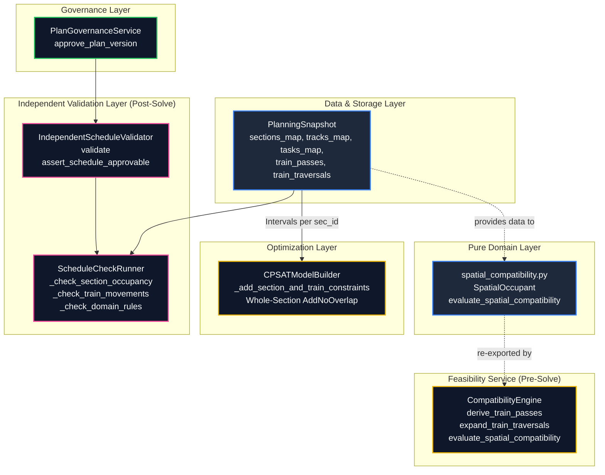

# Phase 16G-B: Independent Validator Spatial Compatibility Integration Discovery

**Phase:** Phase 16G-B — Independent Validator Spatial Compatibility Integration Discovery  
**Status:** Discovery & Contract Design Complete  
**Date:** 2026-10-04  
**Author:** AI Coding Agent (Antigravity)  
**Baseline Commit:** `a55cb19` (`feat(phase-16g): add deterministic track spatial compatibility foundation`)  
**Core Architectural Boundary:** Rules classify $\rightarrow$ Optimization schedules $\rightarrow$ Independent Validator verifies $\rightarrow$ Human reviews $\rightarrow$ Human approves. Decision support only; no autonomous dispatch, signalling, interlocking, or movement commands.

---

## 1. Executive Summary

Phase 16G-A successfully introduced `evaluate_spatial_compatibility()`, a deterministic domain classification engine capable of distinguishing:
- `COMPATIBLE` (e.g. non-adjacent tracks, or adjacent tracks with `NONE` or `CAUTION_ORDER` impact)
- `INCOMPATIBLE` (e.g. same physical track, adjacent track with `FULL_TRAFFIC_BLOCK`, direction mismatch, whole-section occupancy)
- `INSUFFICIENT_DATA` (e.g. unassigned tracks, missing adjacency metadata, unspecified task impact)

Phase 16G-B investigates how this deterministic classifier can be integrated into TrackMeld's **Independent Schedule Validator** (`IndependentScheduleValidator` / `ScheduleCheckRunner`) without introducing semantic divergence between:
1. **Mathematical Solver (`CPSATModelBuilder`):** Which currently enforces whole-section `AddNoOverlap`.
2. **Independent Validator (`ScheduleCheckRunner`):** Which currently verifies whole-section exclusivity (`SECTION_OCCUPANCY_CONFLICT`, `TRAIN_MOVEMENT_CONFLICT`).
3. **Compatibility Engine (`CompatibilityEngine`):** Which evaluates task feasibility pre-solve.
4. **Domain Classification Layer (`spatial_compatibility.py`):** Which evaluates pairwise track-level spatial relations.

### Key Discovery Conclusions:
1. **Validator Independence Must Be Strictly Preserved:** Under Phase 7 principles, the validator must never call `CompatibilityEngine` (the scheduler feasibility service). However, it CAN safely consume the pure, stateless domain function `evaluate_spatial_compatibility()` from `backend.app.domain.spatial_compatibility`.
2. **Whole-Section Mutex Must Remain the Active Authoritative Hard Barrier:** The validator cannot replace section-level occupancy checks with track-level compatibility until CP-SAT, turnout topology, and train speed reduction mechanics exist. Doing so prematurely would create false positives (validating schedules that CP-SAT cannot solve and that physical operations cannot safely dispatch without speed restrictions).
3. **Additive Diagnostic Value Today:** While track-level compatibility cannot yet relax section-level mutex, it provides immediate additive safety:
   - **Direction Conflict Detection:** Catches unidirectional track violations that whole-section checks completely miss.
   - **Caution Order Requirement Flagging:** Emits informational/warning findings alerting operators that adjacent track trains will require TSR / Caution Orders.
   - **Data Completeness Auditing:** Flags incomplete spatial metadata before an operator approves a plan.

---

## 2. Current Validator Flow

```mermaid
sequenceDiagram
    autonumber
    actor Planner as Human Planner / API
    participant Gov as PlanGovernanceService
    participant Val as IndependentScheduleValidator
    participant Runner as ScheduleCheckRunner
    participant Snap as PlanningSnapshot

    Planner->>Gov: Request Plan Approval
    Gov->>Val: assert_schedule_approvable(snapshot, schedule)
    Val->>Val: compute_schedule_identity(snapshot, schedule)
    Val->>Runner: run_all_checks()
    
    rect rgb(20, 30, 45)
        Note over Runner: 12 Deterministic Check Categories
        Runner->>Runner: 1. _check_structural()
        Runner->>Runner: 2. _check_horizon()
        Runner->>Runner: 3. _check_task_windows()
        Runner->>Runner: 4. _check_durations_and_buffers()
        Runner->>Runner: 5. _check_section_occupancy() [WHOLE-SECTION MUTEX]
        Runner->>Runner: 6. _check_multi_section_tasks()
        Runner->>Runner: 7. _check_train_movements() [WHOLE-SECTION MUTEX]
        Runner->>Runner: 8. _check_resources()
        Runner->>Runner: 9. _check_dependencies()
        Runner->>Runner: 10. _check_mandatory_tasks()
        Runner->>Runner: 11. _check_domain_rules()
        Runner->>Runner: 12. _check_solver_output_sanity()
    end

    Runner-->>Val: List[ValidationFinding]
    Val->>Val: Aggregate errors, warnings, info
    alt error_count > 0 or solver INFEASIBLE/UNKNOWN
        Val-->>Gov: ScheduleApprovalBlockedError (is_approvable=False)
        Gov-->>Planner: 422 Approval Blocked with Finding Details
    else error_count == 0
        Val-->>Gov: ScheduleValidationResult (is_approvable=True)
        Gov->>Gov: Transition to APPROVED state
        Gov-->>Planner: 200 Plan Version Approved
    end
```



### Trace Findings in Current Code:
1. In `ScheduleCheckRunner._check_section_occupancy()`:
   - Tasks are grouped strictly by `sec_id` (`section_id` + `additional_sections`).
   - Possession envelopes $[start_{\text{pos}}, end_{\text{pos}})$ are sorted by start time.
   - Any overlap between two tasks on the same `sec_id` produces:
     - `code="SECTION_OCCUPANCY_CONFLICT"`
     - `severity=ValidationSeverity.ERROR` (blocks approval).
2. In `ScheduleCheckRunner._check_train_movements()`:
   - Train passes are indexed by `tp.section_id`.
   - Any temporal overlap between a task possession envelope and a train pass on that section produces:
     - `code="TRAIN_MOVEMENT_CONFLICT"`
     - `severity=ValidationSeverity.ERROR` (blocks approval).
3. Neither check inspects `task.track_id`, `task.adjacent_track_impact`, `tp.track_id`, or `track.direction`.
4. Therefore, any schedule placing two tasks or a task and a train concurrently in the same section—even on completely separate tracks—is currently rejected as `INVALID` with `is_approvable = False`.

---

## 3. Graph Trace: Component Coupling & Data Flow



---

## 4. CP-SAT vs Validator vs Phase 16G-A Comparison Matrix

| # | Operational Scenario | Current CP-SAT Behavior | Current Validator Behavior | Phase 16G-A Evaluation | Semantic Agreement? | Safety of Direct Integration | Missing Domain Facts |
|---|---|---|---|---|---|---|---|
| **1** | Same section, same track (`TRK-UP` & `TRK-UP`) | Rejects concurrently (`AddNoOverlap`) | Rejects (`SECTION_OCCUPANCY_CONFLICT`, ERROR) | `INCOMPATIBLE` (`SAME_TRACK_OVERLAP`) | **AGREE** (All reject) | **SAFE** | None. Physical clash on identical line. |
| **2** | Same section, different tracks, non-adjacent (e.g. 4-track outer lines) | Rejects concurrently (`AddNoOverlap`) | Rejects (`SECTION_OCCUPANCY_CONFLICT`, ERROR) | `COMPATIBLE` (`DIFFERENT_TRACKS_INDEPENDENT`) | **DIVERGENT** (CP-SAT/Val reject; 16G-A allows) | **UNSAFE TO RELAX VALIDATOR ALONE** | Turnout/throat route clearing at stations. |
| **3** | Same section, adjacent tracks, task `FULL_TRAFFIC_BLOCK` | Rejects concurrently (`AddNoOverlap`) | Rejects (`SECTION_OCCUPANCY_CONFLICT`, ERROR) | `INCOMPATIBLE` (`ADJACENT_TRACK_FULL_BLOCK`) | **AGREE** (All reject) | **SAFE** | Structural gauge fouling verified. |
| **4** | Same section, adjacent tracks, task `NONE` | Rejects concurrently (`AddNoOverlap`) | Rejects (`SECTION_OCCUPANCY_CONFLICT`, ERROR) | `COMPATIBLE` (`DIFFERENT_TRACKS_INDEPENDENT`) | **DIVERGENT** | **UNSAFE TO RELAX VALIDATOR ALONE** | OHE portal/cantilever power isolation. |
| **5** | Same section, adjacent tracks, task `CAUTION_ORDER` | Rejects concurrently (`AddNoOverlap`) | Rejects (`SECTION_OCCUPANCY_CONFLICT`, ERROR) | `COMPATIBLE` (Requires Caution Order) | **DIVERGENT** | **UNSAFE TO RELAX VALIDATOR ALONE** | TSR speed limit, train runtime expansion (+4 min delay). |
| **6** | Same section, missing track metadata (`track_id` not in `tracks_map`) | Rejects concurrently (`AddNoOverlap`) | Rejects (`SECTION_OCCUPANCY_CONFLICT`, ERROR) | `INSUFFICIENT_DATA` (`MISSING_TRACK_METADATA`) | **PARTIAL** (All block scheduling) | **SAFE** (Conservative block maintained) | Infrastructure asset register incomplete. |
| **7** | Same section, missing adjacency metadata (`adjacent_track_ids` is `None`) | Rejects concurrently (`AddNoOverlap`) | Rejects (`SECTION_OCCUPANCY_CONFLICT`, ERROR) | `INSUFFICIENT_DATA` (`MISSING_ADJACENCY_METADATA`) | **PARTIAL** (All block scheduling) | **SAFE** | Inter-track spacing (track centers distance). |
| **8** | Same section, adjacent tracks, task `adjacent_track_impact` is `None` | Rejects concurrently (`AddNoOverlap`) | Rejects (`SECTION_OCCUPANCY_CONFLICT`, ERROR) | `INSUFFICIENT_DATA` (`UNSPECIFIED_SPATIAL_RELATION`) | **PARTIAL** | **SAFE** | Worksite equipment clearance classification. |
| **9** | Different sections | Places independently | Passes (no conflict) | `COMPATIBLE` (`DIFFERENT_SECTIONS`) | **AGREE** (All allow) | **SAFE** | None. Independent block sections. |
| **10** | No temporal overlap | Places sequentially | Passes (no conflict) | `COMPATIBLE` (`NO_TEMPORAL_OVERLAP`) | **AGREE** (All allow) | **SAFE** | None. Disjoint time intervals. |
| **11** | Missing/unknown section (`section_id` is `None`) | Excluded / invalid input | Fails structural check | `INSUFFICIENT_DATA` (`UNKNOWN_SECTION`) | **AGREE** (All reject) | **SAFE** | Station / section topology. |
| **12** | Direction mismatch (e.g. DOWN train on UP-only track) | **ACCEPTS** (Ignores track direction!) | **PASSES** (Ignores track direction!) | `INCOMPATIBLE` (`DIRECTION_CONFLICT`) | **CRITICAL GAP** (CP-SAT & Val miss; 16G-A catches) | **HIGH-VALUE INTEGRATION** | Signalling / interlocking reversible running rules. |

---

## 5. Compatibility Mismatch & Divergence Analysis

### Analysis of Asymmetry Between Optimization and Validation:

#### Case A: CP-SAT Rejects, but 16G-A Classifies `COMPATIBLE`
- **Concrete Example:** Task A on `TRK-SEC-01-UP` and Task B on `TRK-SEC-01-DN` both have `adjacent_track_impact = NONE`.
- **System Outcome:** CP-SAT enforces whole-section `AddNoOverlap` on `SEC-01`, placing Task B in a later window or leaving it unscheduled.
- **Is this a bug?** NO. It is a **conservative over-constraint**. In safety-critical railway planning, scheduling fewer concurrent possessions is safe.
- **Can the Validator relax this today?** NO. If the validator were modified to allow concurrent tasks on different tracks, but CP-SAT never schedules them, the relaxation would be dead code for solver plans. But if a manual schedule were injected, passing it without TSR/OHE power isolation verification would violate real-world safety.

#### Case B: CP-SAT Accepts, but 16G-A Classifies `INCOMPATIBLE`
- **Concrete Example:** A train pass or task is assigned to `TRK-SEC-01-UP` (unidirectional UP line), but the train is traveling in the DOWN direction.
- **System Outcome Today:** Because CP-SAT only checks whether `sec_id` is temporally available, it schedules the task/train. The validator only checks section overlap, so it issues 0 errors and marks the plan `is_approvable = True`!
- **Severity:** **SAFETY GAP**. A plan with an unauthorized wrong-line running assignment is currently certifiable!
- **Remedy in 16G-C:** Adding a track direction validation check in `ScheduleCheckRunner` directly closes this gap without touching CP-SAT.

#### Case C: CP-SAT Rejects, but 16G-A Classifies `INSUFFICIENT_DATA`
- **Concrete Example:** Task on `TRK-01` where `adjacent_track_ids` is `None`.
- **System Outcome:** CP-SAT rejects concurrent section use. 16G-A flags `INSUFFICIENT_DATA` (`MISSING_ADJACENCY_METADATA`). Both prevent coexistence, but 16G-A explains that the refusal is due to missing data rather than physical track collision.

---

## 6. Train Traversal Boundary

In Phase 16E-B, `expand_train_traversals` expanded multi-station train passes into ordered physical block sections (`TrainTraversal`).

### Critical Traversal Fact:
In `TrainTraversal`:
```python
traversal_track_id: Optional[str] = None
```
Under Phase 16E-B requirements, `traversal_track_id` was deliberately left unassigned (`None`) because TrackMeld does not model station yard throat turnouts, crossovers, or track continuity across stations.

### Consequence for Phase 16G-A Evaluator:
Rule 4 in `evaluate_spatial_compatibility`:
```python
if occupant_1.track_id is None or occupant_2.track_id is None:
    return TrackSpatialCompatibilityResult(
        status=SpatialCompatibilityStatus.INCOMPATIBLE,
        reason=SpatialCompatibilityReason.WHOLE_SECTION_OCCUPANCY,
        ...
    )
```
### Deduction:
1. Because `traversal_track_id` is `None`, evaluating any `TrainTraversal` against a `MaintenanceTask` via 16G-A will **ALWAYS evaluate to `INCOMPATIBLE` (`WHOLE_SECTION_OCCUPANCY`)**.
2. Evaluating `TrainTraversal` vs `TrainTraversal` will likewise **ALWAYS evaluate to `INCOMPATIBLE` (`WHOLE_SECTION_OCCUPANCY`)**.
3. Therefore, until a deterministic corridor route/track assignment algorithm is developed, track-level spatial compatibility **CANNOT differentiate train traversals by track**. Whole-section train clearance remains the only mathematically valid barrier for traversals.

---

## 7. `INSUFFICIENT_DATA` Handling Analysis

When spatial metadata is incomplete, how should the Independent Validator respond?

| Option | Behavior | Impact on Approval Gate | Assessment |
|---|---|---|---|
| **Option 1: Validation ERROR** | Every `INSUFFICIENT_DATA` produces `ValidationSeverity.ERROR`. | Blocks approval completely (`is_approvable = False`). | **REJECTED.** Many historical tasks have `track_id = NULL` (whole-section tasks) or unspecified adjacent impact. Blocking approval on all such tasks would break backward compatibility and fail existing valid plans. |
| **Option 2: Silent Pass** | Treat `INSUFFICIENT_DATA` as non-blocking; ignore findings. | Allows approval without notice. | **REJECTED.** Violates audit and transparency principles. |
| **Option 3: Two-Tier Governance (Recommended)** | If whole-section rules already catch the conflict, section error blocks. If activities are non-conflicting at section level, but spatial metadata is missing, emit `ValidationSeverity.INFO` or `WARNING`. If an activity explicitly claims track independence on adjacent tracks but has `adjacent_track_impact = NULL`, emit `ValidationSeverity.WARNING`. | Preserves backward compatibility while surfacing data quality debt. | **RECOMMENDED.** Aligns with TrackMeld's core philosophy: *Humans approve, AI explains, rules classify.* |

---

## 8. Validator Independence Analysis

### The Phase 7 Architectural Mandate:
> *"The validator is an independent post-solve safety gate. It does NOT call the Phase 4 CompatibilityEngine to verify placements; it evaluates the schedules from first principles."*

### Why this matters:
If the validator calls `CompatibilityEngine.evaluate_spatial_compatibility()`, it creates a transitive dependency on the scheduling engine. If a future developer modifies `CompatibilityEngine` to use optimistic heuristic relaxations for greedy scheduling, the validator would inherit those relaxations, creating **self-certification**.

### Architecture Review:
In Phase 16G-A, the classification logic was implemented as a pure domain function:
```
backend.app.domain.spatial_compatibility.evaluate_spatial_compatibility
```
`CompatibilityEngine` merely imports and delegates to this domain function.

### Architectural Recommendation:
1. **Do NOT call `CompatibilityEngine` from `ScheduleCheckRunner`.**
2. **DO import pure domain models and functions directly from `backend.app.domain.spatial_compatibility`.**
3. In `ScheduleCheckRunner`, implement dedicated validator checks (`_check_track_spatial_compatibility`) that translate `TrackSpatialCompatibilityResult` into first-class `ValidationFinding` records with appropriate `ValidationSeverity`.

---

## 9. Snapshot / Replay Requirements

To reproduce spatial compatibility decisions deterministically without database queries or dynamic state:

| Spatial Fact | Source in `PlanningSnapshot` | Status Today |
|---|---|---|
| `task.track_id` | `snapshot.tasks_map[task_id].track_id` | **Available** (Phase 16A/B) |
| `task.from_km` / `to_km` | `snapshot.tasks_map[task_id].from_km` | **Available** (Phase 16B) |
| `task.adjacent_track_impact` | `snapshot.tasks_map[task_id].adjacent_track_impact` | **Available** (Phase 16E-A) |
| `track.direction` | `snapshot.tracks_map[track_id].direction` | **Available** (Phase 16A) |
| `track.adjacent_track_ids` | `snapshot.tracks_map[track_id].adjacent_track_ids` | **Available** (Phase 16G-A) |
| `train_movement.track_id` | `snapshot.train_movements_map[movement_id].track_id` | **Available** (Phase 16C) |
| `train_traversal` | `snapshot.train_traversals` | **Available** (Phase 16E-B) |

### Hashing Invariant:
- `compute_snapshot_hash()` hashes `scenario_id`, horizon boundaries, and sorted task IDs.
- `compute_schedule_identity()` hashes task placement intervals, sections, and resources.
- Adding spatial compatibility checks to the validator requires **ZERO changes to snapshot or schedule identity hashing**.

---

## 10. Test Strategy for Validator Integration

Before implementing Phase 16G-C, the following test suite must be designed:

1. **Validator Regression Tests (Non-Negotiable Baseline):**
   - All 34 existing CP-SAT and Phase 7 validator tests must pass with 100% identical findings and approval gate statuses.
2. **Direction Alignment Tests:**
   - Schedule with DOWN train on UP-only track $\rightarrow$ Must produce `ValidationFinding` with code `DIRECTION_CONFLICT` and severity `ERROR`.
   - Schedule with UP train on BIDIRECTIONAL track $\rightarrow$ Must pass direction check.
3. **Caution Order Diagnostic Tests:**
   - Schedule with Task on `TRK-UP` (`CAUTION_ORDER`) and non-overlapping section usage $\rightarrow$ Emits `INFO`/`WARNING` finding detailing TSR requirement.
4. **Data Completeness Tests:**
   - Task assigned to nonexistent `track_id` $\rightarrow$ Must produce `MISSING_TRACK_METADATA` finding.
   - Task on track with `adjacent_track_ids = None` $\rightarrow$ Emits `MISSING_ADJACENCY_METADATA` finding.
5. **Independence Tests:**
   - Verify `backend/app/services/validation/checks.py` does NOT import `CompatibilityEngine`.

---

## 11. Proposed Phase 16G-C Implementation Boundary

### Phase Title:
**Phase 16G-C — Track-Aware Validator Diagnostic & Safety Extension**

### What Phase 16G-C Should Implement:
1. **New Check Method in `ScheduleCheckRunner`:**
   - `_check_track_spatial_safety()`:
     - Iterates through scheduled tasks and their assigned tracks.
     - Verifies track existence in `snapshot.tracks_map`.
     - Verifies direction compatibility between task/train and track.
     - Evaluates pairwise spatial compatibility for tasks sharing section boundaries.
2. **New Validation Finding Codes:**
   - `TRACK_DIRECTION_CONFLICT` (`ERROR`): Activity assigned against running direction on unidirectional track.
   - `ADJACENT_TRACK_CAUTION_REQUIRED` (`INFO`): Adjacent line coexistence requires Caution Order.
   - `ADJACENT_TRACK_FOULING_RISK` (`WARNING`): Adjacent task has unspecified impact.
   - `INVALID_TRACK_ASSIGNMENT` (`ERROR`): `track_id` not found in corridor infrastructure.
3. **What Remains STRICTLY Unchanged:**
   - `_check_section_occupancy()` remains active with whole-section `AddNoOverlap` check (`ERROR`).
   - `_check_train_movements()` remains active with whole-section train pass check (`ERROR`).
   - `CPSATModelBuilder` remains 100% whole-section mutex.
   - Solver objective and constraint formulations are untouched.
   - Governance approval state machine (`assert_schedule_approvable`) remains untouched.

---

## 12. Explicit Non-Goals

1. **No CP-SAT Track Relaxation in 16G-C:** CP-SAT will continue scheduling at whole-section granularity.
2. **No Turnout / Interlocking Modeling:** Station throat routes and point machines will not be synthesized.
3. **No Dynamic Train Runtime Math:** Validator will not calculate speed deceleration curves.
4. **No Replacement of Section Occupancy:** Whole-section collision checks will not be deleted or bypassed.

---

## 13. Open Questions

1. **Should Caution Orders Affect Approvability?** Under Indian Railways practice, a Caution Order does not block work; it is an operational prerequisite. Emitting it as `INFO` or `WARNING` keeps the plan approvable while notifying dispatchers.
2. **When Should CP-SAT Become Track-Aware?** Only after validator diagnostics have been verified in real-world benchmark scenarios, and after inter-track power isolation (OHE) is formalized.

---

## 14. Evidence & File References

- Phase 16F Discovery Report: [`docs/PHASE_16F_TRACK_CONFLICT_SEMANTICS_DISCOVERY.md`](file:///d:/Trackmeld/docs/PHASE_16F_TRACK_CONFLICT_SEMANTICS_DISCOVERY.md)
- Phase 16G-A Foundation Report: [`docs/PHASE_16G_A_TRACK_SPATIAL_COMPATIBILITY_FOUNDATION.md`](file:///d:/Trackmeld/docs/PHASE_16G_A_TRACK_SPATIAL_COMPATIBILITY_FOUNDATION.md)
- Spatial Compatibility Domain: [`backend/app/domain/spatial_compatibility.py`](file:///d:/Trackmeld/backend/app/domain/spatial_compatibility.py)
- Schedule Check Runner: [`backend/app/services/validation/checks.py`](file:///d:/Trackmeld/backend/app/services/validation/checks.py)
- Independent Schedule Validator: [`backend/app/services/validation/validator.py`](file:///d:/Trackmeld/backend/app/services/validation/validator.py)
- CP-SAT Model Builder: [`backend/app/services/optimization/cp_sat_model.py`](file:///d:/Trackmeld/backend/app/services/optimization/cp_sat_model.py)
- Plan Governance Service: [`backend/app/services/plan_governance_service.py`](file:///d:/Trackmeld/backend/app/services/plan_governance_service.py)
