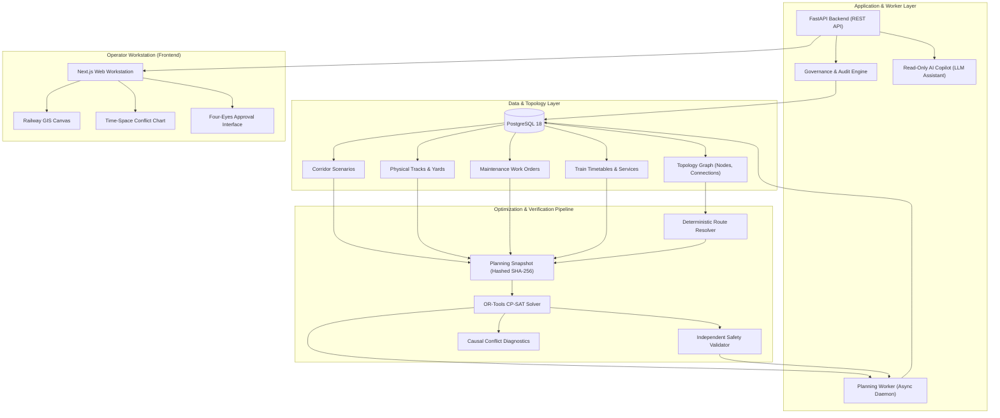

# TrackMeld: System Architecture & Technical Portfolio Reference

## Executive Overview

**TrackMeld** is an advanced railway maintenance possession planning and operational decision-support platform.

### What It Does
TrackMeld coordinates engineering possession windows across railway corridors by solving complex multi-track spatial-temporal scheduling problems. It reconciles conflicting maintenance requests against scheduled commercial train movements, physical track geometry, traction power isolations, machinery fleets, and gang resource constraints.

### Why It Matters
In high-density mixed-traffic railway networks, allocating track blocks requires balancing infrastructure safety with network throughput. Manual or heuristic planning often leads to possession cancellations, delayed trains, or compromised safety buffers. TrackMeld replaces ad-hoc scheduling with mathematically sound, deterministic constraint programming and transparent human review.

### How It Operates
TrackMeld adheres to a fundamental operating principle:
```
[Rules Classify] ➔ [CP-SAT Optimizes] ➔ [Independent Validator Verifies] ➔ [Human Reviews] ➔ [Four-Eyes Approves]
```

---

## Technical Highlights

| Architectural Layer | Core Capabilities & Innovations |
|---|---|
| **Deterministic Snapshots** | Assembles immutable in-memory snapshots with 64-character SHA-256 content hashes, guaranteeing exact reproducibility across runs regardless of input list permutation. |
| **Mathematical Optimization** | Leverages Google OR-Tools CP-SAT with native interval modeling, multi-track disjunctive constraints (`AddNoOverlap`), and adjacent-track caution orders. |
| **Physical Topology Model** | Represents railway infrastructure via `TopologyNode`, `TrackEndpoint`, and `TopologyConnection` entities, enabling continuous physical path tracing. |
| **Deterministic Route Resolution** | Resolves commercial timetable train movements into physical track-level traversals using deterministic graph traversal algorithms. |
| **Independent Verification** | Employs an isolated 12-rule auditor that validates generated schedules without sharing solver state or algorithmic heuristics. |
| **Causal Diagnostics** | Pinpoints root causes for unscheduled tasks, distinguishing train headway conflicts, resource contentions, and window constraints. |
| **Asynchronous Job Worker** | Background daemon architecture with distributed job claiming, heartbeat tracking, timeout trapping (120s), and cooperative cancellation. |
| **Four-Eyes Governance** | Hardened state machine with database-level role enforcement, strictly barring plan creators from approving their own candidate plans. |
| **Immutable Audit Logging** | Append-only relational audit trail documenting actor identity, timestamps, transition types, and justification text for all governance events. |
| **Read-Only AI Copilot** | Specialized assistant providing grounded explanations and diagnostics using typed read-only retrieval tools without write or approval permissions. |
| **Modern Web Workstation** | Next.js 16 with Turbopack, Tailwind CSS, progressive disclosure UI, multi-track time-space diagram, GIS canvas, and full browser E2E test coverage. |

---

## System Architecture Diagram



---

## Core Invariants & Boundaries

TrackMeld enforces strict conceptual and operational boundaries:

### Mathematical Invariants
- **`COMPLETED != APPROVED`**: Run completion merely indicates that computation finished successfully.
- **`OPTIMAL != APPROVED`**: Mathematical optimality within the solver objective does not equal operational approval.
- **`FEASIBLE != APPROVED`**: Constraint satisfaction is an engineering prerequisite, not an operating certificate.
- **`VALID != APPROVED`**: Passing all 12 independent safety checks proves constraint compliance, but never grants track possession.
- **`VALIDATION != APPROVAL`**: Verification is automated; approval requires human engineering responsibility.
- **`CREATOR != APPROVER`**: Enforced Four-Eyes governance prevents candidate creators from self-approving.
- **`AI EXPLAINS != AI APPROVES`**: The AI Copilot has zero mutation authority and cannot approve or reject plans.

### Operational Boundaries
- **Advisory Decision Support**: TrackMeld generates recommended possession plans for human engineering review.
- **Not Signalling / Interlocking**: TrackMeld does not send electrical interlocking commands, clear signals, or lock turnout switches.
- **Not Autonomous Dispatch**: TrackMeld does not issue live dispatch instructions to train drivers or station masters.
- **Not SIL Certified**: TrackMeld is an engineering prototype and has not undergone formal CENELEC EN 50128 SIL certification.

---

## Verification & Quality Metrics

- **Backend Unit Tests**: 310 tests passing
- **Backend Integration Tests**: 148 tests passing
- **Frontend Playwright E2E**: 14 tests passing across 5 browser specs
- **Frontend ESLint**: 0 errors, 0 warnings
- **TypeScript**: 0 errors across frontend and backend
- **Total Automated Test Suite**: 472 / 472 tests passing (100%)
- **Solve Performance**: 20 ms for standard corridor scenario (30 tasks, 12 trains)
- **Validation Performance**: 2.1 ms for comprehensive 12-rule audit

---

## Conclusion

TrackMeld demonstrates the synthesis of modern mathematical optimization (CP-SAT), software engineering discipline (reproducible snapshots, decoupled validation, four-eyes governance), and intuitive user experience for high-stakes infrastructure decision support.
