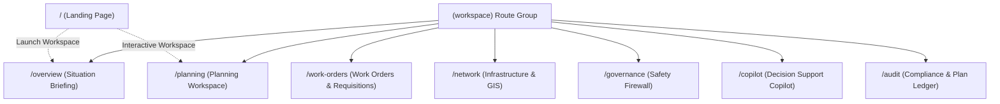

# Report A — Application Structure & Engineering Architecture

**Document ID:** `TM-FRONTEND-AUDIT-01`  
**Target:** TrackMeld Railway Maintenance Planning & Digital Twin Platform  
**Inspection Date:** October 14, 2026  
**Auditor:** Principal Frontend Systems Architect & Railway Simulation Engineer  
**Scope:** Source code discovery, dependencies, routing, layout shell, and component hierarchies under `frontend/`

---

## 1. Core Framework & Runtime Dependencies

The TrackMeld frontend is an enterprise web application built on **Next.js 16.3.8** utilizing the React 19 App Router architecture with Turbopack compilation and client-side 3D WebGL rendering.

### Primary Package Manifest (`frontend/package.json`)

| Package | Version | Architectural Role in TrackMeld |
| :--- | :--- | :--- |
| `next` | `16.3.8` | App Router framework, server/client hybrid rendering, file-based routing |
| `react` / `react-dom` | `19.2.8` | Core UI engine, React 19 concurrent features, `useSyncExternalStore` hydration protection |
| `tailwindcss` | `^4.0.0` | Utility-first CSS styling engine configured via `@tailwindcss/postcss` |
| `three` | `^0.186.1` | Core WebGL 3D graphics library for corridor and rolling stock digital twin |
| `@react-three/fiber` | `^9.8.1` | Declarative Three.js scene graph bindings for React 19 |
| `@react-three/drei` | `^10.7.9` | 3D helpers, shader lofts, text billboards, and camera rigs |
| `maplibre-gl` | `^6.13.0` | Open-source vector tile & GIS renderer for 440 km Northern Corridor spatial maps |
| `lucide-react` | `^1.50.0` | Enterprise iconography system across sidebar, inspection drawers, and status indicators |
| `framer-motion` | `^14.0.0` | Hardware-accelerated UI transitions, docked drawer animations, and toast effects |
| `@base-ui/react` | `^1.8.0` | Accessible unstyled primitives used in select UI elements |
| `clsx` / `tailwind-merge` | `^2.1.1` / `^3.7.0` | Class condition resolution via `@/lib/utils.ts` (`cn` helper) |
| `@playwright/test` | `^1.63.0` | End-to-end browser automation, viewport audits, and screenshot captures |
| `typescript` | `^5.0.0` | Static type checking and strict domain contracts (`strict: true`) |

---

## 2. Application Entry Points & Global Configuration

The application boots through standard Next.js App Router root primitives:

```
frontend/src/
├── app/
│   ├── layout.tsx         # Global Root Layout (Fonts, Dark Theme, TooltipProvider)
│   ├── globals.css        # Global CSS variables, scrollbars, monospaced font declarations
│   ├── favicon.ico        # Railway brand favicon
│   ├── page.tsx           # Public Root Route (/) — Marketing & 3D Interactive Landing
│   └── (workspace)/       # Route Group for Operational Workspace Pages
```

### Root Layout (`frontend/src/app/layout.tsx`)
- Configures two Google Fonts with display swapping:
  - `Inter`: Primary sans-serif user interface typography.
  - `IBM Plex Mono`: High-density railway operational data, timestamps, chainages, and train IDs.
- Sets global dark mode root: `html.dark.h-full.antialiased` with background `#0A0A0A` and text `#F5F5F5`.
- Wraps entire children tree with `<TooltipProvider delay={200}>` from `@/components/ui/tooltip`.
- Defines canonical metadata and platform description.

### Global Stylesheet (`frontend/src/app/globals.css`)
- Imports `@import "tailwindcss";`.
- Configures custom scrollbars (`::-webkit-scrollbar` with width `5px`, track `#0A0E17`, thumb `#1E2D4A`).
- Declares railway utility classes for table rows, monospaced tabular data, and high-contrast status pills.

---

## 3. Routing Architecture

TrackMeld implements a file-system App Router structure consisting of **8 distinct routes**: 1 public marketing/showcase page and 7 operational workspace pages grouped under `(workspace)`.



### Registered Routes Manifest

| Route Path | File System Location | Primary Component | Workspace Shell |
| :--- | :--- | :--- | :--- |
| `/` | `src/app/page.tsx` | `HomePage` | Custom `LandingNavbar` + `LandingHero3D` |
| `/overview` | `src/app/(workspace)/overview/page.tsx` | `OverviewPage` | `<AppShell>` Wrapper |
| `/planning` | `src/app/(workspace)/planning/page.tsx` | `PlanningPageContent` | `<AppShell>` Wrapper |
| `/work-orders` | `src/app/(workspace)/work-orders/page.tsx` | `WorkOrdersPage` | `<AppShell>` Wrapper |
| `/network` | `src/app/(workspace)/network/page.tsx` | `NetworkPageContent` | `<AppShell>` Wrapper |
| `/governance` | `src/app/(workspace)/governance/page.tsx` | `GovernancePage` | `<AppShell>` Wrapper |
| `/copilot` | `src/app/(workspace)/copilot/page.tsx` | `CopilotPage` | `<AppShell>` Wrapper |
| `/audit` | `src/app/(workspace)/audit/page.tsx` | `AuditPage` | `<AppShell>` Wrapper |

> [!NOTE]
> Next.js App Router treats `(workspace)` as an organizational route group that does not introduce a URL segment prefix. All workspace pages resolve directly at the root (e.g., `/planning`, not `/workspace/planning`).

---

## 4. Shared Application Shell Architecture

The operational workspace shell is implemented as a reusable component hierarchy anchored by `AppShell`:

```
AppShell.tsx (wraps children in SidebarProvider)
├── TopBar.tsx (Height: 56px, z-index: 40)
│   ├── TrackMeldEmblem + Wordmark
│   ├── Scenario Selector Drawer Trigger (SCN-DEMO-001)
│   ├── Planning Horizon & Live Synthetic Badge
│   ├── Global Command Search Trigger (Ctrl+K)
│   ├── Notification Drawer Trigger (Bell icon)
│   └── AuthWidget (Operator: chief_operations_admin)
├── Main Workspace Container (flex-1, overflow-hidden)
│   ├── Sidebar.tsx (Width: 218px expanded / 56px collapsed / mobile drawer)
│   │   ├── Navigation Group 1: OPERATIONS (Overview, Planning, Audit)
│   │   ├── Navigation Group 2: DOMAIN SYSTEM (Rail Network, Rolling Stock, Work Orders, Resources)
│   │   ├── Navigation Group 3: INTELLIGENCE (Safety Firewall, Risk Intelligence, Copilot)
│   │   ├── Active Scenario Card (SCN-DEMO-001)
│   │   └── Desktop Collapse Toggle Button (Ctrl+B)
│   └── <main> (Workspace Surface: flex-1 flex-col overflow-hidden)
└── StatusBar.tsx (Height: 28px fixed bottom, z-index: 30)
    ├── PostgreSQL Status (Connected - Port 5433)
    ├── Optimization Worker Status (Idle / Solving)
    ├── Safety Validator Status (Active / 13-Check Pass)
    ├── Operational Metrics (Tasks: 29/30, Solve Time: 1.48s)
    └── Synthetic Demo Notice Badge
```

### Navigation & Sidebar Behavior (`Sidebar.tsx` & `SidebarContext.tsx`)
1. **Desktop Collapse (Ctrl+B / Cmd+B):** Toggles between expanded width (`218px`) and collapsed rail width (`56px`).
2. **Persistent State:** Desktop collapse state is automatically persisted in `localStorage` under `trackmeld_sidebar_collapsed`.
3. **Canvas Auto-Resize Dispatch:** When the sidebar collapses or expands, `SidebarContext` executes `window.dispatchEvent(new Event('resize'))` with a 230ms delay to force MapLibre GL and Three.js canvases to recalculate viewport bounds without manual window resizing.
4. **Mobile Responsive Drawer (<1024px):** Switches to an off-canvas slide-out drawer with a dark backdrop (`bg-black/80 backdrop-blur-xs`), accessible via the mobile hamburger icon in `TopBar`. Pressing `Escape` closes the mobile drawer.
5. **Floating Tooltips in Collapsed Mode:** Each navigation item renders an absolute floating tooltip on hover with exact label and badge status.

### Global Command Search (`CommandSearchOverlay.tsx`)
- Invoked globally via `Ctrl+K` or `Cmd+K`.
- Provides instant fuzzy-filtering across all 8 routes, 32 block sections, active trains, and work orders.
- Direct keyboard navigation (`ArrowUp`, `ArrowDown`, `Enter`, `Escape`).

---

## 5. Main Source Directory Structure & Functional Groupings

```
frontend/src/
├── app/                        # Next.js App Router entry points & routes
├── components/
│   ├── common/                 # Reusable domain-neutral utility components
│   │   ├── MarkdownRenderer.tsx    # Safe markdown display for Copilot answers
│   │   ├── MetricCard.tsx          # Standalone KPI card (currently unreferenced)
│   │   ├── ResponsiveDrawer.tsx    # Slide-over side drawer for inspections & telemetry
│   │   ├── StatusBadge.tsx         # Color-coded status badge (currently unreferenced)
│   │   └── SyntheticDataBadge.tsx  # Tooltip-enabled synthetic data notice
│   ├── copilot/
│   │   └── CopilotDrawer.tsx       # Standalone copilot slide-over (unreferenced)
│   ├── digital-twin/
│   │   └── DigitalTwinInspectionModal.tsx  # Master 3D WebGL Inspection Workspace Modal
│   ├── governance/
│   │   └── PlanApprovalModal.tsx   # Formal Four-Eyes DRM Sign-Off / Rejection Dialog
│   ├── landing-3d/             # Public landing page showcase sections & 3D engine
│   │   ├── CameraRig.tsx           # Multi-mode camera controls (Cinematic, Cab, Drone, Orbit)
│   │   ├── DemoRequestModal.tsx    # Enterprise access inquiry modal
│   │   ├── DigitalTwinHUD.tsx      # In-scene glassmorphic overlay for 3D hero
│   │   ├── DigitalTwinMarkers.tsx  # 3D spatial billboard telemetry tags
│   │   ├── FallbackRailwayCanvas.tsx# 2D Canvas fallback when WebGL is unavailable
│   │   ├── LandingHero3D.tsx       # Real-time 3D Hero canvas for homepage
│   │   ├── LandingNavbar.tsx       # Public fixed navigation bar
│   │   ├── MaintenanceWorksite.tsx # 3D track possession hazard cage & CSM tamper mesh
│   │   ├── ProceduralTrainModel.tsx# Legacy prototype train (superseded)
│   │   ├── RailwayScene.tsx        # Authoritative Three.js railway corridor environment
│   │   ├── RealisticTrainModel.tsx # Legacy prototype train (superseded)
│   │   ├── Section*.tsx            # Sections 2 through 9 showcase components
│   │   ├── SimulationContext.tsx   # Unified per-frame tick clock provider
│   │   ├── TrackMeldEmblem.tsx     # Vector railway SVG emblem
│   │   ├── TrackMeldTrainLoader.tsx# Wrapper delegating to VandeBharatTrainModel
│   │   ├── trainTextures.ts        # 2K procedural canvas PBR textures for coaches & nose
│   │   ├── types.ts                # TypeScript definitions for 3D simulation
│   │   └── VandeBharatTrainModel.tsx# Unified super-elliptical aerodynamic trainset
│   ├── map/
│   │   ├── MapLibreRailwayMap.tsx  # Production GIS vector map with corridor layers
│   │   └── RailwayMapFallback.tsx  # High-performance SVG fallback for offline maps
│   ├── planning/               # Core planning, solving, and validation workspaces
│   │   ├── BenchmarkComparisonModal.tsx # Legacy benchmark modal (superseded)
│   │   ├── ComparePlansModal.tsx   # Three-way plan comparison dialog (Manual vs CP-SAT)
│   │   ├── ConflictsWorkspace.tsx  # Operational conflicts & headway violation list
│   │   ├── CopilotWorkspace.tsx    # Decision support conversational interface
│   │   ├── DiagnosticsWorkspace.tsx# Causal explanation & infeasibility diagnostics
│   │   ├── EntityInspector.tsx     # Contextual inspector for Tasks, Trains, Sections, Conflicts
│   │   ├── PlanLifecycleBar.tsx    # Legacy status bar (superseded)
│   │   ├── TaskInspector.tsx       # Legacy task inspector (superseded by EntityInspector)
│   │   ├── TaskQueueTable.tsx      # High-density sortable maintenance requisition table
│   │   ├── TasksWorkspace.tsx      # Full-height requisition management view
│   │   ├── TimelineScheduleView.tsx# Gantt possession window schedule visualizer
│   │   ├── TimeSpaceChart.tsx      # Stringline diagram (Train trajectories vs Possessions)
│   │   └── ValidationWorkspace.tsx # 13-category safety firewall verification cards
│   ├── railway/                # Legacy 3D experiment components (unreferenced)
│   │   ├── CorridorScene3D.tsx     # Early 3D scene prototype
│   │   ├── RailwayCanvas.tsx       # Early R3F canvas wrapper
│   │   └── RailwayFallback2D.tsx   # Early 2D track schematic
│   ├── shell/                  # Enterprise application layout & navigation shell
│   │   ├── AppShell.tsx
│   │   ├── AuthWidget.tsx
│   │   ├── CommandSearchOverlay.tsx
│   │   ├── ModeBanner.tsx          # Unreferenced mode banner
│   │   ├── NotificationDrawer.tsx
│   │   ├── Sidebar.tsx
│   │   ├── StatusBar.tsx
│   │   └── TopBar.tsx
│   └── ui/                     # Base design system primitives (Radix / Base UI)
│       ├── AlertBanner.tsx, badge.tsx, button.tsx, card.tsx, dialog.tsx,
│       ├── dropdown-menu.tsx, EmptyState.tsx, scroll-area.tsx, SectionHeader.tsx,
│       ├── separator.tsx, tabs.tsx, tooltip.tsx
├── contexts/
│   └── SidebarContext.tsx      # Global sidebar collapse/mobile drawer state & keyboard handlers
├── lib/
│   ├── api/
│   │   └── client.ts           # Unified FastAPI client, demo data fallbacks, API error classes
│   ├── railway/
│   │   ├── corridorGisData.ts  # GIS coordinates for stations, sections, signals, and OHE posts
│   │   └── identity.ts         # Deterministic React keys for shared train movement services
│   └── utils.ts                # Tailwind CSS class merging helper (`cn`)
└── types/
    ├── planning.ts             # Solver, validation, diagnostics, and plan version type definitions
    └── railway.ts              # Corridor, block section, track, task, train movement types
```

---

## 6. Shared State Management Patterns

1. **Absence of External State Stores:** The application deliberately avoids heavyweight state stores like Redux, Zustand, MobX, or TanStack Query.
2. **Context-Driven Shell State:** `SidebarContext` handles the application shell layout, mobile navigation drawer, and desktop collapse state.
3. **Local Component State + URL State Sync:**
   - Operational workspaces manage domain state via standard React hooks (`useState`, `useCallback`, `useMemo`, `useEffect`, `useRef`).
   - Deep-linking and URL synchronization are handled via `useSearchParams()` and `useRouter().push()`. For example, `/network?subtab=STATIONS` and `/planning?subtab=TIMESPACE` reflect the active subtab in browser history.
4. **Hydration Protection:** Dynamic canvas components use Next.js dynamic imports with `{ ssr: false }` or `useSyncExternalStore` guards to guarantee clean client-only initialization without hydration mismatches.

---

## 7. Backend Integration Architecture & API Contracts

All backend requests route through [`frontend/src/lib/api/client.ts`](file:///d:/Trackmeld/frontend/src/lib/api/client.ts).

- **Base URL:** Defined via environment variable `NEXT_PUBLIC_API_URL`, defaulting to `http://127.0.0.1:8000/api/v1`.
- **Authentication:** Token-based bearer authentication via `getAuthToken()` reading from `sessionStorage` or `localStorage` (`trackmeld_auth_token`). Never ships hardcoded admin tokens in public client bundles.
- **Structured Error Handling:** Throws custom `ApiError` with HTTP status code, structured error codes (`NETWORK_UNAVAILABLE`, `UNAUTHORIZED`, `VALIDATION_ERROR`), and correlation tracking via `X-Request-ID`.
- **Synthetic Data Fallback Strategy:** If the FastAPI backend service is offline, endpoints gracefully fall back to deterministic seeded demonstration constants (`DEMO_SCENARIO`, `DEMO_CORRIDOR`, `DEMO_SCHEDULE_RESULT`, `DEMO_VALIDATION_RESULT`), allowing seamless offline inspection and evaluation.
