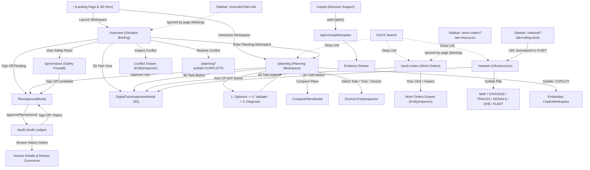

# Report C — User Workflows, Navigation Paths & Data Flows

**Document ID:** `TM-FRONTEND-AUDIT-03`  
**Target:** TrackMeld Railway Maintenance Planning & Digital Twin Platform  
**Inspection Date:** October 14, 2026  
**Auditor:** Principal Frontend Systems Architect & Railway Simulation Engineer  
**Scope:** Verification of actual user workflows, cross-page navigation links, modal triggers, data flows, and disconnected features.

---

## 1. Master Application Flowchart

The following diagram maps all confirmed, inferred, and missing workflow relationships across TrackMeld:

---

## 2. Detailed Workflow Tracing & Verification

### Workflow 1: Executive Corridor Situational Awareness & Triage
* **Source:** [`src/app/(workspace)/overview/page.tsx`](file:///d:/Trackmeld/frontend/src/app/(workspace)/overview/page.tsx)
* **Status:** **VERIFIED**
* **Trace:**
  1. The operator lands on `/overview` and is presented with the 4 situational questions.
  2. The operator reviews Card 1 (8 active possessions across 440 km) and Card 2 (1 critical conflict: `CONF-HDW-01` at SEC-12).
  3. Clicking Card 2 slides out the contextual `ResponsiveDrawer` housing `EntityInspector` populated with the conflict facts (+14 min projected delay on Express 12424, minimum 7 min statutory headway violated).
  4. The operator clicks "3D Twin View" in the GIS map toolbar, which immediately mounts `DigitalTwinInspectionModal` targeting `SEC-12`, allowing 3D corridor visual verification of track clearance.
  5. The operator clicks "Resolve Conflict", which performs client-side Next.js navigation to `/planning?subtab=CONFLICTS`.

---

### Workflow 2: End-to-End Optimization, Validation & Diagnostics Pipeline
* **Source:** [`src/app/(workspace)/planning/page.tsx`](file:///d:/Trackmeld/frontend/src/app/(workspace)/planning/page.tsx)
* **Status:** **VERIFIED**
* **Trace:**
  1. The planner enters `/planning` in `INTEGRATED` mode (3-panel layout).
  2. The planner reviews the 30 maintenance requisitions in `TaskQueueTable` alongside the 440 km GIS corridor map.
  3. The planner clicks "Run CP-SAT Solver".
  4. The UI sets `isSolving(true)` and displays animated solver compilation feedback.
  5. **Step 1 (Optimization):** Calls `optimizeSchedule(scenarioId, 5.0)` via `POST /api/v1/planning/optimize`.
  6. **Step 2 (Validation):** Passes the resulting `ScheduleResult` directly into `validateSchedule(scenarioId, sched)` via `POST /api/v1/planning/validate`.
  7. **Step 3 (Diagnostics):** Calls `diagnoseSchedule(scenarioId, sched)` via `POST /api/v1/planning/diagnostics` to generate causal failure explanations.
  8. **Step 4 (State Refresh):** Updates `scheduleResult`, `validationResult`, `diagnosticsReport`, and fetches the latest `PlanVersion` via `getPlanVersions()`.
  9. The bottom-right panel displays the scheduled intervals on `TimelineScheduleView`, while `TimeSpaceChart` updates train trajectory curves.

---

### Workflow 3: Visual Schedule Conflict Resolution (Stringline & Gantt)
* **Source:** [`src/components/planning/TimeSpaceChart.tsx`](file:///d:/Trackmeld/frontend/src/components/planning/TimeSpaceChart.tsx) & [`TimelineScheduleView.tsx`](file:///d:/Trackmeld/frontend/src/components/planning/TimelineScheduleView.tsx)
* **Status:** **VERIFIED**
* **Trace:**
  1. In `/planning`, the operator switches the view mode to `TIMESPACE` (or toggles the subtab in `INTEGRATED` mode).
  2. `TimeSpaceChart` renders an SVG Stringline diagram: the vertical axis plots corridor distance (KM 0 New Delhi to KM 440 Kanpur Central); the horizontal axis plots a 24-hour time continuum.
  3. Passenger express trajectories (Vande Bharat `#38BDF8`, Shatabdi `#10B981`, Rajdhani `#F59E0B`, Freight `#64748B`) are drawn as diagonal vectors across station lines.
  4. Maintenance possessions are rendered as colored rectangular occupancy zones spanning from task `earliest_start` to `latest_finish` across affected block sections.
  5. Clicking a possession rectangle highlights the task in the docked `EntityInspector`.

---

### Workflow 4: Four-Eyes DRM Governance & Plan Version Sign-Off
* **Source:** [`src/app/(workspace)/governance/page.tsx`](file:///d:/Trackmeld/frontend/src/app/(workspace)/governance/page.tsx), [`src/app/(workspace)/audit/page.tsx`](file:///d:/Trackmeld/frontend/src/app/(workspace)/audit/page.tsx), and [`PlanApprovalModal.tsx`](file:///d:/Trackmeld/frontend/src/components/governance/PlanApprovalModal.tsx)
* **Status:** **VERIFIED**
* **Trace:**
  1. The operator navigates to `/governance` or clicks "Sign Off" from `/overview` or `/planning`.
  2. The page verifies that all 13 independent safety checks have `PASS` status.
  3. The operator clicks "Sign Off Candidate Plan", mounting `PlanApprovalModal`.
  4. The modal presents the candidate plan details: Plan Version ID (`PV-20261002-5F8A180A`), 29 scheduled tasks, 1 unplaced task, and the immutable SHA-256 cryptographic identity hash.
  5. The operator enters their name, selects their statutory role (`CHIEF_OPERATIONS_MANAGER`, `SENIOR_DIVISIONAL_ENGINEER`, `SAFETY_COMMISSIONER`), enters approval notes, and clicks "Authorize & Issue Plan".
  6. The modal invokes `approvePlanVersion()` via `POST /api/v1/plan-versions/{id}/approve`.
  7. The plan status transitions from `PENDING_REVIEW` to `APPROVED`.
  8. Navigating to `/audit` reflects the newly signed plan version and records an immutable entry in the audit event trail.

---

### Workflow 5: 3D Digital Twin Worksite & Trainset Inspection
* **Source:** [`src/components/digital-twin/DigitalTwinInspectionModal.tsx`](file:///d:/Trackmeld/frontend/src/components/digital-twin/DigitalTwinInspectionModal.tsx)
* **Status:** **VERIFIED**
* **Trace:**
  1. The 3D Digital Twin can be launched from **4 distinct locations**:
     - The "3D Twin View" button in `/overview`.
     - The "3D Twin" toolbar button in `/planning`.
     - The "3D Twin" row button in `/work-orders`.
     - The "3D Twin" action in `/network`.
  2. `DigitalTwinInspectionModal` opens full-screen or modal dialog, dynamically mounting Three.js `@react-three/fiber` without SSR.
  3. `RailwayScene` instantiates:
     - Broad Gauge ($1676\text{mm}$) double track with slender UIC-60 rail heads and embedded concrete sleepers.
     - 25 kV AC overhead catenary wiring and steel masts.
     - Vande Bharat Express trainset moving continuously down the UP MAIN line.
     - Stationary maintenance worksite at KM 242+ on the DOWN MAIN line with yellow safety cage and CSM tamping machine.
     - Red protective signal aspect on DOWN MAIN indicating line closure.
  4. The operator can switch camera views (`Cinematic`, `Cab`, `Drone`, `Orbit`), toggle atmospheres (`Dawn`, `Night` with headlights, `Overcast`), adjust train velocity slider ($0\text{--}180\text{ km/h}$), or expand the Corridor Section Telemetry card to inspect permit-to-work status.
  5. Pressing `Escape` or the close icon returns cleanly to the originating workspace.

---

### Workflow 6: Grounded AI Decision Support Queries
* **Source:** [`src/app/(workspace)/copilot/page.tsx`](file:///d:/Trackmeld/frontend/src/app/(workspace)/copilot/page.tsx) and [`CopilotWorkspace.tsx`](file:///d:/Trackmeld/frontend/src/components/planning/CopilotWorkspace.tsx)
* **Status:** **VERIFIED**
* **Trace:**
  1. The operator navigates to `/copilot` (or selects `COPILOT` subtab in `/planning`).
  2. The operator types a natural language query or clicks a suggested pill (e.g., *"Why was TSK-0007 unscheduled?"*).
  3. `CopilotWorkspace` sends a payload containing the prompt, scenario ID, and currently selected task ID to `POST /api/v1/copilot/explain`.
  4. The response arrives with formatted markdown answers and an array of `CopilotEvidenceItem` objects.
  5. `MarkdownRenderer` displays the explanation.
  6. Structured evidence tags appear below the message (e.g., `TASK:TSK-0007`, `CONFLICT:CONF-HDW-01`, `RULE:RULE-HDW-01`).
  7. Clicking any evidence tag slides out `ResponsiveDrawer` to view the raw underlying database records and rule clauses.

---

### Workflow 7: Infrastructure & Rolling Stock Exploration
* **Source:** [`src/app/(workspace)/network/page.tsx`](file:///d:/Trackmeld/frontend/src/app/(workspace)/network/page.tsx)
* **Status:** **VERIFIED**
* **Trace:**
  1. The operator clicks "Rail Network" (`/network`) or "Rolling Stock" (`/network?tab=rolling-stock`) in the sidebar.
  2. When `/network?tab=rolling-stock` is clicked, `NetworkPageContent` recognizes `tab=rolling-stock` and automatically activates the `FLEET` subtab.
  3. The operator can toggle between `MAP`, `STATIONS`, `TRACKS`, `SIGNALS`, `OHE`, and `FLEET` tabs.
  4. Selecting any row in any table opens `EntityInspector` with spatial and technical parameters.

---

## 3. Disconnected, Inferred & Missing Workflows

| Navigation Item / Link | Code Implementation Status | Actual Runtime Behavior | Defect Classification |
| :--- | :--- | :--- | :--- |
| **Sidebar: "Resources"** `/work-orders?tab=resources` | Sidebar links to `/work-orders?tab=resources`. | [`src/app/(workspace)/work-orders/page.tsx`](file:///d:/Trackmeld/frontend/src/app/(workspace)/work-orders/page.tsx) does not inspect `useSearchParams()`. It renders the regular work orders list. | **Broken Query Parameter / Missing View** |
| **Sidebar: "Risk Intelligence"** `/overview?tab=risk` | Sidebar links to `/overview?tab=risk`. | [`src/app/(workspace)/overview/page.tsx`](file:///d:/Trackmeld/frontend/src/app/(workspace)/overview/page.tsx) does not inspect `useSearchParams()`. It renders the standard overview situation briefing. | **Broken Query Parameter / Missing View** |
| **`CopilotDrawer.tsx`** | Component is fully implemented in `src/components/copilot/CopilotDrawer.tsx`. | Not imported or mounted in any page or layout. `CopilotWorkspace.tsx` is used instead. | **Orphaned Component** |
| **`ModeBanner.tsx`** | Implemented in `src/components/shell/ModeBanner.tsx`. | Not imported in `AppShell` or `TopBar`. | **Orphaned Component** |
| **`src/components/railway/*`** | 3 files (`CorridorScene3D.tsx`, `RailwayCanvas.tsx`, `RailwayFallback2D.tsx`). | Not imported anywhere in the application. Superseded by `src/components/landing-3d/*`. | **Orphaned Legacy Module** |
| **`BenchmarkComparisonModal.tsx`** | Implemented in `src/components/planning/BenchmarkComparisonModal.tsx`. | Not imported in `planning/page.tsx`. Superseded by `ComparePlansModal.tsx`. | **Orphaned Legacy Component** |
| **`TaskInspector.tsx`** | Implemented in `src/components/planning/TaskInspector.tsx`. | Not imported in `planning/page.tsx`. Superseded by `EntityInspector.tsx`. | **Orphaned Legacy Component** |
| **`PlanLifecycleBar.tsx`** | Implemented in `src/components/planning/PlanLifecycleBar.tsx`. | Not imported in `planning/page.tsx`. Replaced by inline action headers. | **Orphaned Legacy Component** |
