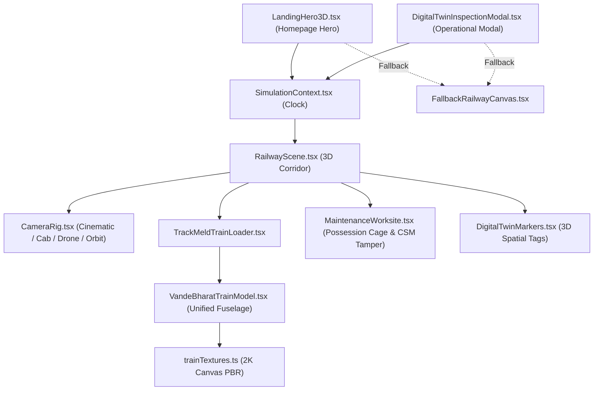

# Report D — Frontend Findings, Architectural Constraints & Prioritized Remediation

**Document ID:** `TM-FRONTEND-AUDIT-04`  
**Target:** TrackMeld Railway Maintenance Planning & Digital Twin Platform  
**Inspection Date:** October 14, 2026  
**Auditor:** Principal Frontend Systems Architect & Railway Simulation Engineer  
**Scope:** Synthesis of critical defects, orphaned code, design system inconsistencies, 3D simulation coupling, domain safety boundaries, and prioritized future improvements.

---

## 1. Global Architectural & Usability Findings

### 1.1 Redundant Route Wrapper Pattern
* **Observation:** Next.js App Router features a dedicated nested layout convention (`layout.tsx`). However, the `(workspace)` route group currently lacks a `layout.tsx`. As a result, every one of the 7 workspace pages ([`overview/page.tsx`](file:///d:/Trackmeld/frontend/src/app/(workspace)/overview/page.tsx), [`planning/page.tsx`](file:///d:/Trackmeld/frontend/src/app/(workspace)/planning/page.tsx), [`work-orders/page.tsx`](file:///d:/Trackmeld/frontend/src/app/(workspace)/work-orders/page.tsx), [`network/page.tsx`](file:///d:/Trackmeld/frontend/src/app/(workspace)/network/page.tsx), [`governance/page.tsx`](file:///d:/Trackmeld/frontend/src/app/(workspace)/governance/page.tsx), [`copilot/page.tsx`](file:///d:/Trackmeld/frontend/src/app/(workspace)/copilot/page.tsx), [`audit/page.tsx`](file:///d:/Trackmeld/frontend/src/app/(workspace)/audit/page.tsx)) redundantly imports and instantiates `<AppShell>` directly.
* **Impact:** When a user navigates between workspace routes (e.g. from `/overview` to `/planning`), the entire `<AppShell>` (including `TopBar`, `Sidebar`, and `StatusBar`) completely unmounts and remounts. This destroys transient UI state, causes minor layout flashes, and triggers redundant `localStorage` reads for sidebar collapse state.

### 1.2 Lack of Centralized Data Caching
* **Observation:** The application does not use a client-side server-state caching library such as TanStack Query or SWR.
* **Impact:** Every page independently fetches the scenario bundle (`getScenarioBundle('SCN-DEMO-001')`) and plan versions upon mounting. If the network is slow, navigation between pages triggers duplicate HTTP calls for identical scenario and GIS data.

### 1.3 Inconsistent URL State Synchronization
* **Observation:** Subtab state synchronization with URL query parameters is implemented inconsistently across pages:
  - [`/network`](file:///d:/Trackmeld/frontend/src/app/(workspace)/network/page.tsx) robustly handles bidirectional sync (`?subtab=STATIONS` and `?tab=rolling-stock` $\to$ `FLEET`).
  - [`/planning`](file:///d:/Trackmeld/frontend/src/app/(workspace)/planning/page.tsx) reads `?subtab=` on initial load but does not consistently push query updates when switching view modes via buttons.
  - [`/work-orders`](file:///d:/Trackmeld/frontend/src/app/(workspace)/work-orders/page.tsx) and [`/overview`](file:///d:/Trackmeld/frontend/src/app/(workspace)/overview/page.tsx) completely ignore query parameters despite the sidebar providing links to `/work-orders?tab=resources` and `/overview?tab=risk`.

---

## 2. Page-Specific Findings & Disconnected Features

### 2.1 Broken Sidebar Navigation Links
1. **Sidebar: "Resources" (`/work-orders?tab=resources`):**
   - *Observation:* The sidebar links to `/work-orders?tab=resources`.
   - *Finding:* `WorkOrdersPage` does not read `useSearchParams()`. It only renders the work orders requisition table. There is no dedicated resources or crew assignment subtab view.
2. **Sidebar: "Risk Intelligence" (`/overview?tab=risk`):**
   - *Observation:* The sidebar links to `/overview?tab=risk`.
   - *Finding:* `OverviewPage` does not read `useSearchParams()`. It always renders the standard 4-question briefing.

### 2.2 Unreferenced / Orphaned Components Inventory
An exhaustive scan of the repository discovered **11 unreferenced components** that exist in the codebase but are never mounted or imported by any active route:

| Unreferenced File Path | Intended Purpose | Reason for Disconnection / Superseded By |
| :--- | :--- | :--- |
| `src/components/copilot/CopilotDrawer.tsx` | Slide-over drawer for Copilot inquiries | Superseded by `CopilotWorkspace.tsx` and full `/copilot` page. |
| `src/components/shell/ModeBanner.tsx` | Top banner for synthetic demo notice | Replaced by synthetic demo pills in `TopBar` and `StatusBar`. |
| `src/components/railway/CorridorScene3D.tsx` | Early 3D corridor prototype | Superseded by `src/components/landing-3d/RailwayScene.tsx`. |
| `src/components/railway/RailwayCanvas.tsx` | Early Three.js canvas wrapper | Superseded by dynamic imports in `DigitalTwinInspectionModal.tsx`. |
| `src/components/railway/RailwayFallback2D.tsx` | Early 2D track schematic | Superseded by `FallbackRailwayCanvas.tsx`. |
| `src/components/planning/BenchmarkComparisonModal.tsx` | Plan comparison dialog | Superseded by `ComparePlansModal.tsx`. |
| `src/components/planning/TaskInspector.tsx` | Standalone task inspector | Superseded by multi-entity `EntityInspector.tsx`. |
| `src/components/planning/PlanLifecycleBar.tsx` | Planning status bar | Superseded by inline headers in `planning/page.tsx`. |
| `src/components/landing-3d/ProceduralTrainModel.tsx` | Early box-modeled train | Superseded by `VandeBharatTrainModel.tsx`. |
| `src/components/landing-3d/RealisticTrainModel.tsx` | Secondary train prototype | Superseded by `VandeBharatTrainModel.tsx`. |
| `src/components/common/MetricCard.tsx` | Generic KPI metric card | Pages construct their own bespoke Tailwind metric cards. |
| `src/components/common/StatusBadge.tsx` | Generic status badge | Pages construct inline colored status spans. |

### 2.3 UI Primitives Underutilization
* **Observation:** The project contains a comprehensive set of Radix UI primitives in `src/components/ui/` (`badge.tsx`, `card.tsx`, `dropdown-menu.tsx`, `EmptyState.tsx`, `scroll-area.tsx`, `SectionHeader.tsx`, `separator.tsx`, `tabs.tsx`).
* **Finding:** With the exception of `Button`, `Dialog`, and `Tooltip`, almost none of these primitives are imported. Pages consistently rebuild containers using raw Tailwind utility strings (e.g. `
`). While visually cohesive, this creates copy-pasted styling blocks across pages.

---

## 3. Digital Twin & 3D Simulation Architecture

### 3.1 Shared Component Graph
The public homepage 3D hero (`LandingHero3D.tsx`) and the operational digital twin modal (`DigitalTwinInspectionModal.tsx`) share the exact same underlying simulation pipeline:

### 3.2 Simulation Engine Characteristics
1. **Procedural Parametric Fuselage:** The train is rendered via an analytical $48 \times 64$ quad loft in `VandeBharatTrainModel.tsx` using a unified super-elliptical cross-section ($W = 3.16\text{m}, H = 2.45\text{m}$) shared identically between the body and nose root, ensuring $C^1$ tangent continuity.
2. **Procedural Canvas PBR Textures:** Flank and nose livery are rendered on $2048 \times 1024$ and $1024 \times 1024$ HTML5 canvases via `trainTextures.ts`, completely eliminating stepped/corrugated 3D box layers.
3. **Slender UIC-60 Infrastructure:** Rail heads are dimensioned to standard UIC-60 specifications ($72\text{mm}$ running width, specular steel reflection), with monoblock PSC sleepers embedded $10\text{cm}$ into crushed ballast stone.
4. **Frame-Rate Clamped Delta Clock:** In `RailwayScene.tsx`, the per-frame delta is clamped to $\min(\max(\Delta t, 0), 0.05\text{s})$, preventing trains from teleporting when browser tabs lose focus.
5. **Progressive Fallback:** Both viewports detect WebGL context availability and render `FallbackRailwayCanvas.tsx` if hardware acceleration is unavailable.

---

## 4. Critical Domain & Operational Constraints

Any future frontend redesign or refactoring must strictly respect the following domain rules established by `AGENTS.md` and railway safety governance:

### 4.1 "Rules Classify. Optimization Schedules. Humans Approve. AI Explains."
1. **Optimization Boundary:** The frontend never implements greedy scheduling arithmetic or heuristic placement in UI components. All scheduling decisions must route through `/api/v1/planning/optimize` (OR-Tools CP-SAT).
2. **Validation Boundary:** Solver output cannot be trusted as self-validating. Every generated schedule must pass through `/api/v1/planning/validate` (independent 13-category safety firewall) before presentation for approval.
3. **Four-Eyes Governance Boundary:** A completed solver run is **never** an approved plan (`COMPLETED ≠ APPROVED`). The frontend must preserve the statutory Four-Eyes DRM approval gate (`PlanApprovalModal`) requiring dual-operator sign-off and role attribution.
4. **Cryptographic Identity Invariant:** Every `PlanVersion` is stamped with a SHA-256 schedule identity hash. If any interval, task, or train is modified, the hash changes, invalidating any prior signature. The frontend must display and preserve this hash.
5. **Read-Only AI Copilot Boundary:** The AI Copilot is strictly read-only and advisory. It possesses zero write tools, cannot alter schedules, and cannot grant approvals. Responses must cite verifiable evidence records (`TASK:`, `CONFLICT:`, `RULE:`).
6. **Synthetic vs. Operational Data Transparency:** Because TrackMeld uses seeded synthetic demonstration fixtures (Train 22436, SCN-DEMO-001, Northern Corridor), the frontend must maintain unambiguous synthetic data badges (`SyntheticDataBadge`, `AlertTriangle` indicators in `StatusBar` and `TopBar`) to prevent operational confusion.

---

## 5. Prioritized Future Improvements

### Priority 1: High Impact (Architecture & Routing)
1. **Create `(workspace)/layout.tsx`:**
   - *Affected File:* Create `frontend/src/app/(workspace)/layout.tsx`.
   - *Remediation:* Move `<AppShell>` into a dedicated route group layout so `TopBar`, `Sidebar`, and `StatusBar` stay mounted across workspace transitions, eliminating remount flicker and preserving sidebar state.
2. **Implement Resources Subtab on `/work-orders`:**
   - *Affected File:* [`frontend/src/app/(workspace)/work-orders/page.tsx`](file:///d:/Trackmeld/frontend/src/app/(workspace)/work-orders/page.tsx).
   - *Remediation:* Read `searchParams.get('tab')`. When `tab === 'resources'`, render a dedicated plant machinery (CSM-01, BCM-09, Tower Wagon) and crew gang allocation table to honor the sidebar link.
3. **Implement Risk Intelligence Subtab on `/overview`:**
   - *Affected File:* [`frontend/src/app/(workspace)/overview/page.tsx`](file:///d:/Trackmeld/frontend/src/app/(workspace)/overview/page.tsx).
   - *Remediation:* Read `searchParams.get('tab')`. When `tab === 'risk'`, highlight corridor vulnerability hotspots, headway compression bottlenecks, and weather/curfew risks to honor the sidebar link.

### Priority 2: Medium Impact (Code Hygiene & Dead Code Removal)
4. **Purge Orphaned Components:**
   - *Affected Files:* Delete `src/components/railway/*` (3 files), `BenchmarkComparisonModal.tsx`, `TaskInspector.tsx`, `PlanLifecycleBar.tsx`, `CopilotDrawer.tsx`, `ModeBanner.tsx`, `ProceduralTrainModel.tsx`, and `RealisticTrainModel.tsx`.
   - *Reason:* Reduces bundle size and eliminates developer confusion regarding active vs legacy implementations.
5. **Standardize Shared UI Primitives:**
   - *Affected Files:* `src/components/common/*` and `src/components/ui/*`.
   - *Remediation:* Adopt `StatusBadge` and `MetricCard` across all pages rather than repeating inline Tailwind string blocks.

### Priority 3: Low Impact (Optimization & Enhancement)
6. **Adopt Client-Side Caching (TanStack Query / SWR):**
   - *Affected File:* `frontend/src/lib/api/client.ts`.
   - *Remediation:* Wrap fetchers in a lightweight query cache so that navigating between Overview, Planning, and Network does not re-fetch identical corridor bundles.
7. **Interactive Conflict Shift Action:**
   - *Affected File:* [`frontend/src/components/planning/ConflictsWorkspace.tsx`](file:///d:/Trackmeld/frontend/src/components/planning/ConflictsWorkspace.tsx).
   - *Remediation:* Wire the "Shift Window +45m" button in the conflict card directly to the CP-SAT solver with modified task bounds rather than displaying a static recommendation note.
